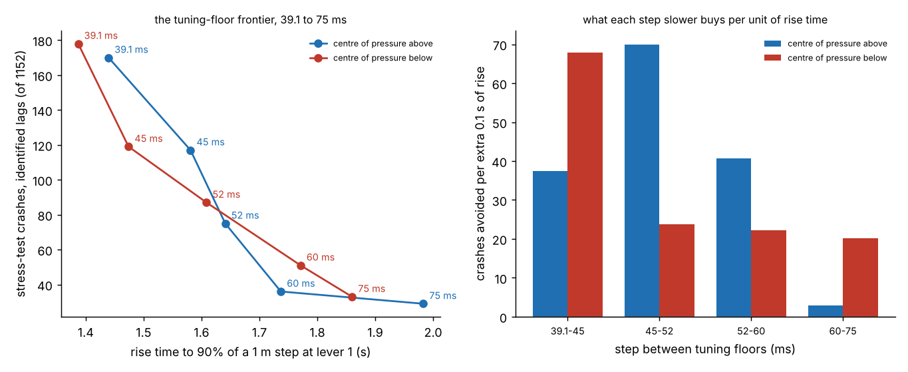

For several milestones of our [rotor-cant co-design programme](../../research/codesign-cant/README.md) we have tuned simulated 5-inch quadrotors for motors slower than the ones they fly. Every slower tuning floor (39.1, 45, 52, 60 ms) crashed less in our stress test, which flies twice the trained centre-of-pressure lever at a 45° tilt limit. [This morning's run](2026-11-18-what-a-slower-drone-tune-costs-step-response.md) priced each step at about 0.1 s of extra rise time on a 1 m position step. So the obvious next question was whether a 75 ms floor keeps paying.

## What we ran

We retrained the same lever-aware design search at a 75 ms floor: 24 CMA-ES runs of 3,200 evaluations each, about an hour on four cores. As before, every accepted design had to pass a linear stability certificate at 33 ms, 75 ms and 150 ms. We then flew the designs through the same stress test and the same calm-air step and wind-step tests as the 60 ms designs. The seven predictions were [committed to the log](../../research/codesign-cant/LOG.md) before the full run, and four held.

## What came out

| | 60 ms tune | 75 ms tune |
|---|---|---|
| Stress crashes at the identified lags 33-39.1 ms (of 1152), CoP above / below | 36 / 51 | 29 / 33 |
| Stress crashes flown at 60 ms (of 384) | 105 / 83 | 49 / 45 |
| Stress crashes flown at 75 ms (of 384) | 193 / 188 | 117 / 103 |
| Rise to 90% of a 1 m step (s) | 1.74 / 1.77 | 1.98 / 1.86 |
| Overshoot (cm) | 3.2 / 2.7 | 4.8 / 3.2 |
| Mass (kg) | 1.51 / 1.47 | 1.43 / 1.44 |

Read the first row with care. Six seeds do not separate the two tunes in five of the six cells for the motors that were actually measured, and at the fast 33 ms motor they tie. The clear gain is at slower motors than either published identification: there the 75 ms tune crashes about half as often, with p between 0.010 and 0.026 in three of four cells.

Two of our predictions failed in instructive ways:

- **The vehicle got lighter, not heavier.** From 45 to 60 ms the search had bought robustness with mass. At 75 ms it found a lighter design on a smaller propeller and got its robustness from the loop instead.
- **The overshoot stopped falling.** Up to 60 ms each slower tune overshot less, which paid for its slower rise. At 75 ms the overshoot went back up, so the time to settle inside 5 cm got worse in both frame geometries.

The right panel shows the trade per unit of cost. With the centre of pressure above the centre of mass, the step from 52 to 60 ms bought 41 crashes per extra 0.1 s of rise, and the step from 60 to 75 ms bought 3. With it below, the rate held at about 20.

## A mistake we caught

Our first verdict said only 9 of 12 designs kept the stability certificate. The cause was our script, which rounded the results file to five significant digits. Certified designs sit at a stability radius of 0.99999 against a strict "below 1" test, and rounding turned them into 1.0. The plain-text summary, written before the rounding, said 12 of 12. We fixed the script and reran the scoring from the cached training, and every count came out the same. The [log entry](../../research/codesign-cant/LOG.md) records the details.

## What a builder can take from it

If your motors behave like the published identifications, tune at 60 ms. Tune at 75 ms only if they may be slower than that, and accept a slower, less crisp position step. This is all simulated. Six seeds and one evaluation set limit what the numbers can show, and 75 ms is a bracket we chose, not a measured motor. Next we will separate the floor of the training plants from their ceiling, and try a position-gain floor that removes the slow final approach that turns up at every tuning floor. Everything needed to reproduce the run is in the [programme README](../../research/codesign-cant/README.md).

*Written with AI assistance (Claude).*
