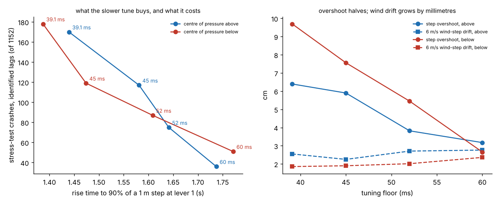

Over the last few milestones of our [rotor-cant co-design programme](../../research/codesign-cant/README.md) we kept tuning simulated 5-inch quadrotors for slower and slower motors: 39.1 ms (the slower published identification), then 45, 52 and 60 ms. Each slower tune crashed less in our stress test, twice the trained centre-of-pressure lever at a 45° tilt limit, even when flown with the fast 33 ms motor. By 60 ms there was [still no knee](2026-11-17-drone-motor-lag-tuning-no-knee-by-60-ms.md): 87 crashes over the identified lags against 348 for the 39.1 ms tune, out of 2,304 flights.

A stress test like that rewards a slow, heavy vehicle by construction, so we had not yet seen the bill. Yesterday's run showed the 60 ms designs are 4-8% heavier and have a 20% softer position loop. Neither number is one a builder writes into a requirement. So today we asked the requirement-shaped question.

## The test

No retraining. We took the 48 designs (four tuning floors × 6 seeds × 2 frame geometries) and flew each through two calm-air tests at the design lever, with turbulence and yaw steps off so the response belongs to the loop:

- a **1 m position step**: rise time to 90%, overshoot past the hold point, and time to stay within 5 cm;
- a **calm-to-wind step** to 3 m/s (the held-out set's wind step) and to 6 m/s: peak drift from the hold point.

That makes 64 flights per design and law, under all three identified motor lags (33, 36, 39.1 ms). The six predictions were [committed to the log](../../research/codesign-cant/LOG.md) before the full run. The whole run took 137 seconds on four cores.

## What it costs

| Tuning floor | Rise to 90% (s), CoP above / below | Overshoot (cm) | Peak drift after 6 m/s step (cm) | Stress crashes, identified lags (of 1152) |
|---|---|---|---|---|
| 39.1 ms | 1.44 / 1.39 | 6.4 / 9.7 | 2.5 / 1.9 | 170 / 178 |
| 45 ms | 1.58 / 1.47 | 5.9 / 7.6 | 2.3 / 1.9 | 117 / 119 |
| 52 ms | 1.64 / 1.61 | 3.8 / 5.5 | 2.7 / 2.0 | 75 / 87 |
| 60 ms | 1.74 / 1.77 | 3.2 / 2.7 | 2.8 / 2.4 | 36 / 51 |

The trade is **rise time for overshoot**. Both columns are monotone in the floor in every cell, which we had not predicted. The 60 ms tune reaches 90% of the step 10-20% later than the 45 ms tune but overshoots a half to a third as much. Because of that, the time to settle inside 5 cm barely moves: +16% with the centre of pressure above the centre of mass, −24% below. Wind drift grows, as predicted, but by 4-5 millimetres, and six seeds do not separate it.

Two more things showed up:

- **In calm air the motor lag itself does not matter.** Every number is the same to three decimals at 33, 36 and 39.1 ms. The lag bites only near the torque limit, which is exactly where the stress test lives. A calm-air step test cannot tell you whether your tune survives the motor you actually have.
- **A slow tail, whatever the floor.** 8 of the 48 designs never settle inside 5 cm within 6 s. They park 5-8 cm short with position gains of 4.5-9.7 s⁻², against a set mean near 20. The stress objective never asks for a fast final approach, so the tuner sometimes skips it. That is worth a constraint in the next search.

## What a builder can take from it

Read along the four floors, each slower step trades about 0.1 s of rise time on a 1 m step for 30-50 fewer stress-test crashes out of 1,152. If your mission tolerates a 1.7-1.8 s rise, the 60 ms tune is the one to pick. Check the final approach separately, because neither test in the training loop does.

The usual caveats hold. This is simulated, the drag model and the 5 cm band are assumptions rather than measurements, and the two motor identifications come from one lab. The next step adds a 75 ms floor scored on both tests, so the frontier in the left panel gets its next point. Code, logs and the one-command reproduction are in the [programme README](../../research/codesign-cant/README.md).

*Written with AI assistance (Claude).*
