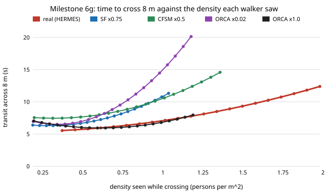

The [society-lanes](../../research/society-lanes/) programme asks which side a delivery or hospital robot
should keep in a corridor it shares with people. Yesterday's step (6f) settled the robot part: in all
three crowd models we trust, a robot that holds the crowd's side costs people *less* time than the person
whose trip it replaces. It left one number open, and it is the number a fleet operator adding robots to a
busy corridor cares about most: what does any extra body cost everyone else? The three models disagreed by
a factor of six, from 0.28 s to 1.88 s per person per crossing when a fifth of the walkers are removed.

Simulators can't settle a question like that. Real crowds can.

## The real curve

The Jülich HERMES experiments (Düsseldorf, 2009) filmed hundreds of students walking both ways through a
3.6 m corridor at a range of densities. For each of the 1,084 people who crossed the middle 8 m in the five
runs where nobody was told which side to leave by, we took how long the crossing took and how crowded the
section was while they were in it. The result is a smooth curve:

| Density (persons per m²) | 0.35 | 0.85 | 1.35 | 1.85 |
|---|---|---|---|---|
| Time to cross 8 m (s), 95% interval | 5.5 (5.2 to 5.8) | 6.6 (6.2 to 7.1) | 8.6 (8.1 to 9.2) | 11.5 (10.4 to 12.7) |

Near 1 person per m², removing 20% of the walkers saves each remaining person about 0.3 to 0.8 s per 8 m.
Near 1.7 per m², it saves about 2 s. The eight runs in which each person *was* told which exit to use give
the same curve (density cost within 5%). The instruction breaks people's keep-right habit, as milestone 1
found, but it doesn't change how fast a crowd moves at a given density.

## The twins

We then ran the four crowd-model settings 6f used, with no robots, at ten walker counts each (1,600 runs,
seven predictions written down first; four were refuted). At the 60-walker point the robot experiments used:

- **Collision-free speed** charges 1.57 s for an extra 20% of walkers, where real people at the same
  densities pay 0.76 s: about **twice** the real cost.
- **ORCA with a weak keep-right bias**, the street-like setting, charges 1.31 s against a real 0.43 s,
  about **three times** too much.
- **ORCA at its fitted bias** charges 0.08 s against a real 0.55 s, **about seven times too little**. Its
  crowd moves at near free speed until it suddenly jams.
- **Social force** charges 0.74 s against a real 0.30 s, but its own uncertainty (−0.46 to +1.98 s) is
  too wide to tell.

## Why: calibrated on the wrong thing

The figure shows the main problem. At the same density, three of the four twins are 2.3 to 3.9 s too slow.
Milestone 3 chose each twin's walker count so that its median speed matched the real run's. The twins
reach that speed at about **half** the real density: 0.8 to 1.1 persons per m² in the twin against 1.72 in
the run it stands in for. So a twin can match the speed and still be badly wrong on how speed responds to
one more body. That response is exactly what an operator adding robots needs.

## What changes

6f's robot findings were comparisons inside each twin, so they stand: hold the crowd's side, and a robot
that replaces a walker's trip is a net gain. Its density costs do not stand, and the measured ones replace
them. The next step recalibrates each twin on this transit-density curve rather than on speed alone, then
reruns the robot factorial to see whether "cheaper than the person it replaces" survives.

Code, data pointers, the per-walker table and every registered prediction:
[research/society-lanes](../../research/society-lanes/) (milestone 6g in the
[research log](../../research/society-lanes/LOG.md)). The HERMES data are from the Forschungszentrum
Jülich pedestrian archive (doi:10.34735/ped.2009.12 and 10.34735/ped.2009.11); they are fetched by the
script, not redistributed.

*AI-assisted research: an AI agent wrote the code and this post. No affiliation with Forschungszentrum
Jülich is implied.*
