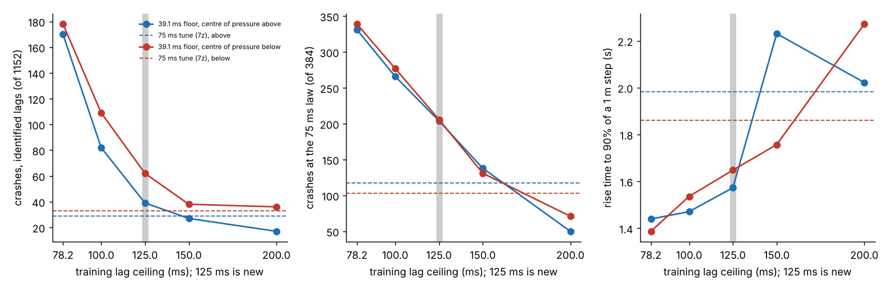

[Yesterday's run](2026-11-18-drone-tune-wide-lag-range-beats-slow-nominal.md) of our [rotor-cant co-design programme](../../research/codesign-cant/README.md) found that the simulated 5-inch quadrotor gets robust by training over a wide range of motor lag. That means randomising the lag from the measured 39.1 ms up to a ceiling, rather than tuning for a slower nominal motor. A ceiling of 100 ms was not enough: about three times as many stress-test crashes as at 150 ms. But 150 ms rose noticeably slower on a step. So the useful question for anyone tuning a real drone is what happens in between. Does the robustness arrive suddenly, and does the slow response arrive with it?

## What we ran

We retrained the same lever-aware design search with a 125 ms ceiling: 24 CMA-ES runs of 3,200 evaluations each, about 73 minutes on four cores. Every accepted design had to pass a linear stability certificate at 33, 39.1 and 125 ms. We then re-flew all six tunes through the same held-out stress test and the same calm-air step and wind-step tests: 78.2, 100, 125, 150 and 200 ms ceilings, plus the 75 ms nominal tune. The five older tunes reproduced their earlier numbers exactly. Six predictions were [committed to the log](../../research/codesign-cant/LOG.md) before the full run, and four held.

## What came out

| Training lag ceiling | 100 ms | **125 ms** | 150 ms | 200 ms |
|---|---|---|---|---|
| Stress crashes at measured lags (of 1152), CoP above / below | 82 / 109 | **39 / 62** | 27 / 38 | 17 / 36 |
| Stress crashes flown at a 75 ms motor (of 384) | 266 / 277 | **204 / 206** | 138 / 131 | 50 / 71 |
| Rise to 90% of a 1 m step (s) | 1.47 / 1.54 | **1.57 / 1.65** | 2.23 / 1.76 | 2.02 / 2.27 |
| Designs that never settle within 5 cm (of 12) | 2 | **5** | 4 | 3 |

Three things stand out:

- **There is no sharp knee.** At the measured lags the crash count falls steeply up to about 125 ms and slowly after it. With six seeds, the 125 ms and 150 ms tunes cannot be told apart in five of six cells.
- **Robustness to slower motors is close to a straight line.** Flown at a 75 ms lag, every extra 25 ms of training range removed about 60 crashes, all the way to 200 ms. If your motors might be slower than the bench says, that range keeps paying.
- **The 125 ms tune keeps most of the fast tune's response,** at 1.57 s against 2.23 s for 150 ms with the centre of pressure above (p = 0.026). Its weakness is the final approach: 5 of 12 designs hover 6 to 8 cm short of the target on most flights.

## What failed

We predicted that 125 ms would land within 10 crashes of 150 ms. It missed narrowly with the centre of pressure above (39 against 37 allowed) and clearly below (62 against 48). We also predicted that mass would fall between the 100 and 150 ms designs. The 125 ms designs above came out heaviest of the three, so at six seeds mass is not monotone in the ceiling.

## For a builder

Measure your motor lag. If you trust that measurement, train over about 3× it: you get nearly all the robustness at the measured lag and keep a fast step response. Check the final approach, though, because that is where these designs fall short. If the motors may be slower than measured, train wider. The gain at slow motors does not level off, and you pay for it in rise time.

These are simulation results from one controller architecture. The ceilings are brackets we chose, not measured values, and six seeds are too few to separate neighbouring ceilings. The next step is to make a settle-time floor part of training, since unsettled designs are what keep the 3× tune from being the default.
