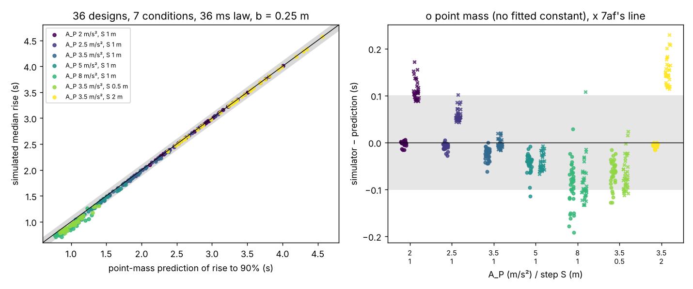

The [last result](2026-11-19-drone-tuner-rise-time-is-set-by-kd.md) ended with a line fitted through 36 tuned quadrotors: when the position loop caps its proportional push at A_P, a 1 m step's rise time is about 0.90 × 0.9 m ÷ (A_P/kd) + 0.33 s. That fit was post hoc, on one cap and one step size. A builder can only trust it where it wasn't fitted, so this run tested that.

## Two predictors, written down first

The first is the fitted line. The second has no fitted constant. It treats the position loop as a 1-D point mass:

x'' = −min(kp·|x|, A_P)·sign(x) − kd·x' + ki·I

The integrator runs only within 0.25 m of the set point. Start at rest at the step size and integrate at 2 ms. The model leaves out the attitude loop, motor lag, sensor noise and the randomised plant. The code is [20 lines](../../research/codesign-cant/experiments/m7ag_cruise/cruise_model.py).

The same 36 designs were then flown again in the full simulator with no retraining: caps of 2, 2.5, 3.5, 5 and 8 m/s² on a 1 m step, and 0.5 m and 2 m steps at 3.5 m/s², under three identified motor-lag laws. That is 756 flights of 64 episodes each. Ten predictions were committed before the run ([log](../../research/codesign-cant/LOG.md)). Seven held.

## What happened

| condition | designs within 0.10 s, point mass | median error, point mass | median error, fitted line |
|---|---|---|---|
| A_P 2, step 1 m | 36 of 36 | 0.002 s | 0.106 s |
| A_P 2.5, step 1 m | 36 of 36 | 0.006 s | 0.054 s |
| A_P 3.5, step 1 m (fitting point) | 36 of 36 | 0.020 s | 0.008 s |
| A_P 5, step 1 m | 35 of 36 | 0.040 s | 0.050 s |
| A_P 8, step 1 m | 23 of 36 | 0.085 s | 0.100 s |
| A_P 3.5, step 0.5 m | 31 of 36 | 0.062 s | 0.077 s |
| A_P 3.5, step 2 m | 36 of 36 | 0.005 s | 0.144 s |

When the cap is in charge, which here means steps of 1 m or more and caps up to 5 m/s², the point mass with nothing fitted gets every design's rise time to within a few hundredths of a second, on rises from 0.8 to 4.6 s. The fitted line drifts by 0.1 to 0.15 s once it leaves its fitting point. Swapping the motor-lag law (33 or 39.1 ms instead of 36) moves no design's rise by more than 0.05 s. No flight diverged in any condition, including the 8 m/s² cap the designs were never tuned for.

## Where it misses, and why

The misses all point the same way. With a 0.5 m step or an 8 m/s² cap, the real loop arrives sooner than the point mass and overshoots more (4.9 cm against 2.2 cm at A_P = 8). The derivative term brakes by leaning the vehicle back, and the lean takes time to happen. On a short step or under a hard cap, braking is a larger share of the trip, so that lag shows.

After the run, as a check that wasn't in the predictions, I gave the point mass one first-order lag on its acceleration and fitted it on the 3.5 m/s², 1 m condition alone. It came out at 135 ms. With that lag, the 8 m/s² cap goes from 23 to 33 of 36 within 0.10 s and the 0.5 m step from 31 to 36 of 36, and the other conditions are no worse. Swapping motor laws changed nothing, so the 135 ms belongs to the attitude loop, not the motors. It is a fitted constant, not a measured one.

## For anyone tuning a multirotor position loop

- If your position controller caps its proportional term, you can compute the step rise time from kp, kd, ki, the cap and the step size before you fly. Use the point mass, not a straight line in kd.
- Expect it to be accurate while the cap is no more than about half of g·tan(tilt limit) and steps are around 1 m or longer. For shorter steps or harder caps, fly one step, fit a single acceleration lag to it, and use that.

Everything here is simulated, with one evaluation seed. The designs were tuned at a 3.5 m/s² cap and flown at the others, so this tests the response model, not what a tuner would choose at another cap. Code and verdicts are in [`experiments/m7ag_cruise`](../../research/codesign-cant/experiments/m7ag_cruise/), and section VII of the [paper draft](../../research/codesign-cant/paper/DRAFT.md) now carries this rule.
