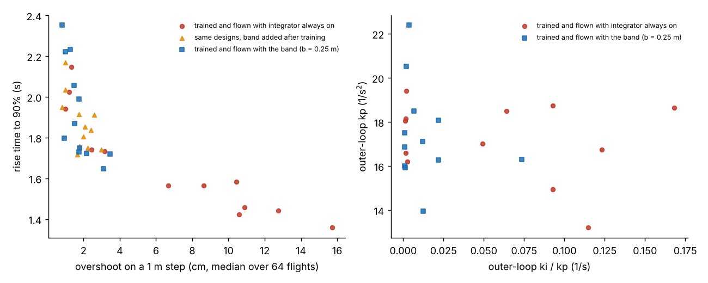

Earlier today, [our co-design programme](../../research/codesign-cant/README.md) found [why a quarter of its tuned quadrotors stop 5 to 8 cm short of a 1 m step](2026-11-19-why-a-tuned-drone-stops-short-of-its-set-point.md). The position integrator's slow pole leaves a tail. Running the integrator only within 0.25 m of the set point fixed every one of them, with no extra crashes. The fix had a price: the median rise to 90% of the step went from 1.74 to 1.91 s.

That fix was added after the controller had been tuned. The tuner (CMA-ES over the airframe and every gain) never knew the integrator would be gated. So the obvious next question: if it tunes with the band on, will it raise the proportional or derivative gain and win the speed back?

## The test

We reran the 125 ms motor-lag-ceiling training from the [motor-lag coverage study](2026-11-19-randomise-drone-motor-lag-from-the-slow-end.md) exactly, with one change: the band was on in every training flight. That is 24 CMA-ES runs of 3,200 evaluations, about an hour and a half on four cores. We committed seven predictions before the full run. The headline one (60% prior) was that the tuner would buy some rise time back. A second, at 60%, said it would do it by raising the position gain kp.

## What happened

| 12 designs, 36 ms motor law, 1 m step | old tunes, band added after | retrained with the band |
|---|---|---|
| median rise to 90% | 1.84 s | 1.83 s (p = 0.95) |
| median position kp | 17.5 s⁻² | 17.0 s⁻² (p = 0.84) |
| median ki/kp | 0.057 s⁻¹ | 0.005 s⁻¹ (p = 0.069) |
| unsettled designs | 0 | 0 |
| crashes over the identified lags (of 2,304) | 101 | 107 |

The tuner did not go faster. It left kp and kd where they were and gave up most of the integral gain. That makes sense once you look at what training rewards: with the integrator gated, integral action barely helps in the training gusts, so the search stops paying for it.

Three predictions failed (both rise-time ones and the kp one) and four held: no design is unsettled, crashes are not separated, all 12 pass the stability certificate, and flown without the band at all the new tunes still settle (1 of 12 does not, against 5 of 12 of the old ones).

## The real reason the rise was fast

Plotting rise time against overshoot for every design explains it. The old tunes with the integrator always on that rose in 1.35 to 1.6 s overshot by 7 to 16 cm. The integrator wound up on the way in and pushed the vehicle past the target. All three groups (always on, band added after, band trained in) sit on the same rise-versus-overshoot curve. The 10% slower rise is what it costs not to overshoot. No retune within the stability certificate gets it back.

For anyone tuning a multirotor position loop: gate the integrator near the set point. Retraining with the gate on is optional. If you want rise time back, ask for it in the objective with a set-point step, which this tuner's training has never included. That is the programme's next step.

Everything here is simulated, with six seeds per geometry and one 0.25 m band. The code, results and committed predictions are in [`experiments/m7ae_cint_train`](../../research/codesign-cant/experiments/m7ae_cint_train/) and the [research log](../../research/codesign-cant/LOG.md).
