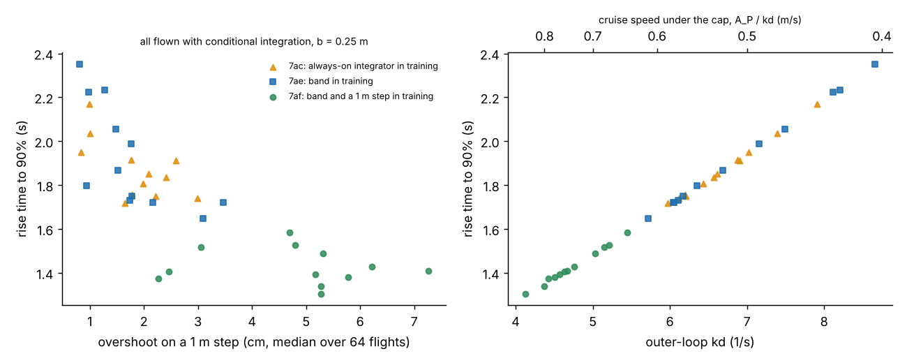

This morning's [co-design result](2026-11-19-drone-tuner-drops-the-integral-gain.md) ended on a reading I now have to take back. Gating the position integrator near the set point fixes quadrotor tunes that stop short of a 1 m step, but it slows the rise by about 10%. Retraining with the gate on did not win that time back, and every design sat on one rise-versus-overshoot curve. I read that as "the slower rise is the price of not overshooting".

There was a simpler explanation I had not tested. The tuner's training objective never contained a set-point step. It scored gusts, small start offsets and yaw steps, so nothing ever asked it to rise fast.

## The test

Same training as before (CMA-ES over airframe and every gain, 125 ms motor-lag ceiling, integrator gated at 0.25 m, six seeds per centre-of-pressure geometry), with one change: a fourth training condition, a 1 m step in calm air, weighted the same as each of the three gust conditions. About two hours on four cores. Nine predictions were committed before the full run ([commit 3dbb3a805](../../research/codesign-cant/LOG.md)).

I also wrote down a mechanism beforehand. Since milestone 7k the position loop caps its proportional request at A_P = 3.5 m/s². With kp around 17 s⁻², that cap is active for any error above about 0.2 m, which is most of a 1 m step. During that phase the vehicle accelerates until the derivative term, kd times speed, cancels the capped push, so it cruises at about A_P/kd. If that is right, the gain the tuner should move is kd, not kp.

## What happened

| 12 designs, 36 ms motor law, gated integrator | trained without a step | trained with a 1 m step |
|---|---|---|
| median rise to 90% | 1.83 s | **1.41 s** (p = 3.7×10⁻⁵) |
| median kd | 6.52 s⁻¹ | 4.65 s⁻¹ |
| median kp | 17.0 s⁻² | 13.3 s⁻² |
| crashes over the identified lags (of 2,304) | 107 | 97 (p = 0.84) |
| unsettled / certified | 0 / 12 of 12 | 0 / 12 of 12 |
| median overshoot | 1.1–1.8 cm | 4.7–5.3 cm |

The rise time came back and then some. 1.41 s is faster than the original always-on-integrator tunes (1.57 and 1.65 s), and crash counts did not move. The tuner lowered kd, as predicted. It also lowered kp, which I had predicted it would raise; that prediction failed. So did the one saying overshoot would stay under 3 cm. Seven of nine held.

The right panel shows the mechanism. Across all 36 designs from three training setups, rise time is almost a straight line in kd: Spearman ρ = 0.999. Fitted after the fact, rise ≈ 0.90 × 0.9 m ÷ (A_P/kd) + 0.33 s, with r = 0.9994. That is the time to cover 0.9 m at the cruise speed plus about a third of a second to get going.

The left panel is where I was wrong this morning. Two of the new designs rise in 1.37 to 1.41 s with only 2.3 to 2.5 cm of overshoot. Every earlier design needed about 1.7 s or more for that overshoot. The curve I called a frontier was only where an objective with no step in it happened to land.

## What it costs

Median overshoot grows three- to fourfold, the 6 m/s wind-step peak grows by up to about 9 mm, and gust tracking gets 0.5 to 3.6% worse. With the integrator gate removed, 4 of 12 new designs fail to settle, so the gate is still doing work. One step weight and one step size were tried. Mapping how far the trade goes in each direction is the next step.

## For anyone tuning a multirotor position loop

- Gate the position integrator near the set point (about a quarter of the step here).
- If you tune by optimisation, put a set-point step in the objective. An optimiser won't buy rise time it is never scored on.
- If your proportional term is capped, estimate rise time from A_P/kd before you fly. To go faster, lower kd or raise the cap.

Everything here is simulated, with six seeds per geometry, one evaluation seed and an unsourced step weight. Code, results and the committed predictions are in [`experiments/m7af_step_obj`](../../research/codesign-cant/experiments/m7af_step_obj/), the [research log](../../research/codesign-cant/LOG.md) and section VII of the [paper draft](../../research/codesign-cant/paper/DRAFT.md).
