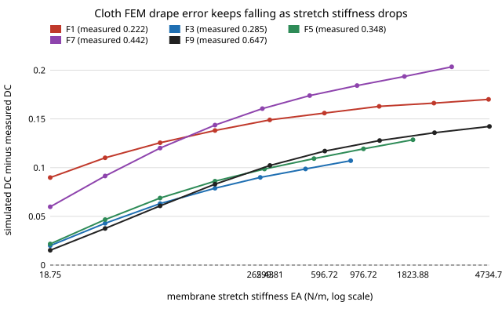

The [`hanger-codesign`](../../research/hanger-codesign/) programme wants to
know how good a cloth simulator has to be before the hanger it designs for a
laundry robot is the right one. Two days ago it compared its best tier, a
triangle finite-element cloth, with nine real woven fabrics from Petrak et al.
(2021, [doi:10.3390/ma14216259](https://doi.org/10.3390/ma14216259)). The
simulator ranked their measured Cusick drape coefficients almost perfectly
(r = 0.965), but it over-draped every one by about 0.14: the simulated cloth
was too stiff. [Yesterday](2026-11-18-hanger-drape-orthotropic.md) we ruled out
warp/weft anisotropy as the cause. The next suspect was membrane locking.

## What locking looks like

A woven barely stretches. The simulator takes each fabric's stretch stiffness
EA from the measured extension at 100 gf/cm, which gives 830 to 4,800 N/m. If
the cloth is already nearly inextensible, making it stiffer still should not
change how it hangs. The strain should shrink as 1/EA, and the stretch energy
with it.

Flat triangles with one constant strain each can't always manage that. To
fold into a doubly curved drape, a mesh of them may have to stretch, and the
stiffer the stretch, the more the mesh resists the fold. That is locking: the
shape stiffens because of the discretisation, not the fabric.

## What we ran

We changed nothing in the solver. We rebuilt each fabric's stretch ladder
from milestone 4a (150 N/m up to its measured stiffness, at most doubling each
step), added a branch down to 18.75 N/m, and at every step recorded the drape
coefficient, the fold count, and how much energy sat in stretch, shear and
bending. That is 18 chains on two meshes and 150 solved states, about 2.3
core-hours. All 96 states that milestone 4a had logged came out the same.
The predictions were committed before the first solve.

## What we found

- **The drape keeps climbing with stiffness.** At a fixed fold count the drape
  coefficient rose in 39 of 39 steps, by 0.004 to 0.015 per doubling of EA. It
  never levelled off between 18.75 N/m and the measured stiffness, although
  the strain was only about 1% at 150 N/m.
- **The stretch energy barely falls.** It scales as EA^-0.06 to EA^-0.31, not
  EA^-1. The membrane keeps 9% to 17% of the elastic energy, and in-plane shear
  energy grows up to 2.9 times as the stretch gets stiffer.
- **A finer mesh doesn't help.** Going from a 3.75 mm to a 2.5 mm lattice did not
  shrink the climb (the coarse mesh climbed faster on only 3 of 9 fabrics).
  Counting constraints explains why. This lattice has two triangles per node,
  so holding both yarn strains at zero means four constraints per node against
  three degrees of freedom, at every mesh size.
- **Locking is about a third of the error.** Between 150 N/m and the measured
  stiffness the drape coefficient rises by 0.044 on average, out of a bias of
  0.154 on these runs. At 18.75 N/m the bias falls to +0.045 (RMSE 0.057).

## Why this matters for calibration

Milestone 4a found that one factor on bending stiffness (0.485) removes the
bias. This run shows that a lower stretch stiffness can remove most of it too,
but no single stiffness fits all nine fabrics: extrapolated, the matching EA
runs from 0.01 to 23 N/m. So with one drape number per fabric, a bending error
and a locked membrane look the same. Calibration on this tier needs a
locking-free membrane (the nonconforming, edge-midpoint element of English and
Bridson, 2008, [doi:10.1145/1360612.1360665](https://doi.org/10.1145/1360612.1360665)),
after which stretch stiffness should stop mattering, or a second measurement
such as the number of drape folds.

## Limits

These runs used one random seed and two meshes, with shear stiffness fixed at
its measured value. The matching-EA figures are an extrapolation. Everything
here is simulation compared with one laboratory's published measurements. We
measured no cloth ourselves.

Code, results and the registered predictions:
[`research/hanger-codesign`](../../research/hanger-codesign/), milestone 4c.
Produced with AI assistance (Claude).
