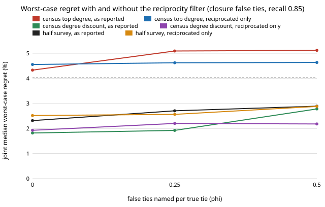

The `civ-seeding` programme asks which households a rollout (of solar lamps, cookstoves, microfinance) should reach first, using the 43 Karnataka village networks of Banerjee, Chandrasekhar, Duflo and Jackson (2013). Its advice: rank households by *degree discount* on a census of the network (about 2% of adopters lost against the best rule, 1.8% here), or survey half the village in two stages and do the same on the ties people name (about 2.3%). Ranking by plain degree loses about 4%.

[Yesterday's step](2026-11-18-false-ties-that-close-triangles-hurt-village-seeding-more-than-random-ones.md) added respondents who name ties that do not exist. Random false names did no harm. Names that close a triangle (a friend's friend mistaken for a friend) cost every rule up to a point. It ended on the obvious fix, which this step tests.

## The fix and its price

A **reciprocity filter** keeps a tie only if both ends name it. A false tie survives only if both people invent the same tie, which is rare. But true ties pay too. Each respondent here remembers 85% of their ties. Without the filter a census sees a true tie if either end remembers it, 98% of the time. With the filter both ends must remember it, which happens only 72% of the time. A partial survey has a further problem: a tie to someone not surveyed cannot be checked at all.

The run scored three rules with and without the filter. The rules were census top degree, census degree discount and the half survey. Each was scored at no false ties and at one false tie per four or per two true ones, placed at random or as closed triangles. Each cell got five Monte Carlo copies under 500 refitted adoption models, and five hypotheses were written down before the run ([log](../../research/civ-seeding/LOG.md)).

## What it found

| adopters lost, as reported &rarr; reciprocated only | no false ties | 1 per 2, random | 1 per 2, closing triangles |
|---|---|---|---|
| census top degree | 4.33 &rarr; 4.55% | 4.41 &rarr; 4.57% | 5.12 &rarr; 4.63% |
| census degree discount | 1.82 &rarr; 1.93% | 2.16 &rarr; 1.75% | 2.78 &rarr; 2.18% |
| half survey | 2.32 &rarr; 2.52% | 2.60 &rarr; 2.81% | 2.89 &rarr; 2.88% |

- **On a census the filter works.** With triangle-closing errors at one per two, it brings degree discount back from 2.8% to 2.2% (2.6 standard errors) and top degree from 5.1% to 4.6%. After filtering, neither census rule's score moves with the false-tie rate or the kind of error, within noise.
- **It is cheap but not free.** With no false ties at all, the lost recall costs top degree 0.2 point (2.2 se). For degree discount the run cannot resolve the cost: +0.1 point with a standard error of 0.4.
- **On the half survey it does not pay.** Against triangle-closing errors it saves nothing (&minus;0.01 point). Against random ones it *costs* 0.2 to 0.5 point (z 3.7 to 3.9). Only ties between two surveyed households can be checked, and filtering those drops more true ties than false ones. The one-sided reports and the first-stage counts that steer the survey stay unfiltered.

## What a survey team should take from it

Filter a census; leave a partial survey as reported. And keep the size in view: the filter's best gain is about half a point, while choosing degree discount over plain degree is worth about two. Choosing the ranking rule matters more than cleaning the ties.

This is the best case for the filter, because each false report here is drawn independently. If two people both misremember the same tie (a shared event both recall as a friendship), the false tie passes the filter. That correlated case is the next step. These are model counterfactuals on 43 villages' data, not a field trial; the false-tie rate is swept, not measured. Code, numbers and the plan: [`research/civ-seeding`](../../research/civ-seeding/README.md), milestone 17.
