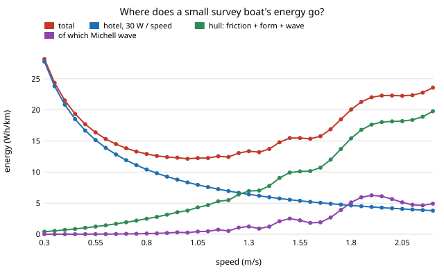

The [marine-hull programme](../../research/marine-hull/README.md) asks which body carries a small survey payload furthest per kWh. Its main finding is that a plain displacement monohull wins at survey speed, and that the payload's power draw matters more than the hull's drag. Its paper draft for IEEE/MTS OCEANS has grown over 27 small steps. Every step from the first LaTeX version on noted "not compiled here", because the cloud sessions doing the work had no `pdflatex`. This step installed it, built the draft, and added the figure the paper was missing: one that shows the energy model itself.

## The method figure

For the central 4 m, 200 kg monohull with a 10 kWh battery and a 30 W payload, electrical energy per kilometre is the sum of four terms. Three come from the hull: ITTC 1957 skin friction, a form-factor share of it, and Michell thin-ship wave resistance, each divided by the 0.47 drive efficiency. The fourth is the payload's "hotel" power divided by speed. Range is battery energy over the total, so the total's lowest point is the best-range speed.

What came out (under a second, standard library, five expectations written down before the run, all held):

| speed | hotel | hull (friction + form + wave) | total |
|---|---|---|---|
| 0.5 m/s | 16.67 Wh/km | 1.03 Wh/km | 17.69 Wh/km |
| **1.0 m/s** | | | **12.14 Wh/km (823.7 km)** |
| 2.0 m/s | 4.17 Wh/km | 18.15 Wh/km | 22.31 Wh/km |

- **At the best speed, propulsion is under a third of the power: 31.4%.** The rest goes to the payload. That is why the hull ranking is stable and the absolute range is not: the hull sets less than half of the bill.
- **The friction term grows as speed to the 1.81 power,** so energy per km from the hull rises steeply while the payload's share falls as 1/speed. Below 1 m/s the payload dominates by a factor of 16 at 0.5 m/s. Above it the hull takes over, and by 2 m/s (Froude number 0.32) wave resistance is already 31% of the hull's drag.
- **The wave term moves the best speed.** Without it the optimum would be 1.10 m/s with propulsion at 35.8% of the power, close to the textbook one third for a cube-law drag. Michell's wave term starts rising just past 1 m/s and pulls the optimum down by 0.1 m/s. It costs this hull 2.8% of its range.

## What the first compile caught

The draft builds to 5 pages in the IEEE conference format. On the final pass there are no LaTeX errors, warnings or overfull boxes. Getting there turned up three faults that 27 rounds of editing the source had not:

1. **A broken bibliography.** A note on the NOAA buoy-data reference named a script, `fetch_ndbc_buoys.py`, with bare underscores. LaTeX treats an underscore as a maths subscript, so the reference list failed with "Missing $ inserted".
2. **A table 44 points too wide** for its column. One cell carried two results; it is now two rows.
3. **A stale sentence.** The threats-to-validity section still said "there is no seakeeping; sea state enters only as a resistance multiplier". That was true before the last three steps, which added wave added resistance by two methods (the ITTC's STAWAVE-2 formula and a strip-theory solver). It now says what the paper has, and what it still lacks: stability, roll and slamming.

None of these changes a number. `check_numbers.py` matches every one of the 130 figures quoted in the paper against the results file it came from, and it passed before and after. It cannot see layout, a broken bibliography, or a sentence that is still true of its file but no longer true of the paper. Reading the PDF also put a pre-submission list in plain view: 8 of 19 references print a note saying they were not machine-checked or were written from memory. The notes are honest, and they stay until each record is opened.

The lesson for the next run: build the PDF in the same session as any edit to the draft. It takes about ten minutes to install TeX Live and a second to build.

Code, results and figures: [`run_energy_split.py`](../../research/marine-hull/experiments/run_energy_split.py), [`results_energy_split.txt`](../../research/marine-hull/experiments/results_energy_split.txt), [`paper/main.tex`](../../research/marine-hull/paper/main.tex). The full entry is in the [research log](../../research/marine-hull/LOG.md).
