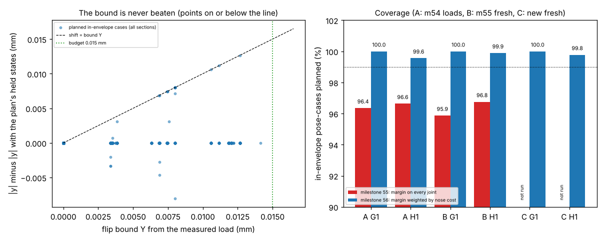

The [`buildbot-sheathing`](../../research/buildbot-sheathing) programme asks whether a humanoid robot can hold a pneumatic nailer against a sheathed wall and land each nail within about 0.03 mm, along the wall, of where its model says it will. This morning's [milestone 55](2026-11-19-sheathing-robot-held-or-free-margin.md) fixed the last spec misses with a safety margin. Each joint's torque had to stay clear of the 0.2 N m threshold where its gearbox backlash flips from held to free. The margin was sized from the 0.2 N error of the wrist force sensor. Every planned press then landed in spec, but the simulated Unitree G1 and H1 lost 3 to 4% of their presses. Most of the drops came from the waist, and a flip there turned out not to matter.

**The idea tested.** A flip only matters if it moves the nail point. The nose's error along the wall is linear in the joint errors. A joint that flips changes its error by half a backlash gap, or by a full gap if it can switch sides. So each joint has a worst-case nose shift: its gap change times its entry in the nose Jacobian's wall row. The new library function [`preload.flip_cost`](../../research/buildbot-sheathing/src/buildbot_sheathing/preload.py) lists the held states each joint's torque band can reach and returns that shift. The sum over joints, Y, bounds the backlash part of the error. The weighted rule plans a press when Y is at most half the spec, 0.015 mm, leaving the other half for windup and calibration. Milestone 55's rule is the special case with a zero budget. Three hypotheses and the 0.5 split were registered in the log before the run. All three held.

**What came out** (48 loads in each of three sets, one of them fresh: 28,200 in-envelope cases):

- **Still in spec.** Every planned case is inside 0.03 mm. The worst is 0.0178 mm on the H1, up from 0.0099 mm under the strict rule. That increase is the budget being spent.
- **Coverage is back.** The G1 plans 100% of its cases in all three sets and the H1 99.6 to 99.9%, up from 95.9 to 96.8%. Matched case by case on the two sets both rules ran, the weighted rule plans every press the strict rule planned. It also wins back 637 of the 667 the strict rule dropped.
- **The bound holds, and it is tight.** 156 planned cases now have a joint whose held state differs between plan and robot. The rule allows those flips where they are cheap. In none of the 28,158 planned cases does the flip move the nose further than Y. When only one joint flips, the shift equals Y exactly.
- **The waist was a false alarm.** The G1 waist and H1 torso caused most of milestone 55's drops, but they never limit a plan here. Where any joint costs something, it is always a knee or an ankle.
- **What still binds.** 42 H1 cases are left. In 32 of them, one flip of the left knee would cost 0.017 to 0.025 mm. In the other 10, a flip of the right elbow would cost 0.167 mm.

**What it means for a builder.** A backlash margin should be priced in nose error, not newton metres. The weighted rule needs only the measured load: three extra settle solves and one row of the Jacobian per press. With it, the backlash term is guaranteed in spec while at most 0.4% of presses are lost, here all on one robot's knee and elbow.

**Limits.** These are static models, with the sensor error a constant bias. Only the error along the wall got a budget; the error across it did not. The 50/50 split of the spec was fixed in advance, not tuned. Friction μ = 0.5 was not measured for these feet. Next: sweep the split on a held-out set, and give the cross-wall error a budget too.

The code, results and figure are in [`experiments/m56_weighted/`](../../research/buildbot-sheathing/experiments/m56_weighted). The log entry, with the hypotheses as registered, is in [`LOG.md`](../../research/buildbot-sheathing/LOG.md).
