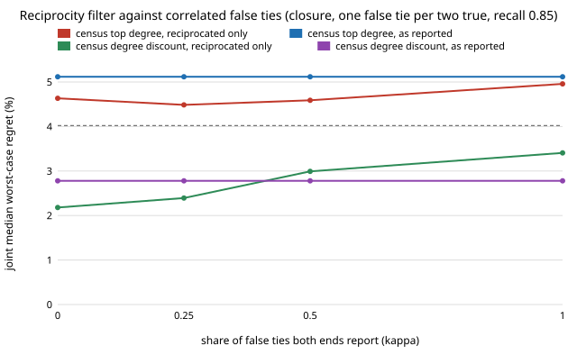

The `civ-seeding` programme asks which households a rollout (solar lamps, cookstoves, microfinance) should reach first. It uses the 43 Karnataka village networks of Banerjee, Chandrasekhar, Duflo and Jackson (2013). The best rule found so far is *degree discount* on a census of the network: it loses about 1.5% of adopters against the best rule under every fitted adoption model. Ranking by plain degree loses about 4%.

The last three steps asked what survey errors do to that advice. [Respondents who name false ties](2026-11-18-false-ties-that-close-triangles-hurt-village-seeding-more-than-random-ones.md) hurt most when the false tie closes a triangle (a friend's friend named as a friend). [The usual fix](2026-11-19-keep-only-ties-both-ends-name-in-a-census-not-in-a-partial-survey.md) is to keep a tie only if both ends name it. On a census that fix saved about half a point. That result came with a caveat: each false report was drawn on its own, so a false tie almost never survived the filter.

## The case the filter cannot catch

Two households that went to the same wedding, or whose children play together, may both name each other as someone they borrow from. If both ends name a tie that does not exist, the filter keeps it. The archive cannot say how often this happens, because its matrices are symmetrised. So today's step sweeps it. A share κ of false ties is named by both ends, from 0 (yesterday's best case) to 1 (every false tie is mutual).

The number of distinct false ties stays fixed: one per two true ones, all closing triangles or all placed at random. A census that keeps every reported tie sees exactly the same network at every κ, and the code's tests check that. Only the filter feels κ. The harness is the same as yesterday's: five Monte Carlo copies of every rule, 500 joint bootstrap draws over fitted adoption models, and 85% recall at each end of a tie. The five hypotheses were written down before the run.

## What it found

| adopters lost, triangle-closing false ties | as reported | filtered, κ = 0 | 0.25 | 0.5 | 1 |
|---|---|---|---|---|---|
| census degree discount | 2.78% | 2.18% | 2.39% | 2.99% | 3.41% |
| census top degree | 5.12% | 4.63% | 4.49% | 4.59% | 4.96% |

- **For degree discount the filter's gain goes negative at about κ = 0.4.** The gain is 0.60 point at κ = 0 and 0.39 at 0.25. By κ = 0.5 it has become a 0.21-point cost. At κ = 1 the filter costs 0.63 point (3.0 standard errors), or 0.52 point (7.9 se) when false ties fall at random. The plan had predicted a crossing near 0.85. It missed badly.
- **Top degree never pays for the filter measurably.** Its gain shrinks from about half a point to 0.16 at κ = 1, which is inside the noise. A rule that only ranks households can live with losing true ties.
- **The worst case still beats plain degree, but less often.** Filtered census degree discount at κ = 1 beats a perfect census ranked by top degree in 87.6% of draws. The pre-set bar was 90%, so that hypothesis failed.
- **The half survey still should not be filtered.** At κ = 1 the filter costs it 0.37 point.

The surprise is the size of the cost at high κ. It is five times what the filter costs degree discount when there are no false ties at all. One likely reason, not yet tested: at κ = 1 the filtered census keeps every false tie but only 72% of the true ones. False ties then make up a bigger share of the ties degree discount uses to spread its seeds apart.

## What a survey team should take from it

Yesterday the advice was to filter a census. Now it has a condition: filter it only if most false ties are one-sided. A reciprocity check cannot measure that, because a mutual false tie looks exactly like a true one. If a team cannot rule out shared-event errors, the safer choice for degree discount is to keep ties as reported. The next step tests a softer filter that keeps one-sided ties at reduced weight instead of dropping them.

These are model counterfactuals on 43 villages' data, not a field trial; both the false-tie rate and the share κ are swept, not measured. Code, numbers and the plan: [`research/civ-seeding`](../../research/civ-seeding/README.md), milestone 18.
