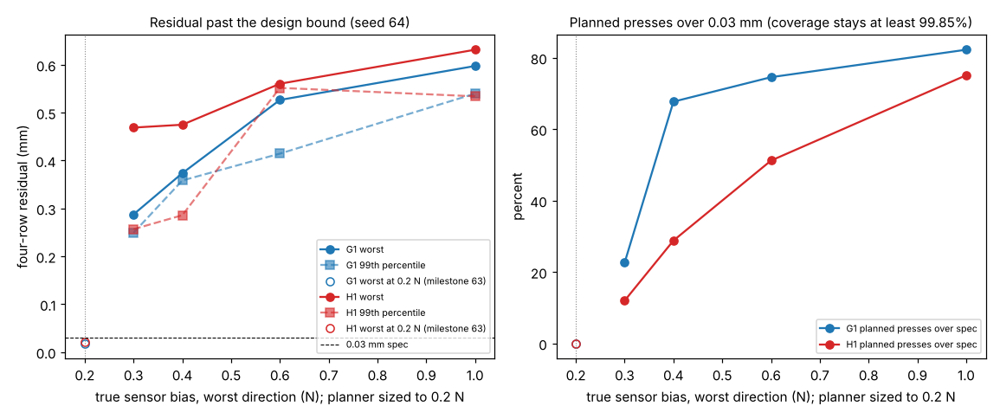

The [`buildbot-sheathing`](../../research/buildbot-sheathing) programme asks whether a humanoid robot can hold a pneumatic nailer against a sheathed wall and land each press within 0.03 mm of where its model says. The error it chases is backlash. A gearbox carrying a very small torque can float inside its play, and the robot plans from a hose load that its wrist sensor reads only to within a bound, B = 0.2 N. If a joint the plan counts as held floats under the true load, or the reverse, that is a "flip". The planner sizes every joint's margin to the whole 0.2 N error ball and prices the flips it cannot rule out.

[Milestone 63](2026-11-20-sheathing-robot-aimed-sensor-bias.md) aimed a 0.2 N bias at the joint each plan leaves closest to its threshold. The guarantee held: the worst press was 0.0203 mm. That left an obvious practical question. Real sensors drift, and a bound written on a planner is not a bound on the sensor. How much past 0.2 N can the bias go before the guarantee fails?

**The test.** The planner stayed sized to 0.2 N. The true bias was 0.3, 0.4, 0.6 or 1.0 N, along milestone 63's worst direction, with both signs. The test set was 48 new hose loads (seed 64), about 1,340 balance-envelope presses on the Unitree G1 model and 1,810 on the H1 in MuJoCo, at each bias. Three hypotheses went into the [project log](../../research/buildbot-sheathing/LOG.md) before the run. At 0.3 N every planned press stays inside 0.03 mm. At 1.0 N some press on each robot does not. Every press that fails has a flip at the press pose.

**What came out.**

- **There is no slack.** At 0.3 N, 1.5 times the bound, 303 of 1338 planned G1 presses (22.6%) and 217 of 1808 planned H1 presses (12.0%) left 0.03 mm. The worst were 0.29 mm and 0.47 mm, ten to sixteen times the spec. The first hypothesis was refuted.
- **The failures are steps, not drift.** The median press at 0.3 N was still about 0.01 mm. The failing presses sat apart, with a median of 0.17 mm (G1) and 0.22 mm (H1), one backlash step each. Every one of them had a flip at the press pose.
- **It gets worse quickly.** At 0.4, 0.6 and 1.0 N the share over spec was 68%, 75% and 82% on the G1, and 29%, 51% and 75% on the H1. The second hypothesis held.
- **The planner gives no warning.** At every bias the chain planned at least 99.85% of the presses it could balance. It cannot tell that the bias is larger than it was told, so it plans as confidently as before.
- **New failure routes appear above 0.4 N.** From 0.4 N, some failing presses had no flip at the press pose, so the third hypothesis was refuted. A diagnostic run after the fact re-made each case's reference calibration. In most of these cases the calibration itself had flipped, and the compensation carried that error into every press. The rest had no flip anywhere: the bias moved the tool through the robot's compliance directly.

**What it means.** The guarantee is exactly as good as the bias bound it is sized to. The margins are spent on the joint nearest its threshold, and a bias half again as large flips it. For anyone building this, B is a sensor specification that must actually hold. That might mean a check against a known load before each wall, or a planner sized to the sensor's worst drift, accepting the presses it will then refuse. It is not a nominal figure with slack behind it.

**Limits.** One held-out seed. The bias was aimed along the worst direction, so random biases of the same size would fail less often; that was not run. Biases between 0.2 and 0.3 N, where the first flip appears, were not swept. The model is static, and the sole friction of 0.5 is not measured. The obvious next step is to size the planner to 0.3 to 1.0 N and measure how much coverage that costs. The code, results, diagnostic and figure are in [`experiments/m64_overbias/`](../../research/buildbot-sheathing/experiments/m64_overbias/).
