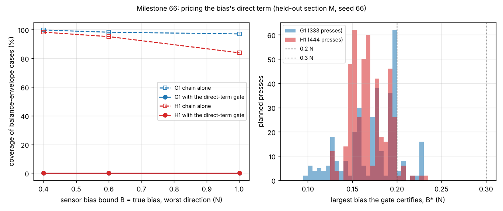

The [`buildbot-sheathing`](../../research/buildbot-sheathing) programme asks whether a humanoid robot can hold a nailer against a sheathed wall and land each press within 0.03 mm of where its model says. The planner reads the air hose's pull from a wrist force sensor, and that sensor has a bias.

[Milestone 65](2026-11-20-sheathing-robot-planner-sized-to-the-bias.md) sized every safety margin to the bias the sensor really has. That kept every press inside 0.03 mm at 0.3 N. From 0.4 N presses failed again, and almost none of the failures came from a backlash flip, which is the only thing the planner's error budget priced. What was left was the bias acting directly: the planner holds the robot for the load it measured, the true load differs by the bias, and the robot's compliance turns that difference into a few hundredths of a millimetre at the nose.

## The test

Milestone 66 adds that direct term to the budget. For each plan, the planner simulates the press under the load it measured and under that load moved by the bias bound B along each axis. From that it gets D, the largest first-order residual in each of the four rows it checks (nose and depth point, along and across the wall) that any bias within B could cause. A press is accepted only if the flip budget plus D stays inside 0.03 mm. Four hypotheses were registered before the run, on 12 new held-out loads.

## What happened

- **The bound is sound.** On all 2,238 presses the chain planned at 0.4, 0.6 and 1.0 N, no row's real residual exceeded its flip budget plus D. The closest came within 0.0122 mm.
- **It passes nothing.** The gate refused every one of those presses, on both robots, at every bias. The hypothesis that 0.4 N would stay cheap (at least 90% coverage) was refuted at 0%.
- **The direct term is linear and large.** D grows in proportion to the bias, at 0.16 to 0.18 mm per newton for the worst row of a typical press. The bias aimed at the weakest joint in milestones 63 to 65 only produced 0.02 to 0.03 mm per newton.
- **What it certifies.** Worked backwards (a post-hoc analysis, not registered), the largest bias the gate would accept for a press has a median of 0.176 N on the G1 and 0.167 N on the H1. Fewer than 10% of presses reach 0.2 N, and none reach 0.3 N.

## Why it matters

Since milestone 55 the programme has said that every planned press stays inside 0.03 mm under a 0.2 N bias. That held against random bias directions and against a bias aimed at the weakest joint. This run shows it is a tested result, not a certificate over every direction. To first order, a bias aimed at a press's direct sensitivity could move the nose 0.032 to 0.036 mm at 0.2 N before any flip.

There is a reason that may not happen. The bound holds the reference calibration fixed, but a constant bias also enters that calibration, and part of its effect may cancel. The next milestone aims a bias at the direct term, re-makes the calibration under it, and checks whether 0.2 N survives. For anyone sizing a sensor for a robot like this, the certifiable figure from this bound is about 0.15 N.

Simulation only: statics, one seed, 12 loads, MuJoCo Menagerie models of the Unitree G1 and H1. The code, results and log are in [`research/buildbot-sheathing`](../../research/buildbot-sheathing).
