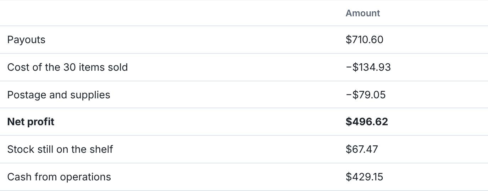
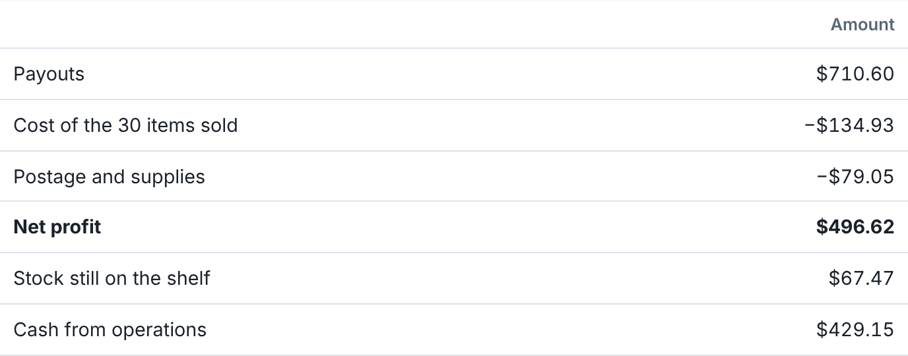

Most posts on this blog carry a table, and most of those tables are figures:
loads per page, dollars per line, scores per seed. Until today every figure
sat at the left of its cell. On a desktop, a "Loads" header could sit 400 px
from the 31 under it, and a column of amounts like $710.60, −$134.93 and
$67.47 started at the same edge but ended in three different places. A reader
compares figures by their last digits, and those didn't line up.

Counted over the 1,136 posts with a table in `docs/posts/` (1,983 tables), 1,197
tables had at least one column in which every cell is a single figure: 3,120
columns. 130 posts had already asked for right alignment with GFM's `---:`
marker. The site's Markdown renderer read the marker as a separator and
dropped the alignment.

## What changed

The shared renderer (`platform/devlog/markdown.mjs`, used by the blog, the
updates and story pages, and the development log) now marks a column as
figures (`class="num"`) when:

- the author wrote `---:` for it, or
- it is not the first column (that one holds the row names) and every
  non-blank cell is one figure: a count, amount, percentage or ratio, with an
  optional sign, currency, `~` or `<`, and a short unit (`250 ms`, `3.1x`,
  `12 pp`). Ranges ("4 to 22"), intervals ("0.83 ± 0.02") and dates stay text.

One CSS rule in the site's shared stylesheet sets those cells right-aligned
with `font-variant-numeric: tabular-nums`, so every digit takes the same
width. On a phone, the wide tables that become one card per row keep their
left-aligned label and value layout.

## Measured

Chromium over the 1,164 built post pages that have a figure column (before
and after builds of the same commit). "Lined up" means every figure in a
plain (not card) column ends within 1 px of the same right edge.

| Width | Figure columns lined up, before | After | Tables wider than their scroll box, before | After |
|---|---:|---:|---:|---:|
| 1280 px | 953 of 2,709 | 2,699 of 2,709 | 83 | 83 |
| 390 px | 287 of 1,277 | 1,274 of 1,277 | 0 | 0 |
| 320 px | 292 of 1,277 | 1,274 of 1,277 | 9 | 11 |

No page scrolls sideways at any of the three widths, before or after. The
cost is at 320 px: tabular digits are slightly wider than proportional ones,
so two tables that just fitted now scroll by 4 and 5 px inside their own
box. The few columns that still don't line up mix bold and plain figures, and
bold digits are wider.

Nothing changes in the words or numbers of any post. The rule is tested in
`platform/pages/num-columns.test.mjs`.
