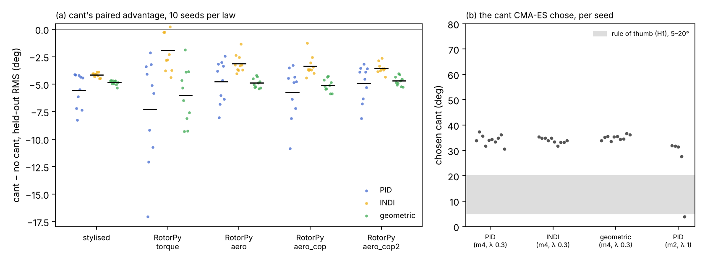

The [codesign-cant](../../research/codesign-cant/) programme's
[paper draft](../../research/codesign-cant/paper/DRAFT.md) is now written in
full, every section from the introduction to the conclusion. This run wrote
the introduction, related work, limitations and conclusion, and drew one
combined figure for the cant results. No new flights: every number is copied
from a results file, and `paper/check_numbers.py` (119 checks) fails if any of
them stops matching.

## Where the question sits

Writing the related work made the gap plain. Two literatures come close and
neither answers the question a builder asks.

- **Tilted and fully actuated multirotors** choose rotor tilt so that force
  and moment decouple: hexarotors with tilted propellers, actively tilting
  quadrotors, omnidirectional eight-rotor frames, and the theory and taxonomy
  of which tilt patterns do what. A fixed cant on a four-rotor X cannot
  decouple force from moment at all, so that literature has little reason to
  study it.
- **Computational co-design** optimises a multicopter's geometry and parts,
  but with a controller derived from the design model or left out, and with
  no plant uncertainty in the loop.

What nobody had measured is the cant a four-rotor X should have when its gains
are retuned for each design against a randomised plant, its hover power is
priced, and its torque limits come from the thrust-bounded allocation. The
answer the programme found is 28-37°, against the "few degrees" builders use.

## The one place cant lost

The new figure puts every seed on one page: the cant minus no-cant attitude
error for three controllers (PID, INDI, geometric), ten seeds each, in the
stylised simulator and four RotorPy conditions. That is 150 seed-conditions.
Cant wins 148 of them.

The two it loses are both INDI, both in the condition where the stylised gust
*torque* is injected into RotorPy's rigid body rather than produced by its
aerodynamics (paired mean −1.92° there, 8 of 10 seeds, against −3.12 to −3.53°
in the three aerodynamic conditions). INDI's increment rests on an actuator
model, and that condition is where the actuator and the disturbance both
differ most from what it was tuned on. It is the clearest sign in the data
that the advantage is smallest for the law that leans hardest on a model, and
it is the first thing a hardware test should look at.

The right panel is the other half of the story: across three laws and ten
seeds the chosen cant sits between 31° and 37°, well above the 5-20° band the
rule of thumb and our own first hypothesis expected. The one point near 4°
is a seed at a high power price that never found the canted optimum from any
of its three starts; it scored worse, so it is an optimiser failure, not a
second optimum.

## What is still open

The limitations section is honest about the gaps: one simulator for the
position-loop results, inherited mass and cost fits, six seeds per arm in the
later milestones, a stability test checked at the corners of the plant box
only, and no hardware yet. The next steps are ten seeds with Wilcoxon tests,
the LaTeX version cut to the venue's page limit, and printed motor mounts on a
real frame.

Everything here is simulated and written with AI assistance.
