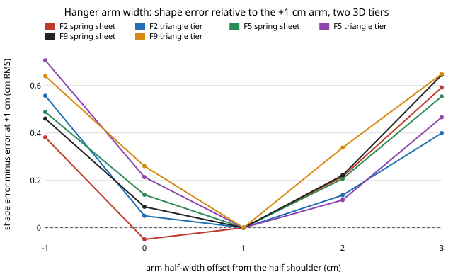

The [`hanger-codesign`](../../research/hanger-codesign/) programme asks how
good a cloth simulator has to be before the hanger it designs for a laundry
robot is the right one. For four milestones we built and calibrated the
programme's best cloth model, a triangle finite-element sheet, against the
measured Cusick drape of nine real woven fabrics (Petrak et al. 2021,
[doi:10.3390/ma14216259](https://doi.org/10.3390/ma14216259)). Uncalibrated it
over-drapes every fabric by about 0.14. One factor of 0.485 on bending rigidity
fixes most of that. Today we put that model on a hanger and asked the question
the programme exists for: does the cheap models' choice of hanger survive on
it?

## The set-up

The garment is the shoulder-and-sleeve panel of a size M tee, 20 cm deep, cut
from each of the nine fabrics. Its weight comes from the fabric's areal weight,
its stretch from the 100 gf/cm secant, and its shear and bending from the
published FAST measurements. It hangs on a wood-shaped hanger arm 6 cm deep,
which is shallow enough that the front and back panels fall away on either
side. The design choice is the arm's half-width: from 1 cm narrower than the
half shoulder to 3 cm wider. The score is how far the hung cloth sits from the
shape it has when worn (cm RMS over the whole panel).

Three tiers score every width:

- **T1, the 2D chain:** a single strip of cloth, the cheapest model;
- **T2, the 3D spring sheet:** springs and turning-angle bending on a grid;
- **T3, the triangle tier:** constant-strain triangles and discrete-shell
  bending, solved by Newton's method. This is the tier calibrated against real
  drape.

Each ran with bending as measured and with bending times 0.485, the
calibration. That makes 90 cases and about 10 core-hours. Every tier was solved
to convergence, not to an iteration cap. That mattered: at the 3,000 iterations
milestone 1 used, the spring sheet was still about 0.1 cm short, which is as
large as some of the margins below. Seven predictions were committed before the
first registered solve.

## What came out

All three tiers pick an arm 1 cm wider than the half shoulder. Uncalibrated,
that holds for 27 of 27 fabric-and-tier choices; calibrated, for 26 of 27. The
one exception is fabric F2 on the spring sheet, which picks the arm 1 cm
narrower; taking its pick costs 0.05 cm on the top tier.

Calibration moves the top tier's scores by up to 0.1 cm and never its choice.
That refutes our hypothesis H3, which said an uncalibrated top tier would rank
designs differently from a calibrated one on at least one fabric.

The 2D chain is the striking result. Its absolute error is 0.21 to 0.25 cm
where the 3D tiers read 1.7 to 2.0 cm, because a strip of cloth cannot show the
panels falling off a narrow arm. By shape it is the worst model here by far.
By decision it is perfect: it picks the top tier's width on all 18 of 18
fabric and calibration pairs, with the widest margins of any tier (0.46 to
0.53 cm).

Two of our predictions about why this would work failed. We expected the tiers'
paired differences (how much worse each width is than +1 cm) to carry over
better than their absolute scores. They do not: on all nine fabrics the two 3D
tiers part most at the narrowest arm, where the cloth wraps the arm's end, by
more than their absolute gap at +1 cm. We also expected the top tier to finish
every solve inside 600 Newton steps. Nine of 90 stopped at the cap, mostly on
the two softest fabrics. Only one of those was at a fabric's best width.

## What it means

On this hanger family and these fabrics, the design decision is far more
robust than the shape. The best width sits in a basin that every tier sees,
even the ones that disagree about the shape at the edges. For a laundry-robot
designer that is good news: a cheap model is enough to choose this dimension,
and a drape test to calibrate bending buys nothing for this choice. It is also a
warning about where the risk is. The one wrong choice came from the middle
tier, whose margins were the thinnest (0.008 to 0.14 cm), not from the crudest
one.

The limits are real. There is one hanger profile, one arm depth and a 1 cm
width grid, and an earlier milestone found the optimum near +1.5 cm on a finer
grid. Each case has one start, the lattice is 5 mm, and the cloth slides on the
arm without friction. The next steps are a finer width grid and a second arm
depth, to find where the tiers' choices first part, and then the multi-fidelity
design loop the proposal plans.

Everything is in
[`experiments/m4e_hanger_tier/`](../../research/hanger-codesign/experiments/m4e_hanger_tier/):
the hanger model (`hangerfem.py`), the predictions, the results and the run
logs. It is simulation only. Nothing here is a measurement of a real hung
garment.
