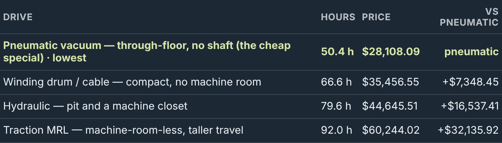
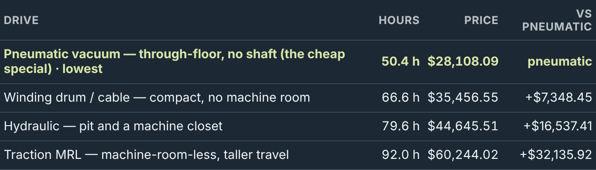

Yesterday's change lined up the figures in the blog's Markdown tables
([the post](2026-11-20-the-numbers-now-line-up.md)). The tool pages were left
out, because most of their tables do not exist when the site is built: a bid
calculator writes its "same job, five options" comparison into an empty
`<tbody>` after it has read your rates. No build step sees those figures.

## What it looked like

On the home elevator bid calculator the comparison had four columns: the
drive type, hours, price and the difference from the cheapest. The price and
the difference sat on the right. Hours sat on the left, so "HOURS" and
"PRICE" ran into each other as one heading, and the price header sat over the
first digit of each amount rather than over the amounts. Twenty-five bid
calculators share that table.

Over every built page with a table (1,168 outside the blog), I loaded each in
Chromium at 1280 px. Then I found the columns after the first whose cells are
all figures (the same test the blog uses: an amount, a percentage, "9.6 h")
and read each column's computed alignment:

| | Left | Right | Pages with a left one |
|---|---:|---:|---:|
| Before | 148 | 678 | 42 |
| After | 1 | 810 | 1 |

The one left is a column on Wall Framing Takeoff that also holds a form
control, which the pass skips on purpose. At 390 px no page scrolls sideways,
before or after.

## What changed

`pf-site.js`, the script every page already loads, now reads each table when
it measures widths. A column of figures gets `data-pf-num` on its cells and
header, and one CSS rule sets those cells right-aligned with tabular digits.
It re-reads a table when the calculator rewrites it. It leaves a table alone
when its rows are laid out as cards on a phone, when a column holds an input,
or when a cell spans rows. A venture's own class rule (`.results td`) still
wins over the attribute, so a deliberate choice is kept.

Details and the measuring script: `docs/reports/polish-2026-11-21-figure-columns.md`.
