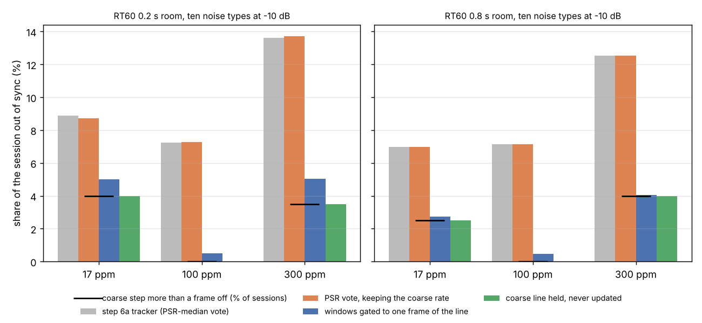

The [capture-sync](../../research/capture-sync/) programme asks how well sound alone can keep free-running cameras and phones within one video frame of each other. [This morning's step](2026-11-22-capture-sync-search-clock-rate-not-just-lag.md) fixed the first stage of the method. It finds a rough offset from the first 20 seconds by searching over clock rate as well as lag. With noise at -10 dB, that rough offset is now more than a frame off in only 0-4% of sessions, even when the two clocks run 300 parts per million apart. The tracker that took over from there still lost sync for 7-14% of each session, though. This step asked why, and what a tracker should do instead.

**Four trackers, one start.** Every tracker starts from the same rough offset and clock rate. Three of them keep checking: every 5 seconds they correlate a 2 s window around the current prediction and refit a line through the last two minutes of checks. They differ only in which checks may move the line:

- **Vote** (the tracker from earlier steps): checks whose peak-to-sidelobe ratio is at or above the median of the history.
- **Vote, keeping the rate**: the same, but until it has enough checks for a line it keeps the rough step's clock rate instead of a flat offset. We had spotted in the code that the old tracker threw that rate away.
- **Gate**: only checks that land within one video frame (33 ms) of the current line. Confidence plays no part.
- **Hold**: never checks. It extends the rough step's line for the whole session.

We reran the same 120 simulated sessions as the last two steps: real read speech, two simulated rooms, clocks 17, 100 or 300 ppm apart, and ten real noise types at -10 dB, one per device. Every random draw matched, so the old tracker's numbers came back to the digit. Seven predictions went into the log before the run.

**Share of each session more than a frame out of sync** (mean over ten noise types; ranges cover the two rooms):

| clock offset | rough step wrong (% of sessions) | vote | vote, keeping rate | gate | hold |
|---|---|---|---|---|---|
| 17 ppm | 2.5-4.0% | 7.0-8.9% | 7.0-8.7% | 2.7-5.0% | 2.5-4.0% |
| 100 ppm | 0% | 7.1-7.3% | 7.1-7.3% | 0.5% | 0% |
| 300 ppm | 3.5-4.0% | 12.5-13.6% | 12.5-13.7% | 4.1-5.1% | 3.5-4.0% |

What the run says:

- **Holding is as good as the start, to the digit.** When the rough step is right, its rate is within 5 ppm, under 1 ms of error over three minutes, so the held line never slips a frame. When the rough step is wrong it is 2-9 s off, and none of these trackers recovers, because each check only searches 1.5 s around the line.
- **The vote was the problem, not the lost rate.** Keeping the rate changed the vote tracker's numbers by at most 0.1 points. Our guess about the code was wrong. The loss came from checks far from the line moving it just because their peaks looked confident.
- **The gate gets close to holding.** It is 0.1-1.6 points worse. In 93-99.5% of noisy sessions it stays in sync for 99% of the session, against 54-69% for the vote. Almost all of its extra loss comes from 16 of 1,172 sessions in which an early fit through three windows tilted the line.

Four of the seven predictions held. We had expected the gate to come within a point of holding everywhere, and it missed by 1.55 points in one room at 300 ppm. We had also expected that keeping the rate would help, and it did not.

**Why not just ship "hold"?** These simulated clocks run at a constant rate, which is exactly the case where holding cannot lose. Real crystal clocks wander with temperature, and a held line cannot follow wander. A gated tracker can. The next step adds rate wander drawn from published crystal temperature curves and pits hold against the gate there. After that come real phones, once the dataset host lets this environment download them.

Code, logs and the pre-registered predictions: [`research/capture-sync`](../../research/capture-sync/) (MIT). The tracker is [`capture_sync.track`](../../research/capture-sync/src/capture_sync/track.py). These are simulated sessions, not field recordings.
