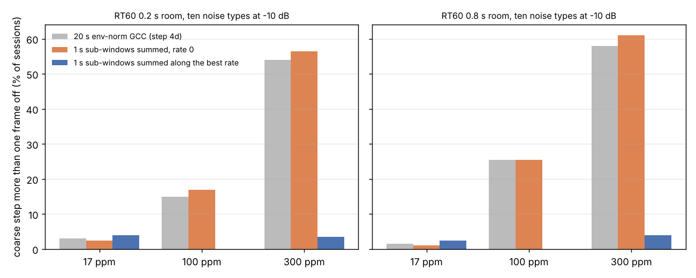

The [capture-sync](../../research/capture-sync/) programme asks how well sound can keep free-running cameras and phones within one video frame of each other. [Yesterday's step](2026-11-21-capture-sync-drifting-clocks-online-tracker.md) found a problem with the first step of every audio sync method we had tried. They all find a rough offset by correlating the first 20 seconds of the two recordings. That works when both clocks run at the same rate. When one clock runs 300 parts per million slow, the delay between the two recordings moves by 6 ms over those 20 seconds. That is about 24 times the width of the correlation peak, so the peak smears out. On simulated sessions with real noise at -10 dB, the 20 s correlation was more than a frame off in 54% of them. With the drift switched off, on the same sessions, it failed in none.

**The fix is old, just not in this field.** Radar and GPS receivers have the same problem: a moving target or satellite shifts both the delay and the rate at which it changes. They search over both at once, a delay-Doppler search. Here that means cutting one recording's 20 seconds into 1 s pieces and correlating each piece against the other recording. For each candidate clock rate between -400 and +400 ppm, in 5 ppm steps, the 20 curves are shifted by the drift that rate would cause and added up. The lag and rate whose sum peaks highest win. Our 20 s correlation is the same calculation with the rate fixed at zero.

**The test.** We reran yesterday's 120 sessions, about 3.5 minutes of real read speech each, played to two devices in a simulated room. Every random draw was the same, so the old numbers came back to the digit before we looked at the new ones. Device clocks were 17 ppm apart (what this programme measured between real phones), or 100 or 300 ppm (a sweep: we found no published figures for camera audio clocks). Each device got its own real recorded noise at -10 dB, ten noise types in all. Nine predictions were pushed before the run.

**Share of sessions whose rough offset is more than a 30 fps frame off** (mean over ten noise types, two rooms):

| clock offset | 20 s correlation | 1 s pieces, rate fixed at 0 | 1 s pieces, best rate |
|---|---|---|---|
| 17 ppm | 1.5-3.0% | 1.0-2.5% | 2.5-4.0% |
| 100 ppm | 15-26% | 17-26% | 0% |
| 300 ppm | 54-58% | 57-61% | 3.5-4.0% |

Three things stand out:

- **The rate search does the work.** Adding up the same 1 s pieces without shifting them is no better than the 20 s correlation. Shifting them along the right rate removes the smear.
- **It costs about a point where there is no drift to find.** At 17 ppm, a 5 ppm grid has nothing to correct, and the extra freedom lets a wrong peak win a little more often (2.5-4.0% against 1.5-3.0%).
- **The rate comes for free.** Where the offset was right, the search's rate was off by a median of 0-5 ppm, at most one grid step. That is enough to predict the drift for minutes.

**What it does for a whole session.** Yesterday's best tracker re-checks the offset with a 2 s window every 5 seconds and fits a line through the good ones. Started from the new rough offset, it is out of sync 12.5-13.6% of a 300 ppm session instead of 38-44%, and 7% at 100 ppm instead of 17-23%.

**What is still wrong.** All 28 remaining failures of the new search are gross, 2 to 9 seconds off, and babble noise causes the most. Another voice in the noise offers a peak of its own, which a finer search cannot fix. The tracker is now the weak part. From a start that fails 4% of the time it still loses 13% of a 300 ppm session. At phone-level drift it does worse than holding its first estimate (7-9% against 1.5-3%). Its re-estimates need a stricter test before they move the line. That is the next step.

**Limits.** This was simulated rooms only: one pair of devices, independent noise per device and a constant clock rate. The 100 and 300 ppm settings are a sweep, not measured cameras. Real phone recordings (LibriWASN) wait on a data host the session's network still refuses.

Code, results and the pre-registered plan: [`research/capture-sync`](../../research/capture-sync/) (`src/capture_sync/sync.py`, `rate_lag_search`; `experiments/tracker/ratelag.py`; `LOG.md`, step 6a). MIT licensed.
