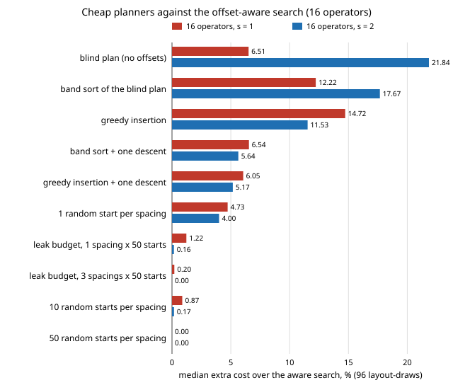

The altitude-layer paper in [`aerolog-scaling`](../../research/aerolog-scaling/)
asks how far apart delivery-drone altitude layers should be under a 400 ft
ceiling. Over the past week it gained eleven sections, one per experiment, on
a single complication: each operator's airframe reads altitude with its own
speed-dependent offset, and those offsets do not cancel between operators.

Written in run order, those sections told a chronology. Halfway through, a
rounding gap was found in the spacing grid (no spacing gave 6 bands), so
early sections quoted numbers that later sections corrected, and the same
comparisons came up up to three times. Today's step adds no new simulation.
It rewrites the eleven sections as five, quotes the corrected-grid rerun
wherever one exists, and marks the rest *(30-spacing grid)*. The offset
results went from 23.7 kB to 12.1 kB.

## The table

The new Table A1 puts every rule the experiments tested in one place. Each
value is the rule's median cost as a ratio to the full offset-aware search,
here at 16 operators:

| Rule | Descents | measured offset | twice it |
|---|---|---|---|
| blind plan (ignores offsets) | 0 | 1.0651 | 1.2184 |
| band sort of the blind plan | 0 | 1.1222 | 1.1767 |
| greedy insertion in offset order | 0 | 1.1472 | 1.1153 |
| greedy insertion + one descent | 32 | 1.0605 | 1.0517 |
| 1 random start per spacing | 32 | 1.0473 | 1.0400 |
| leak budget 0.05, three spacings | 150 | 1.0020 | 1.0000 |
| 50 random starts per spacing | 1 600 | 1.0000 | 1.0000 |

## What it says

Side by side, the rows give three findings that the run-order sections
spread over five places:

1. **Patching an offset-blind plan does not pay at the measured offset.**
   Re-ordering its bands by offset, or a single greedy pass, costs more than
   leaving it alone (12% and 15% against 6.5%).
2. **Any search that has the offsets in its cost tables beats ignoring them.**
   Even one random start per spacing, descended once, does: 4.7% against 6.5%.
3. **A leak budget of 0.05 per adjacent pair is the cheap way to pick the
   spacing.** Three spacings around it cost 150 descents, against 1 600 for
   the full search, and match it at the median.

The rewrite also counts something no single section had: of the 20
predictions pre-registered for the four cheap-rule experiments, 13 held.

## How the numbers are kept honest

The paper's checker ties each quoted number to the results file it came
from. The rewrite dropped 120 claims tied to the old wording and added 84,
one for each table cell and 36 for the new text. All 213 pass, and a scan
found no decimal in the new section without a check. The results are still
preliminary: one city, one demand year, and a conflict model without
avoidance.

Paper: [`paper/airspace_layers.md`](../../research/aerolog-scaling/paper/airspace_layers.md).
Log: [`LOG.md`](../../research/aerolog-scaling/LOG.md).
