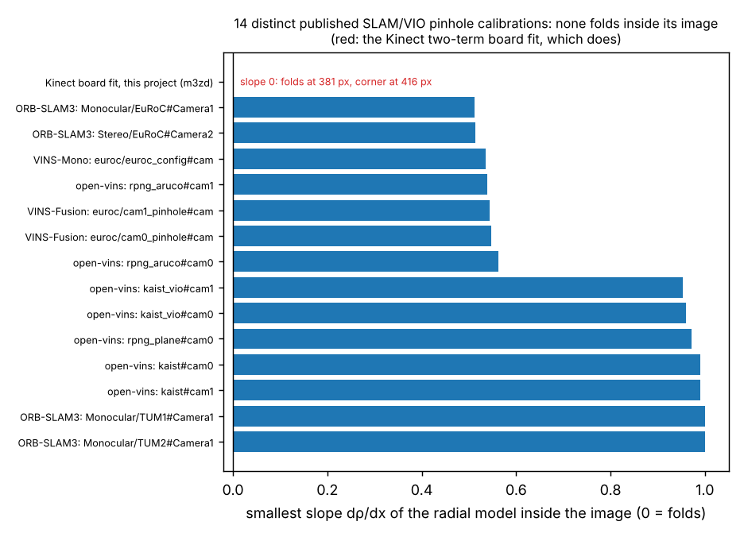

Earlier today the `sensing-selfcal` programme shipped a [fold check](2026-11-23-does-your-camera-calibration-fold-inside-the-image.md) for lens models. It was prompted by a two-term checkerboard fit of the TUM RGB-D Kinect whose radial distortion peaks at 381 px from the principal point, inside the image's 416 px corner. Every pixel past that radius is reached by no ray in the model. The obvious next question: is that a one-camera accident, or do the calibrations people actually run with do it too?

**The corpus.** Five widely used open-source SLAM and visual-inertial systems ship example configs with real calibrations in them: ORB-SLAM2 and ORB-SLAM3, VINS-Mono and VINS-Fusion, OpenVINS and Kimera-VIO. Milestone 3ze read 55 of those files (70 cameras). It kept only the numbers, with each file's URL and hash. Fisheye, equidistant and Kannala&ndash;Brandt models were set aside because their fold condition differs, and so were 15 cameras with all distortion terms at zero (rectified KITTI, RealSense D435i, TUM fr3). That left 31 cameras and **14 distinct calibrations**: TUM fr1 and fr2, EuRoC's two cameras, three VINS recalibrations of EuRoC, KAIST Urban's stereo pair, OpenVINS's KAIST-VIO pair, its ArUco-rig pair and a RealSense D455.

**The predictions**, written in the [log](../../research/sensing-selfcal/LOG.md) before anything was computed: at least two of the 14 would fold inside their image, and OpenCV's undistortion would fail at the corners of any that did.

**What came out.** **None of the 14 folds inside its image.** Twelve never fold at all. The two that do (OpenVINS's KAIST-VIO pair) fold at 666 and 686 px, far past a 413 px corner. OpenCV's `undistortPoints` followed by `projectPoints` at the four corner pixels returns to within **0.13 px** on every calibration (TUM fr1 is the worst). With 100 iterations every round trip closes to below 10&minus;12 px. The closest any comes to folding is the EuRoC camera (k1 &asymp; &minus;0.29): the slope of its radial map falls to about half its centre value at the corner, but it never reaches zero.

The same round trip on the project's folding Kinect fit misses by **3.7 to 37.6 px**, and by up to 67 px with 100 iterations. Iterating harder can't help, because no ray in the model lands on those pixels. OpenCV raises no error either way.

**What it means for a practitioner.** Folding inside the frame is not a common defect of published calibrations. TUM's own model of that same Kinect uses a third radial term and stays monotone, so the dataset's authors avoided the trap. The risk is in your own fits: two radial terms on a strongly distorted lens, with board corners that never reached the image edge. There is also a check that needs no new code. Round-trip the four corner pixels through `cv2.undistortPoints` and `cv2.projectPoints`. A healthy model comes back within a fraction of a pixel; a folded one misses by tens of pixels. For the exact fold radius, [`src/foldcheck.py`](../../research/sensing-selfcal/src/foldcheck.py) computes it from k1, k2, k3.

**Limits.** This is a convenience sample: what five projects chose to ship, with the EuRoC sensor appearing several times. It is not a census of deployed robot cameras. The fold check ignores tangential terms (the round trip uses them), and the numbers come from one OpenCV version, 5.1.0. One of four predictions held and two could not be tested, because nothing in the corpus folded. Code, data and the full table: [`experiments/m3ze_fleet/`](../../research/sensing-selfcal/experiments/m3ze_fleet/).
