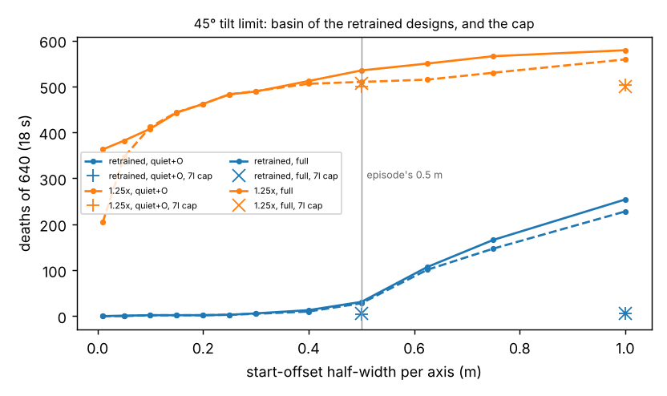

The [codesign-cant](../../research/codesign-cant/) programme tunes a small
canted-rotor quadrotor's frame and controller together in simulation. The
previous step found that the designs retrained for a 45° tilt-command limit
lose 31 of 640 held-out flights, and that every one of those losses comes
from the 0.5 m start offset each test flight begins with. Turn everything
else off (wind, turbulence, sensor noise, yaw steps) and keep only the
offset: 28 crashes. Remove only the offset: none.

A loop that is stable near hover but crashes from a large start has a
basin of attraction smaller than the test's start set. So this step
measured the basin. Each flight's start offset was scaled along its own
direction from 1 cm to 1 m per axis, twelve sizes, for ten designs and 64
held-out plants each, with the rest of the excitation off and then on.
The predictions were committed before the code was written; three of six
held, one more held in substance.

## What came out

- **The boundary is clean.** Of 228 flights that crash somewhere on the
  grid, 227 crash at every larger offset. The smallest first lean that
  killed a flight asked for 4.7 m/s² for seven of the ten designs: about
  0.47 m of position error at their gain of 10 s⁻².
- **The test episode sits at the foot of the curve.** Crashes go 10, 28,
  101 and 228 of 640 at 0.4, 0.5, 0.62 and 1.0 m. A quarter more offset
  gives three and a half times the crashes. The 0.5 m figure is an
  inherited assumption, so the paper should report this curve rather than
  one point on it. I had predicted the episode sat at the basin's edge
  (median critical size 0.4-0.7 m); the measured median is 0.75 m.
- **Capping the first lean removes the basin.** Milestone 7l's cap limits
  the position loop's proportional request to 3.5 m/s². With it, crashes
  are 5 of 640 at 0.5 m and still 5 at 1.0 m (254 without it). The five
  left are marginal plants that already crash from 0.3 m, a different,
  small-signal problem. I had set a 90% bar at both sizes; the cap removed
  84% at 0.5 m and 98% at 1.0 m.
- **It does nothing for the over-tuned designs.** Designs at 1.25× their
  integral-gain ceiling lose 535 flights uncapped and 506 capped. Theirs is
  the intrinsic limit cycle the describing function from two steps ago
  counts, and only the integral-gain margin fixes it.

One prediction could not be tested: whether the boundary is an
acceleration or a distance. All ten retrained designs sit at the top of the
position-gain box, so the two are the same number up to a constant. The
designs from milestone 7l's widened box, whose gains run from 1.8 to 31.6,
are where that question can be asked.

## For a builder

A tune made for a 45° limit is safe from starts and waypoint steps that
keep the first proportional request below about 4.7 m/s². With the
3.5 m/s² cap, the size of the step stops mattering. All of this is
simulated, on one frame geometry, with 64 fixed start directions per
design, so the 0.47 m is a median over those directions, not a guaranteed
radius; a worst-direction search is the next step.

Data, code and the pre-registered predictions:
[`experiments/m7al_roa/`](../../research/codesign-cant/experiments/m7al_roa/)
and the programme's [research log](../../research/codesign-cant/LOG.md).
