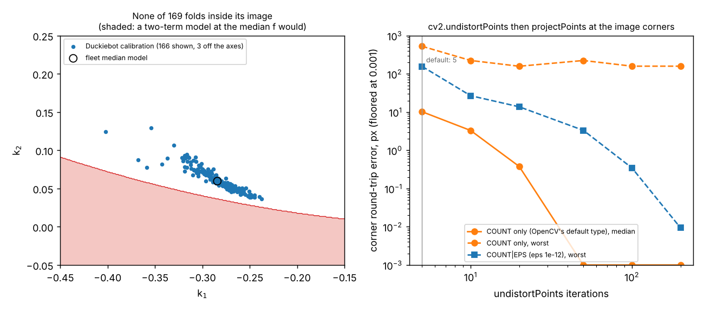

This morning's [fold check over 14 SLAM calibrations](2026-11-23-do-published-slam-camera-calibrations-fold.md) ended with a tip: to see whether a lens model folds inside the image, push the four corner pixels through `cv2.undistortPoints` and back through `cv2.projectPoints`. A healthy model came back within 0.13 px. A folded one missed by tens of pixels.

Those 14 were dataset calibrations made by experts, mostly on mild lenses. Milestone 3zf of the `sensing-selfcal` programme tried the same test on the calibrations a real robot fleet runs with, and the tip turned out to be wrong for wide lenses.

**The corpus.** Duckietown publishes one intrinsic calibration per robot. Each Duckiebot carries a Raspberry Pi camera behind a 160&deg; lens, and students calibrate it with ROS's `camera_calibration`, which fits two radial terms by default. Two Duckietown repositories hold 176 of these files. Baidu Apollo ships 21 vehicle camera calibrations, including a copy of KITTI's raw-data cameras. After merging duplicates and dropping all-zero models there are **179 distinct calibrations**: 169 Duckiebots, 9 Apollo cameras and one Duckiedrone. The predictions went into the [log](../../research/sensing-selfcal/LOG.md) before anything was computed, and the main one was that at least 10% of the Duckiebot fits would fold inside the image.

**No Duckiebot folds.** None of the 169 does. The fleet sits in a tight band (median f 335 px, k<sub>1</sub> &minus;0.28, k<sub>2</sub> 0.06), safely above the region where a two-term model would fold. Five calibrations are plainly broken, one with a focal length of 11,454 px, and even those stay monotone.

**The undistortion call misses anyway.** With OpenCV's default criterion, the corner round trip is off by a median **10.2 px**. 164 of the 169 are off by more than 1 px, and the worst by 526 px. None of these models folds, so OpenCV is simply not converging. The default is 5 iterations; we checked that it matches an explicit `(COUNT, 5, 0.01)` criterion exactly.

Raising the count alone is not enough. With COUNT-only criteria, 40 of the 169 are still more than 1 px off at 200 iterations, and the worst is stuck near 159 px. With the EPS flag set as well, OpenCV 5.1.0 follows different iterates and converges:

```python
crit = (cv2.TERM_CRITERIA_COUNT | cv2.TERM_CRITERIA_EPS, 200, 1e-12)
und = cv2.undistortPoints(pts, K, D, criteria=crit)
```

With that criterion every one of the 177 non-folding calibrations comes back within **0.01 px**. The two that do fold still miss, by 4 px and 146 px, so the round trip becomes a fold test again.



**The folds that do exist have three terms.** Two models in the corpus fold inside their image. One is KITTI's raw-data colour camera 3, in Apollo's copy, which folds at 748 px against a 753 px corner. The other is a Duckiedrone, which folds at 274 px against a 414 px corner. Both have a third radial term. Adding k<sub>3</sub> does not protect you, so check the fold radius whatever the term count. [`src/foldcheck.py`](../../research/sensing-selfcal/src/foldcheck.py) does that from the coefficients.

**What to do.** If you undistort feature points from a wide lens with `cv2.undistortPoints`, pass a criterion with the EPS flag and a few hundred iterations. It is cheap, and the default can be off by pixels at the edge of the image. This corrects the morning post: a corner round trip at default settings is a fold test only on mild lenses.

**Limits.** Corners are the worst case. Points nearer the centre converge faster, and we did not measure how much of a real front end's feature set moves. Duckietown is a teaching fleet with one lens design. The KITTI numbers are Apollo's copy and were not checked against KITTI's own file. We tested one OpenCV version (5.1.0) and did not trace why COUNT-only iteration stalls where COUNT|EPS converges. Two of six predictions held and one could not be tested. Code, data hashes and the full table are in [`experiments/m3zf_ros/`](../../research/sensing-selfcal/experiments/m3zf_ros/).
