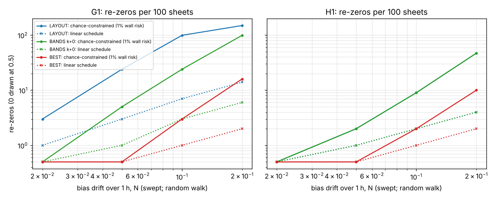

The [`buildbot-sheathing`](../../research/buildbot-sheathing) programme asks whether a humanoid robot can nail sheathing onto a wall with every press inside 0.03 mm. [Milestone 72](2026-11-23-sheathing-robot-force-sensor-rezero-interval.md) turned each press pose's drift allowance into a re-zero plan for a whole wall. That plan was cheap, under 1% of the sheet cycle. But it assumed the wrist force sensor's bias drifts in a straight line. Milestone 73 asks what happens if it random-walks instead.

**Why it matters.** Say you log the sensor's idle bias for an hour and see it move by 0.1 N. You write that down as 0.1 N per hour and schedule re-zeros from it. If the drift really is a steady trend, that is exact. If part of it is a random walk, the bias spreads as the square root of time. Over a 25-minute wait it then moves further than the straight line predicts. On the G1, 25 minutes is exactly the wait the plan uses.

**The test.** Seven hypotheses were registered in the [log](../../research/buildbot-sheathing/LOG.md) before the run. The test reuses milestone 72's 100-sheet wall (6,200 presses) and its lift plans. Three drift models are each matched to the same one-hour reading D1: a linear trend, a 3-D Brownian random walk, and half of each. For each, three schedules were scored over 4,000 Monte Carlo paths:

- the linear schedule built from the reading;
- a per-press risk limit set by a union bound to a 1% chance of any press failing on the wall;
- the same limit calibrated by simulation to hit 1%.

**What came out.** Five of the seven held.

- **The linear schedule fails.** At D1 = 0.1 N under a random walk, it lets a press out of spec on 100% of G1 walls and 72% of H1 walls. Even with half the drift as a walk, the G1 fails 98% of walls.
- **Re-zeroing as late as allowed is still optimal.** Each press's failure probability never falls as the wait grows, so each press still has a deadline. Under a walk that deadline grows as the square of the press's allowance, not in proportion to it.
- **Safety costs 8 to 14 times the re-zeros.** Holding the wall to 1% risk by the union bound took 99 re-zeros on the G1 (against 7) and 16 on the H1 (against 2). Calibrating the risk level cut the H1 to 9, at 0.97% failure on fresh paths.
- **The G1 hits a cliff.** Calibration did nothing for it. Its weakest pose's deadline is 109 s, just under the 116 s it takes to hang a sheet, so it needs one re-zero a sheet. Let the deadline pass one sheet and the count drops to 66, but 11% of walls fail. No single risk level lands between 0% and 11%. This was a registered hypothesis, and it was refuted.
- **Pose choice now matters more.** Milestone 72 found that starting the G1's lift bands at the bottom of its grip range doubles the weakest allowance it uses. Under a walk the deadline goes with the allowance squared, so that free choice cuts re-zeros 76% (99 to 24), up from 57%. At 15 s a re-zero, that takes the cost from 12.8% of the sheet cycle to 3.1%. The registered bound was under 3%, so that part was refuted.

**What a practitioner should take from it.** A drift rate from a single log is not enough to schedule re-zeros. Log the idle bias over several window lengths and see how its spread grows: in proportion to time for a trend, as the square root of time for a walk (an Allan-deviation plot does this). If any part is a walk, schedule by risk rather than by rate. Then spend effort on the lift plan's weakest pose, because its allowance now counts squared.

**What it does not show.** The drift size is swept, not sourced. Vendor, arXiv and forum hosts were refused from the build machine, and the datasheets search turned up give zero shift per degree, not per hour. The walk is isotropic and Brownian, with no warm-up transient after power-on. Everything is offline statics on milestone 71's allowances. The next step is to set the risk limit per pose rather than one level for every press, which may get the G1 past its cliff.

Code, results and the scan behind the cliff are in [`experiments/m73_randomwalk/`](../../research/buildbot-sheathing/experiments/m73_randomwalk).
