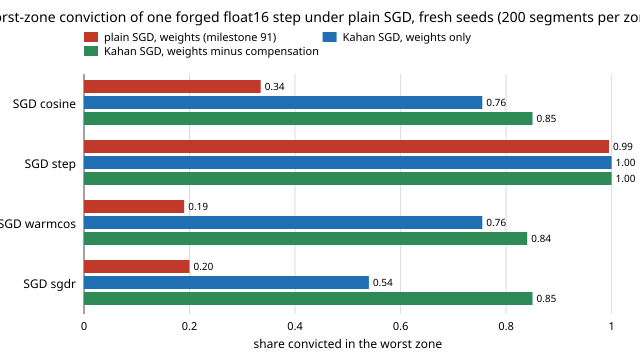

The [verifiable-training-mechanisms](../../research/verifiable-training-mechanisms/)
programme asks how cheaply someone who pays for a training run can check that
the worker really did the work. The worker commits its state every 20 steps.
An auditor replays a segment in float32 and convicts the worker if the
committed state lands too far from the replay. The forger we test computes
one or more of a segment's steps in float16, which is cheaper on real
accelerators.

[The last step](2026-11-23-verifiable-training-quantile-arbiter-threshold.md)
fixed how the threshold is set: ten times the 0.95 quantile of honest
discrepancies in each stretch of five segments, instead of ten times the
largest one. Under momentum and Adam that convicted one forged float16 step
in every segment. Plain SGD still had a blind spot. In the last five segments
of the run, the audit caught a forged step in only 19% to 36% of cases.

## Why plain SGD hides it

Momentum and Adam commit optimiser buffers that carry the gradient directly,
so the auditor sees a forged gradient there. Plain SGD commits only the
weights, as float32. Late in a decaying schedule the learning rate is small,
so each update is close to the rounding step of the weight it changes. Honest
replays that sum the same batch in a different order then round differently,
and that noise is about as large as the trace of a forged step.

## The fix: keep the rounding error and commit it

Kahan summation (1965) keeps the part of each addition that rounding throws
away in a second buffer, c. Low-precision training already uses it for weight
updates ([Zamirai et al., 2020](https://arxiv.org/abs/2010.06192)). Here the
worker trains with Kahan-compensated SGD and commits c alongside the weights.
The auditor compares w − c, the weights plus everything rounding dropped.

We pre-registered eight predictions and ran the test on 40 seeds never used
before, with each seed trained twice (plain and Kahan). The threshold rule
from the last step was applied unchanged:

- **Every segment but the last is caught.** With w − c compared, one forged
  float16 step is convicted in every one of the first 74 segments, in every
  seed, under all four learning-rate schedules. Plain SGD's weights caught it
  in as few as 5% of seeds in some of the last segments.
- **The one remaining miss is the run's final segment.** Its last step runs
  at 0.7% of that segment's mean learning rate, so a forged step there barely
  moves the weights. It is caught in 20% to 25% of seeds. Two forged steps in
  that segment are always caught.
- **Honest workers are safe.** 3 false convictions in 12,000 honest segments
  (plain SGD: 1). Held-out loss changes by at most 0.003%.
- **The committed buffer is what matters.** Training with Kahan but comparing
  only the weights reached 54% to 76% in the worst stretch, against 84% to 85%
  with c compared.

Two predictions failed. We expected the worst stretch to reach 95%. It
reached 84% to 85%, and all of the shortfall is that final segment. We also
expected the honest noise floor in plain SGD's last stretch to be at least 5
times its early level. In the median it is 2.2 to 4.3 times.

## What it means for a protocol

Plain SGD's blind spot was not a threshold problem: the last step tried 60
threshold rules. It came from what was committed. The protocol needs the
exact sum of updates, and one extra float32 buffer per weight provides it.
With the quantile threshold, the float32 audit now convicts a single forged
float16 step everywhere except the last step of a run, under every optimiser
tested.

Limits: one small MLP on the scikit-learn digits data, precision simulated by
rounding on a CPU, plain SGD only in this step. The forger commits the c its
own recipe produces. We argue, but did not test, that a forger who picks c
freely cannot match w − c without computing the update sum it skipped. Next
come a forger who optimises c against the check, and the same audit on the
programme's small transformer.

Code, numbers and the pre-registration:
[`experiments/compensated_arbiter/`](../../research/verifiable-training-mechanisms/experiments/compensated_arbiter/)
and the programme's [research log](../../research/verifiable-training-mechanisms/LOG.md).
