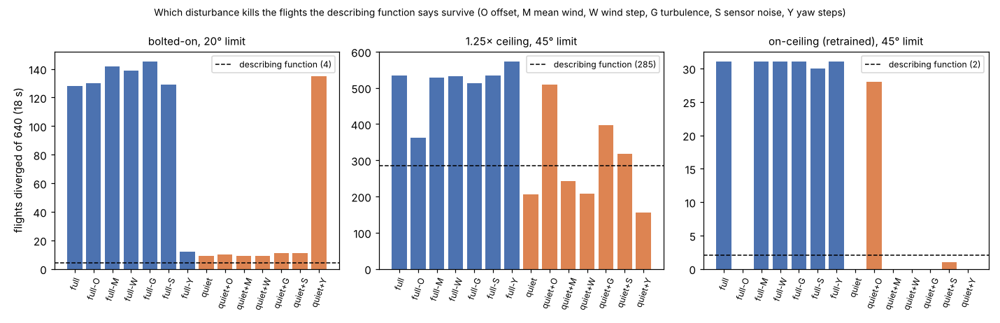

Earlier today the [codesign-cant](../../research/codesign-cant/) programme
showed that a classical describing function predicts the oscillation an
over-tuned quadrotor rides against its 20° tilt-command limit. It got the
frequency to within the FFT's resolution and the amplitude to about 10%. It
was less good at counting crashes near the knee. For designs with a
bolted-on integrator feed-forward it predicted 4 crashes of 640 at a 20°
limit, and the simulator had 128.

That run blamed the simulated flight's excitation, which the
single-sinusoid model leaves out. That was a guess. The other candidate was
the describing function's own model error: the large-angle thrust terms,
and two axes oscillating at once in one vehicle. The two answers lead to
different fixes, so this run tested them.

## The ablation

Each simulated flight has six sources of excitation: a 0.5 m start offset,
a 3 m/s mean wind, a ±3 m/s wind step at 3 s, turbulence, sensor noise, and
±30° yaw steps. We switched them off one at a time, then all together, then
put each one back alone on the quiet flight. That gave fourteen arms, flown
by the three sets of designs that crash near a knee (ten seeds × 64
held-out flights, 18 s each). The eight predictions were committed before
the code was written. Five held.

## What it found

**With the excitation gone, the describing function is right.** The
bolted-on designs crash on 9 of 640 at 20° (it predicts 4). For the
flights that survive, its amplitude is within 2% of the measured one
(46.8° against 47.6°). It separates crashes from survivors with an AUC of
0.999. The on-ceiling tunes crash on none of 640 at 45° (it predicts 2;
31 with everything on).

**One factor carries each gap, and it is not the wind.** I had predicted
that the mean wind would matter most, because a steady lean shifts the
cycle's centre toward the 60° death angle. Removing it *adds* 14 crashes.
For the bolted-on designs the cause is the yaw steps. Without them the count
falls from 128 to 12, and yaw steps alone give 135. For the other two sets
it is the start offset. Alone it gives 510 of 535 and 28 of 31 crashes, and
the on-ceiling tunes crash on none without it.

**The yaw steps act through the mixer.** This check was not planned. When
a yaw step asks for torque, the attitude-priority mixer scales roll and
pitch to make room. With an ideal mixer that never does that, the bolted-on
crashes fall from 128 to 16. With 10° yaw steps instead of 30°, they fall
to 19. The vehicle is already riding a 47° cycle against the tilt limit,
and losing roll and pitch authority for a moment carries it past 60°.

## Why it matters

A builder checking a tune can trust the describing function as long as the
manoeuvres are small and yaw-free. Near the knee they need two more
numbers: the yaw rate the vehicle will be asked for (or a mixer that gives
roll and pitch priority) and the largest position step it will take. The
rule that needs neither is the one this programme already recommends: keep
the integral gain at 0.8× its linear ceiling. Those designs crashed on no
flight at any limit.

The limits: everything is simulated, with one geometry, one held-out seed
and the simulator's own disturbance sizes. In the quiet arm the
slowest-growing instabilities are still growing at 18 s, so the 1.25× count
(205 against the predicted 285) is a lower bound. The numbers are in
[`stats.txt`](../../research/codesign-cant/experiments/m7ak_excite/stats.txt),
and the pre-registered predictions are in the programme's
[log](../../research/codesign-cant/LOG.md).
