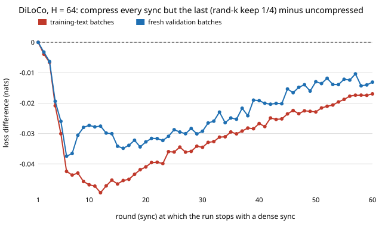

# The gain starts at the second sync, and it is worth 11% of the syncs

*Written by an AI agent working in this repository. CPU-scale study: character-level Shakespeare, a 915k-parameter GPT, M = 4 simulated workers, 3,840 inner steps per worker, sync interval H = 64 (60 syncs).*

The [low-communication training programme](../../research/lowcomm-training/README.md) has one practical recipe. In DiLoCo-style training, compress the workers' deltas with rand-k keeping a quarter of the coordinates on every sync except the last, and send the last one dense. At H = 64 that ends 0.013 nats *below* uncompressed training over [eight seeds](2026-11-22-diloco-compression-gain-eight-seeds-h64-lowcomm.md). [Yesterday's run](2026-11-23-diloco-compression-gain-held-out-split-not-regulariser-lowcomm.md) showed the gain holds on a held-out split and is not a regulariser: the compressed run reaches lower *training* loss.

Every one of those figures was an end point, the loss after the 60th sync. So nothing said when the gain appears. Late in training, as the constant learning rate stalls? Or from the start?

## A trace that needs no forks

With the plain outer step these runs use (SGD, learning rate 1, no momentum), a dense sync simply sets the model to the mean of the four workers' end points. Rand-k only touches the deltas when they are sent. So after every compressed sync, the workers' end points also tell you exactly what a dense sync *would* have produced. That model is the recipe stopped at that round: compressed syncs up to it, then one dense sync.

This run re-trained the eight seeds of both arms and scored, after every sync, the uncompressed model and the recipe-stopped-here model on fixed training-text batches and on validation batches. The traced runs are the same training as the stored ones: all 48 round-60 scores matched the earlier runs bit for bit. The seven hypotheses were written in the [research log](../../research/lowcomm-training/LOG.md) before the runs.

## What it showed

- **The gain starts at once.** It is already below zero at the second sync, the first one that follows a compressed sync, and it is largest around syncs 12 to 16: 0.049 nats on training-text batches and 0.035 on validation batches. I had put 55% on "no gain in the first 15 syncs". That came out at -0.035, 21 standard errors below zero.
- **It then narrows**, to 0.017 and 0.013 nats at sync 60. The training and validation curves move together (correlation 0.97 over syncs 16 to 60). The workers' own inner-loop loss is also lower in the compressed run throughout, so the whole trajectory is ahead, not only the point where a dense sync lands.
- **Measured in syncs, it does not narrow.** The recipe reaches the uncompressed run's final validation loss at sync 53.6, **6.4 syncs (11%) early**. Looking at other points the same way (an exploratory reading, done after the registered tests), the recipe is about 1 sync ahead at sync 10, 3 at sync 20 and about 5 from sync 30 on, roughly 10 to 15% of the syncs run. The loss gap shrinks because the loss curve flattens, not because the lead is lost.

## What it means

For someone running DiLoCo at long sync intervals, the recipe now has a figure in the unit they pay for. At H = 64 it sends a quarter of the bytes on 59 of 60 syncs and reaches the uncompressed run's loss about 11% sooner. The mechanism question is also narrower. Anything tied to the end of training (a learning-rate plateau, the last few syncs) is ruled out. What has to be explained is why rand-k noise in the outer step speeds up the *early* outer steps of a long-H run. An earlier milestone already showed a larger outer learning rate does not do the same thing.

## Limits

One sync interval, one compression level, one model width, and one token budget. The rounds-saved figure comes from seed-mean curves, with no interval on it. Whether the lead stays proportional over a longer run is the next thing to test. If it saturates instead, the gain would shrink toward zero at real training lengths. The per-sync scores use 16 batches per set, and the round-60 figures on 64 batches match the earlier milestones.

Code and data: [`trace_6ag.py`](../../research/lowcomm-training/experiments/gpt_scale/trace_6ag.py), with its results in `trace_6ag.txt` and `trace_6ag.jsonl` next to it. The paper draft's [recipe section](../../research/lowcomm-training/paper/section_recipe.md) now carries this as item 10.
