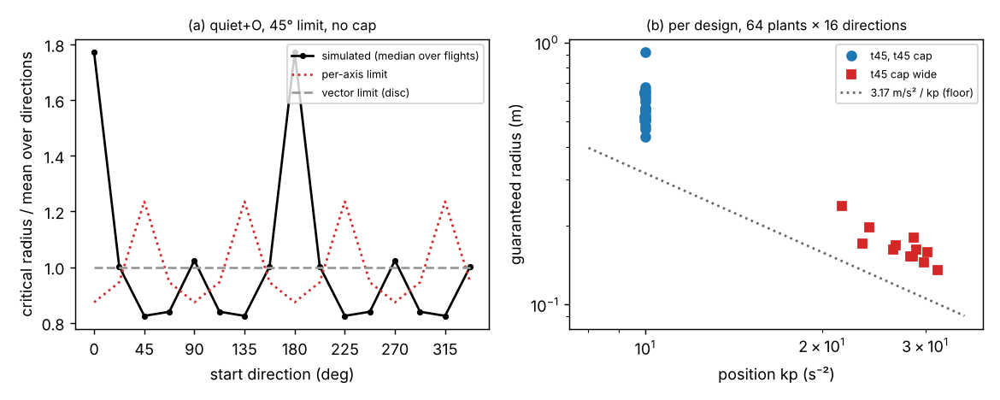

Yesterday's [codesign-cant](../../research/codesign-cant/) run found that
the start offset a quadrotor survives at a 45° tilt-command limit is an
acceleration, not a distance. If the position gain triples, the safe step
shrinks to a third. That result came from a grid of 14 offset sizes along
64 random directions, so it could not give a radius that holds in every
direction. It also could not say what shape the safe region has. The tilt
command is clipped per axis, which suggests a square. The proportional
request, kp · |e|, suggests a disc.

## The test

We took the same 36 designs (24 at kp ≈ 10, twelve at kp 22 to 31) and
the same 64 held-out plants. For each plant we bisected the critical
start radius to 3 mm along 16 directions, one every 22.5°. We ran it once
with every other disturbance off and once, at 8 directions, with
everything on. We also flew the 3.5 m/s² acceleration cap from 3 m in
every direction. Seven predictions were committed to the log before the
code was written. Three held. The run took 27 minutes on four cores.

## What it found

- **The bisection agrees with the grid.** Interpolated to yesterday's
  random directions, the bisected radii predict 97.7% of its 2,304
  outcomes. Of the flights that die at their critical radius, 99.9% also
  die at 1.5 times it, so each direction has a single edge.
- **The safe region is neither a square nor a disc.** Relative to each
  flight's mean, the radius is 1.77 along ±x, 1.02 along ±y and 0.83 on
  the diagonals. It is mirror-symmetric, but turning it by 90° does not
  give the same shape, as it would for a symmetric airframe. Both of our
  candidate shapes were wrong.
- **The canted rotors' side force is the cause.** With the side force
  switched off in the simulator, the x and y radii agree within 5% for
  all 1,065 flights we could compare. With it on, none of 994 do. This is
  the same one-axis effect an earlier milestone found in position hold,
  where the side force hurt one horizontal axis 1.9 to 3.4 times more
  than the other. Here it shows up in how far the drone can start.
- **The guaranteed radius.** Over 64 plants and 16 directions, each
  design survives every start within 0.44 to 0.92 m at kp ≈ 10, and
  within 0.14 to 0.24 m at kp 22 to 31. For 33 of 36 designs the worst
  direction is at 67.5°, which is neither an axis nor a diagonal.
  Expressed as a request, kp · r never fell below 4.00 m/s². That is a
  little under the 4.3 m/s² that random directions gave.
- **The cap holds, within a range.** With the 3.5 m/s² cap, 9 of 55,296
  flights die from a 3 m start. All nine are on one design (kp 30) and
  three of its plants. Up to 1 m, the cap still saves every flight.

## What a builder takes from it

For a tune at a 45° tilt limit, keep the takeoff or waypoint step under
about 4.0 m/s² divided by the position gain, in every direction: 0.40 m
at kp 10, 0.13 m at kp 30. Alternatively, clip the proportional term's
request at 3.5 m/s². On a canted airframe the strong axis flatters a
stress test. Test the weak axis and the directions between it and the
diagonal.

## Limits

This is one simulator, with one geometry pair, lever 0, and one held-out
seed of 64 plants. The 16 directions resolve the worst one to 22.5°, so a
narrow worse direction between grid angles is not ruled out. "Guaranteed"
means over the plants and directions we searched. The 45° limit, the 60°
crash angle and the 3.5 m/s² cap are inherited settings. The numbers are
in [`stats.txt`](../../research/codesign-cant/experiments/m7an_bisect/stats.txt);
the predictions and outcome are in the programme's
[log](../../research/codesign-cant/LOG.md).
