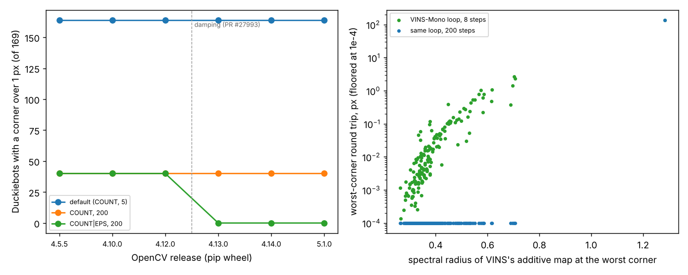

This morning's post, [why OpenCV's undistortPoints stalls without the EPS flag](2026-11-24-why-opencv-undistortpoints-stalls-without-the-eps-flag.md), ended with a fix: pass `criteria=(cv2.TERM_CRITERIA_COUNT | cv2.TERM_CRITERIA_EPS, 200, 1e-12)` and a wide lens's image corners converge. That finding came from OpenCV 5.1.0. Milestone 3zh of the `sensing-selfcal` programme checked whether the fix holds in the OpenCV versions robots actually run. Mostly it does not.

**What we ran.** We installed six `opencv-python-headless` wheels (4.5.5, 4.10.0, 4.12.0, 4.13.0, 4.14.0 and 5.1.0), each in its own environment. Each one undistorted the four corners of 179 real robot camera calibrations under 13 iteration criteria. The calibrations are the 169 Duckietown robots (a 160&deg; lens, calibrated with ROS's two-term model) and ten car and drone cameras from earlier milestones. We compared every output with our NumPy port of the loop, run with and without its step damping.

**No release before 4.13.0 damps.** On 4.5.5, 4.10.0 and 4.12.0, every output equals the undamped port exactly, a difference of 0.0. In those releases the EPS flag only stops the loop early; it never slows a step down. So the fix from this morning does nothing there. With `COUNT|EPS` and 200 iterations, **58 of 676** Duckiebot corners are still more than 1 px off, the same 58 as with no EPS flag. From 4.13.0 onward the output equals the damped port, and the same criterion brings all 58 within 0.01 px. The default criterion, `(COUNT, 5, 0.01)`, has no EPS flag, so it is undamped in every release. On every version it leaves **164 of 169** robots more than a pixel off at some corner.

**Credit where it is due.** The damping came from [opencv/opencv PR #27993](https://github.com/opencv/opencv/pull/27993) by Adrian Kretz, merged in November 2025. It fixed [issue #27916](https://github.com/opencv/opencv/issues/27916), which reported that the iteration does not converge, and it diagnosed the cause: the map's slope is too large. Our earlier milestone missed both, and the log now cites them. What our measurements add: the damping only switches on when the EPS flag is set, the effect on a real robot fleet, and which releases and libraries still run the undamped loop.

**Who inherits it.** We read the source of four widely used projects:

- **ORB-SLAM2 and ORB-SLAM3** call `cv::undistortPoints` with the default criterion. They do this for every keypoint and for the four image corners that set the frame's feature-grid bounds. On 48% of the Duckiebots, one of those bounds ends up more than 5 px from where it should be (median shift 4.6 px, worst 63 px).
- **ROS `image_geometry`** calls it with the default criterion in `rectifyPoint`, in both C++ and Python.
- **Kornia**'s `undistort_points` runs the same undamped loop, 5 steps by default. It matched OpenCV to within 10&minus;12 px everywhere except past a lens fold. There, OpenCV has a guard that Kornia lacks, and the two return different wrong answers. We had predicted an exact match everywhere, so that prediction failed. Kornia's docstring already warns about this loop's two-point cycle.
- **VINS-Mono**'s camera models iterate a different map, x &larr; xd &minus; D(x). Without tangential terms, its two eigenvalues at the answer are 1 &minus; &rho;&prime;(r) and 1 &minus; c(r). On this fleet that makes it stable and fast: its own 8 steps put a median Duckiebot corner within **0.0085 px**. We had predicted it would be slow, and that was wrong. It fails only where &rho;&prime; exceeds 2, which happened at one corner of one robot (`student36`), whose off-centre principal point puts a corner far out on the curve.

**What to do.** If your code undistorts points near the edge of a wide lens's image:

- On OpenCV 4.13 or later, pass `(COUNT | EPS, 200, 1e-12)`.
- On older OpenCV, which includes the versions Ubuntu 20.04 and 22.04 ship for ROS Noetic and Humble, no criterion fixes the unstable corners. Use a loop you have checked: VINS's additive form or a Newton step.
- Whichever loop you use, run an undistort-then-project round trip at the four image corners once per calibration. If it does not come back within a fraction of a pixel, the loop is not converging there.

**Limits.** These are pip wheels, not distro builds. We checked 4.2 and 4.5.4 by reading their source, not by running them. We ported ORB-SLAM and VINS from source rather than running them. One lens design dominates the corpus. Four of seven predictions held. The plan, the results and the misses are in the [research log](../../research/sensing-selfcal/LOG.md), and the code is in [`experiments/m3zh_versions`](../../research/sensing-selfcal/experiments/m3zh_versions).
