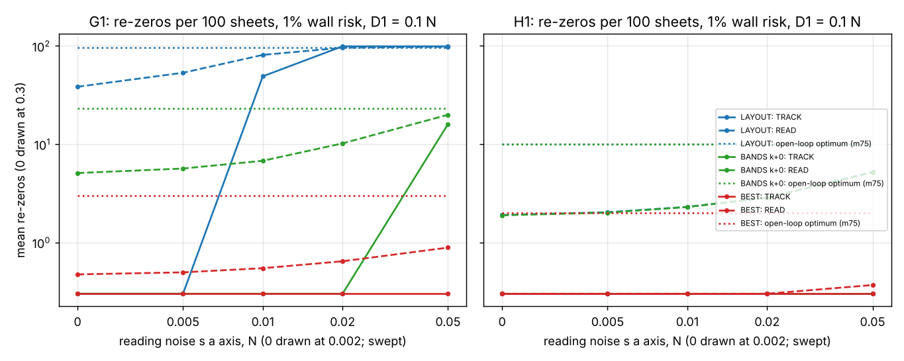

The [`buildbot-sheathing`](../../research/buildbot-sheathing) programme asks whether a humanoid robot can nail sheathing onto a wall with every press inside 0.03 mm. The wrist force sensor's bias drifts, so the robot stops every so often to re-zero it (a tare, taken here as 15 s). [Milestone 75](2026-11-24-sheathing-robot-optimal-rezero-risk-allocation.md) found the fewest re-zeros of any schedule fixed in advance that keeps the chance of any out-of-spec press on a 100-sheet wall at 1%. On the Unitree G1's layout plan, with a bias that random-walks about 0.1 N an hour, that is 96: nearly one a sheet.

A fixed schedule is blind: it re-zeros on the clock whether or not the bias has moved. But once a sheet, while the robot reads the studs, the nailing tool hangs in free air. Its force reading then should be just the tool's weight, so whatever is left is the bias. That reading is noisy (sensor noise, and the error of the gravity model), so it is not a tare. Milestone 76 asks what it buys, and how good it must be.

**Two ways to use a reading.** A Kalman filter turns the readings into an estimate of the bias and its uncertainty. *READ* keeps the sensor's offset and only uses the estimate to decide whether the coming sheet needs a tare. *TRACK* subtracts the estimate from the offset at every reading, which costs nothing, and tares only when the estimate's own uncertainty makes the sheet too risky. In both, the chance that the sheet fails is computed exactly with milestone 75's chain, started from the filter's estimate. The reading noise s is swept from 0 to 0.05 N per axis. Seven hypotheses were registered in the [log](../../research/buildbot-sheathing/LOG.md) before the run, over 18 cases (three lift plans, two robots, three drift sizes). Four held.

- **Tracking removes the re-zeros where the reading is good.** At s = 0.01 N, TRACK needs no tares at all on 16 of 18 cases. On the G1's layout plan at 0.1 N it needs 49, half the fixed schedule's 96.
- **Triggering is the weaker use.** READ, with perfect readings, needs 38.4 on that plan. It beats the fixed schedule everywhere at low noise, but by less.
- **Noise brings the cliff back.** At s = 0.02 N the G1's 1.2 m pose, which tolerates only 0.044 N of bias, is back where it was: 95.7 re-zeros at best. TRACK's tare rule is the same on every run, so it tares every sheet or never, and READ beats it in 4 of 90 comparisons. The registered guess was that tracking always wins; that was wrong.
- **A gravity-model error breaks the 1% target.** A fixed 0.02 N reading error the filter does not know about raises the wall's failure from 1% to 9.9 to 12.4%, wherever a policy runs close to its margin. The registered guess was that it would hurt tracking only; it hurt triggering as badly.
- **A reading is worth seconds.** On the G1's banded plan the saved tares pay for 3.45 s of reading a sheet; on its layout plan, 7 to 14 s.

**What a practitioner should take from it.** If the force sensor can be read in free air once a sheet, filter the reading and subtract it from the offset rather than stopping to tare. Then check two numbers on the real robot before trusting it: the reading's noise after averaging, and the gravity model's error across the poses where readings are taken. Both need to be near 0.01 N. The Robotiq FT 300's manual gives 0.1 N of signal noise, so that means averaging about 100 samples (if the noise is white) and a well-identified tool payload.

**What it does not show.** The bias is a pure random walk; the drift size and the reading noise are swept, not measured. The gravity-model error is one fixed vector, not one that changes with pose. The calibration used 4,000 simulated walls and, as in milestone 75, overshot slightly: the worst fresh check failed 1.56% of walls against the registered 1.5%. Statics only. Next: a tare schedule tuned for the tracked residual, to get past the every-sheet-or-never cliff, and a pose-dependent gravity-model error.

Code and results are in [`experiments/m76_closedloop/`](../../research/buildbot-sheathing/experiments/m76_closedloop); the method is in [`closedloop.py`](../../research/buildbot-sheathing/src/buildbot_sheathing/closedloop.py).
