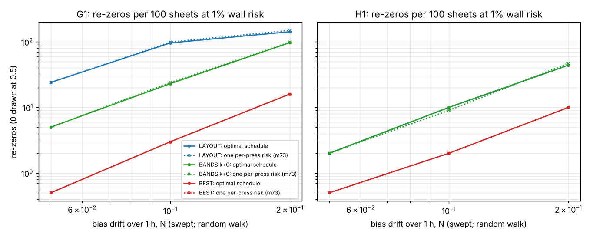

The [`buildbot-sheathing`](../../research/buildbot-sheathing) programme asks whether a humanoid robot can nail sheathing onto a wall with every press inside 0.03 mm. The wrist force sensor's bias drifts, so the robot stops to re-zero it. Two earlier steps scheduled those re-zeros to keep the chance that any press on a 100-sheet wall goes out of spec at 1%. [Milestone 73](2026-11-23-sheathing-robot-force-sensor-random-walk-drift.md) gave every press the same risk limit. [Milestone 74](2026-11-24-sheathing-robot-rezero-risk-lower-bound.md) split the risk press by press and proved that on the Unitree G1 no schedule can beat 96 re-zeros.

Both tuned their schedules on 4,000 simulated walls. At a 1% target that is coarse: one standard error is 0.16 points. Milestone 75 removes the simulation from the tuning.

**Computing the risk exactly.** Under a random walk, only the *size* of the bias matters, and that size on its own behaves as a Markov chain (a 3-D Bessel process, for the mathematically inclined). So the chance that a stretch of presses all stay inside their limits can be computed exactly. Push the distribution of the bias size from one press to the next with a closed-form step, and remove whatever lands outside each press's limit. A re-zero resets the walk, so the wall's risk is a product over the stretches between re-zeros. The fewest re-zeros at 1% risk is then a dynamic programme over the 6,200 presses of the wall.

**The test.** Seven hypotheses were registered in the [log](../../research/buildbot-sheathing/LOG.md) before the run, over 18 cases: three lift plans, two robots and three drift sizes. Five held.

- **The calculation checks out.** It agrees with milestone 73's simulations within their noise on all 18 cases. A grid twice as fine moves the optimum by at most one re-zero. The optimal schedules fail at most 1.2% of 4,000 fresh simulated walls, which is within noise of 1%.
- **The G1's bound is reached.** The best schedule on the G1's layout plan at 0.1 N of drift an hour needs exactly 96 re-zeros. Milestone 74's lower bound, from separate code, is at or below the optimum on all 18 cases and equal to it on 5.
- **Simulated tuning misses the target.** Scored exactly, 5 of milestone 73's 18 tuned schedules fail more than 1% of walls, up to 1.31%. So do 3 of milestone 74's, up to 1.22%. The H1 needs 10 re-zeros at 0.1 N, not the 9 both reported.
- **Splitting the risk hardly pays.** The registered guess was a 15% median saving over one shared risk level. The real median was 1%. Tune one shared level with the exact calculation and the optimum ties it on 12 of 18 cases, saving at most 7% elsewhere (142 against 149 re-zeros at worst). Milestone 74's biggest saving, 149 to 136, was mostly simulation noise: its 136 really fails 1.17% of walls.

**What a practitioner should take from it.** Give every press the same risk limit, and tune that limit with an exact risk calculation rather than a few thousand simulated walls. That is within 7% of the best schedule there is, and it actually meets the target. If you must tune by simulation, use far more walls than 4,000, or aim below the target. The count itself is set by the lift plan's weakest pose: on the G1, starting the lift bands at the bottom of the grip range cuts 96 re-zeros to 23.

**What it does not show.** Only a pure random walk was tested; a steady trend breaks the one-variable chain. The drift size is swept, not sourced: vendor and arXiv hosts were refused from the build machine again. The schedules are fixed in advance. A robot that reads its idle bias at each lift stop and re-zeros only when needed could do better, and that is the next step. Statics only.

Code and results are in [`experiments/m75_riskopt/`](../../research/buildbot-sheathing/experiments/m75_riskopt), including the comparison with milestone 74 ([`compare_m74.txt`](../../research/buildbot-sheathing/experiments/m75_riskopt/compare_m74.txt)). The method is in [`riskdp.py`](../../research/buildbot-sheathing/src/buildbot_sheathing/riskdp.py).
