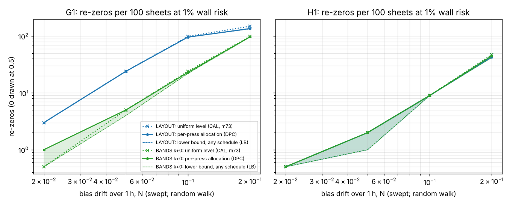

The [`buildbot-sheathing`](../../research/buildbot-sheathing) programme asks whether a humanoid robot can nail sheathing onto a wall with every press inside 0.03 mm. The wrist force sensor's bias drifts, so the robot has to stop and re-zero it. [Milestone 73](2026-11-23-sheathing-robot-force-sensor-random-walk-drift.md) found that if the bias random-walks, a schedule needs far more re-zeros than a straight-line drift reading suggests. It also found a cliff on the Unitree G1. Its weakest press pose, at 1.2 m, needs a re-zero about every 109 s, and hanging a sheet takes 116 s. So the G1 needed one re-zero per sheet, 99 on a 100-sheet wall, and no single per-press risk level landed between 0% and 11% wall failure.

Milestone 74 asks whether that cliff came from using one risk level for every press. If the weak presses got a smaller share of the risk and the others a larger one, could the G1 do better?

**The method.** A schedule splits the wall's 6,200 presses into segments, each starting with a re-zero. The bias walks independently in each segment, so risks add across segments. Two segment risks give two answers:

- **Sum of each press's failure chance.** This is an upper bound on the wall's risk. The fewest re-zeros that keep the sum under 1% is the best per-press split the union bound allows.
- **Largest single press's failure chance.** A segment fails at least that often, so this gives a lower bound. No schedule with 1% wall risk can use fewer re-zeros than the count it gives.

Both are solved exactly by one dynamic programme. Every sheet is the same, so each press's risk depends only on its place in the sheet and the time since the last re-zero. Brute force agrees with the programme on small walls. A third schedule raises the budget until a 4,000-path simulation shows 1% wall failure, then is checked on 4,000 fresh paths. Five hypotheses were registered in the [log](../../research/buildbot-sheathing/LOG.md) before any code was written.

**What came out.** Four of the five held.

- **The cliff belongs to the wall.** On the G1's layout plan, with 0.1 N of drift in the hour's reading, the lower bound is 96 re-zeros. The calibrated per-press split reaches exactly 96, against 99 before. Skipping one more re-zero leaves two weak presses near 116 s after a re-zero, and the 1% budget runs out after three such sheets. No split of the risk can fix that.
- **The best schedule doesn't re-zero just before the weak nail.** It re-zeros 16 presses earlier, on 82 of its 96 re-zeros. That puts the weak presses 30 to 47 s into the segment. The rest of the sheet, with larger allowances, takes the long wait.
- **Splitting the risk beats the union bound's single level.** It needs fewer re-zeros on 17 of 18 large cases, and 12 instead of 16 on the H1. This needs no simulation, so it is the version to use without a simulator.
- **But it barely beats a calibrated single level.** It saves 0 to 9% (at most 149 to 136) and wins on 9 of 20 cases. The registered bar was half, so this one was refuted. On two cases it needed one re-zero where the single level needed none. That came from the calibration search, which never tests its upper end, not from the split.
- **The bounds nearly meet.** Wherever the schedule needs 10 or more re-zeros, it is within 10% of the lower bound (median 1.3%). For this drift model, the best re-zero count is known to within a few re-zeros.

**What a practitioner should take from it.** Once a schedule is calibrated in simulation, how the risk is split between presses hardly matters. What matters is the weakest pose the lift plan makes the robot use. At 0.1 N of drift the G1 needs 96 re-zeros on its layout plan, 23 with its lift bands started at the bottom of the grip range (2.97% of the sheet cycle at 15 s a re-zero), and 3 with every nail at its best pose. Each is close to its own lower bound. The next step is to choose the pose plan and the schedule together.

**What it does not show.** The drift size is still swept, not sourced, and the walk is an isotropic 3-D Brownian motion with no warm-up after power-on. Presses are checked only at their ends. The lower bound holds for this drift model, not every drift law. Everything is offline statics on milestone 71's allowances.

Code, results and the figure are in [`experiments/m74_allocate/`](../../research/buildbot-sheathing/experiments/m74_allocate); the programme is in [`allocate.py`](../../research/buildbot-sheathing/src/buildbot_sheathing/allocate.py).
