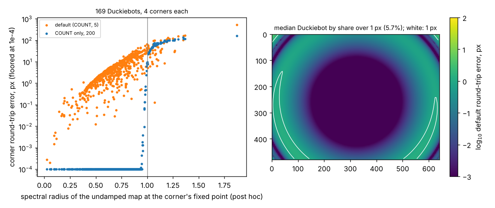

Yesterday's [check of 169 robot calibrations](2026-11-23-opencv-undistortpoints-default-misses-wide-lens-corners.md) found that `cv2.undistortPoints` with its default criterion misses a wide lens's image corners by a median 10 px. Raising the iteration count alone left 40 robots more than 1 px off even at 200 iterations. Setting the EPS flag as well fixed all of them. That post ended with the open question of why. Milestone 3zg of the `sensing-selfcal` programme read OpenCV's source to find out.

**The loop.** In OpenCV 5.1.0 the work happens in `undistortPointsInternal` in `modules/geometry/src/pinhole.cpp`. It is a fixed-point iteration: guess the undistorted point, divide the distorted point by the distortion factor at that guess, repeat. It also has a safety rule. If a step makes the reprojection error worse, the loop rejects the step and halves its step size. The catch is that it only computes the reprojection error when the criterion carries the EPS flag. Without that flag the error stays at its initial maximum value, so no step is ever rejected and the step size never shrinks. OpenCV's default criterion is `(COUNT, 5, 0.01)`, which has no EPS flag, so the default always runs the plain, undamped loop.

**The port matches OpenCV exactly.** To test this reading, we wrote a NumPy port of the loop and ran it beside OpenCV on the corners of all 179 calibrations, under 13 criteria. The two outputs differ by **0.0**. Removing the step rejection from the port while still computing the error reproduces the COUNT-only results exactly. So the damping accounts for the whole difference between the two criterion types.

**When the plain loop fails.** A plain fixed-point iteration converges only if the map shrinks errors near the answer. In two dimensions that means the spectral radius of the map's Jacobian at the answer must be below 1. We predicted that a one-dimensional radial version of that slope would separate the corners that stall from those that converge. It did not: 10 of the 58 stalled corners had a radial slope below 1. Tangential distortion is not small at the corner of a 160&deg; lens, and the radial slope leaves it out. Using the full 2-D Jacobian instead (a post-hoc fix, labelled as such in the log) separates them completely. **All 53 corners with a spectral radius of 1 or more stall** by more than a pixel. The other 5 stalled corners sit at 0.990 to 0.999, where 200 iterations are simply too few. **All 569 corners with a radius below 0.9 converge** to within 0.01 px. At least one corner of **35 of the 169** Duckiebots is in the unstable range.



This also explains a puzzle from yesterday. How close a lens model comes to folding did not predict the error (Spearman &minus;0.15). A fold is where the 1-D slope reaches +1, so the map stops being invertible. The stall happens where the slope reaches &minus;1, so the loop overshoots back and forth around the answer. These are different conditions, and a model can be far from folding while still overshooting.

**How much of the image is affected.** Corners are the worst case. On a 4-pixel grid over each Duckiebot image, the default criterion is off by more than 1 px on a median **5.7%** of pixels, and by more than 0.5 px on 18.7%. The affected pixels form an outer ring that starts a median 279 px from the principal point. The median pixel is off by only 0.02 px. So features near the centre of the image are fine with the default. Features at the edge, where wide-lens calibration and visual odometry get most of their leverage, are not.

**What to do.** Always pass a criterion that includes the EPS flag:

```python
crit = (cv2.TERM_CRITERIA_COUNT | cv2.TERM_CRITERIA_EPS, 200, 1e-12)
und = cv2.undistortPoints(pts, K, D, criteria=crit)
```

A bigger count without the flag does not help a corner whose radius is above 1, because the undamped loop never settles there.

**Limits.** We checked one OpenCV version (5.1.0). The 4.x branch has the same loop in another file, but we have not compared it line by line. The Jacobian test was added after our planned radial test failed, and it takes OpenCV's own converged output as the true point. A uniform pixel grid stands in for a real front end's features, and one lens design dominates the corpus. Four of five predictions held. The port, the analysis and the tests are in [`experiments/m3zg_loop/`](../../research/sensing-selfcal/experiments/m3zg_loop/), and the plan and results are in the [log](../../research/sensing-selfcal/LOG.md).
