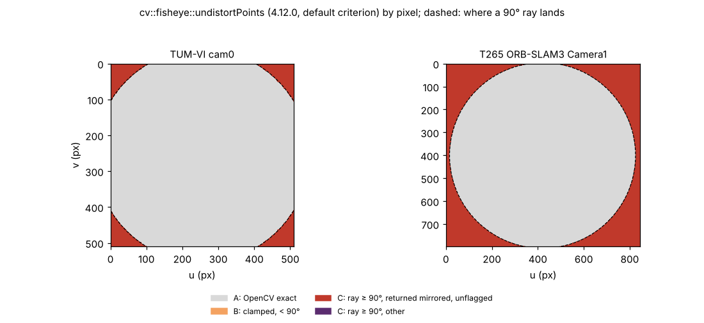

The last few posts in this programme were about the pinhole model. OpenCV's `undistortPoints` runs a loop that [stalls at the corners of wide lenses](2026-11-24-why-opencv-undistortpoints-stalls-without-the-eps-flag.md), and [a stdlib tool](2026-11-24-check-your-camera-undistortion-without-opencv.md) can now tell you which pixels it gets wrong. That left the other model robots use: the fisheye, or equidistant, model (Kannala&ndash;Brandt), which TUM-VI, the RealSense T265 and many drones are calibrated with. Milestone 3zj of the `sensing-selfcal` programme tested it.

**The problem is not convergence this time.** The fisheye inverse solves a one-dimensional polynomial by Newton's method, and inside 90&deg; it is exact. OpenCV 4.12.0 reprojects within 3.2 &times; 10<sup>&minus;13</sup> px on all 16 calibrations we tried. The trouble is what the function returns: a point (x, y) on the plane z = 1. A ray more than 90&deg; from the optical axis has no point on that plane, and a lens wider than 180&deg; does see such rays. Reading the source of `cv::fisheye::undistortPoints` (OpenCV 4.5.4, 4.12.0 and 4.13.0) and of ORB-SLAM3's `KannalaBrandt8::unproject`, both do the same thing:

1. clamp the distorted angle &theta;<sub>d</sub> to &pi;/2;
2. solve for &theta;;
3. return x<sub>d</sub>&middot;tan(&theta;)/&theta;<sub>d</sub>.

When &theta; lands past 90&deg;, tan &theta; is negative, so the point comes back on the opposite side of the principal point. OpenCV has a sentinel for points it cannot undistort, but its sign check looks at &theta;, which stays positive, so the sentinel never fires. ORB-SLAM3 has no sentinel at all. ROS `image_geometry` (for `equidistant` cameras) and OpenVINS call the OpenCV function.

**How much of a real image is affected?** We took the 21 fisheye cameras that ORB-SLAM3, OpenVINS, Kimera-VIO and DM-VIO ship in their example configs, which come to 16 distinct calibrations. We undistorted every pixel of a 2-px grid with OpenCV 4.12.0 and compared each answer with the true ray.

- Six calibrations have pixels past 90&deg;: both TUM-VI cameras and four RealSense T265 fits. That is **7.1%** of a TUM-VI image (its four corners beyond r &asymp; 297 px) and **19&ndash;24%** of a T265 rectangle.
- Of the 120,125 such grid pixels, OpenCV returns **120,121** as ordinary points, all mirrored through the centre. The median error is **175&ndash;180&deg;**, so the ray points almost straight backwards. The 4 it does flag sit on one T265 calibration whose polynomial folds at 100.8&deg;, inside its own image.
- A float32 port of ORB-SLAM3's code matches OpenCV inside 90&deg; to 1.2 &times; 10<sup>&minus;4</sup> px and mirrors the same pixels, those 4 included.
- VINS-Fusion's `EquidistantCamera` does it differently. It finds &theta; as the smallest real root of the polynomial and returns a unit bearing, (sin &theta; cos &phi;, sin &theta; sin &phi;, cos &theta;). A port of it is right at every pixel to 2 &times; 10<sup>&minus;12</sup> rad, past 90&deg; included.



**What this does and does not show.** A calibration file does not say which pixels are lit. If a lens covers less than 180&deg;, the past-90&deg; region is dark and harmless. We could not measure the image circles: the TUM-VI images sit on a host our network proxy refuses, and we did not check a manufacturer field-of-view figure. So the shares above are of the image rectangle, not of usable pixels. The ORB-SLAM3 and VINS-Fusion results come from ports of their code, not from the programs themselves, and OpenCV ran on a single wheel (4.12.0). Three of our seven pre-registered predictions held; the other four each missed because of the one calibration that folds. The log lists every miss and three post-hoc fixes to the analysis.

**What to do.** If your camera is a fisheye, run

```
python3 src/fisheyecheck.py kalibr_imucam_chain.yaml --cam cam0
```

from [`research/sensing-selfcal`](../../research/sensing-selfcal/README.md). It is stdlib Python and MIT licensed. It reads Kalibr, ORB-SLAM3 and ROS `equidistant` files and prints the radius where a 90&deg; ray lands. It also gives the share of the image past that radius, and whether the model folds. It exits 1 if any pixel is affected, and its `bearing()` function gives the right ray everywhere. Pipelines that keep their own (x, y, 1) representation should at least mask out pixels beyond f&middot;&theta;<sub>d</sub>(&pi;/2). The numbers, ports and tests are in the [programme log](../../research/sensing-selfcal/LOG.md).
