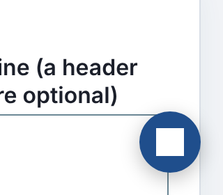
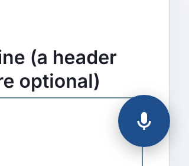

# Polish 2026-11-10: floating mic icon drew a white square on 65 tool pages

**Found.** I took 390 px screenshots (light and dark color scheme) of the hub, /writing/, two posts, /research/, /stories/ and four flagships (ai-bookkeeper, changepoint-detector, shift-roster-builder, sales-agent). None scrolled sideways. On changepoint-detector and shift-roster-builder, the floating "Speak or type" button showed a white square where the mic should be. Cause: those pages style a bare `svg { background: #fff }` for their charts, and the button injected by `assistant.mjs` inherited it.

**Measured.** I loaded all 1,338 tool pages (top-level folders that load `pf-site.js`) at 390 px in headless Chromium, with external requests blocked:

| | before | after |
|---|---|---|
| pages showing the button | 955 | 955 |
| icon blank (white path on white svg background) | 65 | 0 |
| icon wrong size (wall-framing-takeoff: 22x22, bordered cream svg) | 1 | 0 |

 

The before image was rendered by serving the old launcher CSS to the same built page. The after numbers come from the built `pf-site.js`, with its launcher CSS replaced by the new source string. I did not run a full rebuild after the fix.

**Changed.**
1. `assistant.mjs` launcher CSS: `.pf-ask-voice svg{flex:none;width:20px;height:20px;background:none;border:0}` and `.pf-ask-voice path{fill:currentColor}`. I merged two duplicate `@media (max-width:560px)` blocks and a separate transition rule to keep the launcher under its 3,600-byte test budget (3,525 to 3,598). That leaves 2 bytes, so the next addition to the launcher needs a budget decision.
2. `assistant.test.mjs`: a new test pins the reset.
3. New `platform/pages/ask-voice-icon.mjs` is the browser sweep, documented in `platform/pages/README.md`. It exits 1 and lists each failing page.

**Noticed, not changed.**
- Venture tool pages ignore `prefers-color-scheme: dark` and render light. Site-owned pages (/writing/, /research/) do follow the dark scheme. This looks deliberate, but no note says so.
- On the hub at 390 px the header shows no Search pill, while /writing/ shows a plain "Search" text link and tool pages show a pill. The three header variants are inconsistent.

**Next.**
- Add `ask-voice-icon` to `platform/ci/browser_checks.py`. That is control-plane CI, so it goes in its own PR.
- Raise or rethink the launcher's 3,600-byte budget. 2 bytes are left.
- Make the header Search control the same across the three page families.
- Run Lighthouse on one flagship. No polish run has recorded Lighthouse numbers yet.
