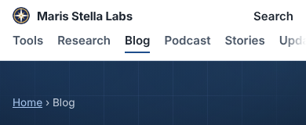
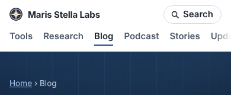
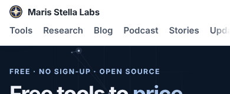
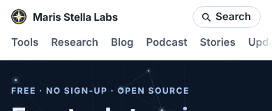

# Polish 2026-11-11: one header Search control on every page family

**Found.** This picks up the 2026-11-10 note (mic-icon report, "Noticed, not changed"). Below 1080 px the header's Search control had three forms:

| page family | before | after |
|---|---|---|
| site pages (/writing/, /research/, /compare/ ...) | bare bold text "Search" | pill with a magnifier |
| venture tool pages | pill, no icon | the same pill, with the magnifier |
| hub | nothing | the same pill, below 1080 px only |

On the hub, the hub's own `#search` form sits 681 px down at 390 px (input at 706 px) and 655 px down at 1280×800. That is in view on a desktop but below the fold on most phones, so the phone header now links to it. On a wide screen the hub still shows no control.

**Changed** (`platform/pages/site-nav.mjs`, `build.mjs`):
1. `SITE_HEADER_CSS` draws `.pfs-searchlink` as a pill (border `var(--pfs-line)`, radius 999px) with a 15 px `::before` magnifier. The magnifier is the same `--pfs-glass` SVG mask the desktop form used. `--pfs-glass` moved from `.pfs-search` to `[data-pfs-head]`, because the venture header has no form. The link displays `inline-flex`.
2. `renderSiteHeader` takes a new `search: 'narrow'` mode (the link without `pfs-always`), and it is the hub's default.
3. Deleted the duplicate venture pill rule in build.mjs (`.pf-chrome-top .pfs-searchlink{padding:4px 14px;border:1px solid var(--pf-line)...}`). `VENTURE_CHROME_CSS` keeps the colours and now applies to every `.pfs-searchlink`, plus a hover border.
4. Tests in `site-nav.test.mjs`: the hub renders the phone-only link with no form and no `pfs-always`, and the pill rule, glass mask and header-level `--pfs-glass` stay in the shared CSS. 16/16 pass.

**Measured** (local full build, headless Chromium, external requests blocked):
- At 320 px, light theme: `scrollWidth` equals the viewport on the hub, /writing/, /research/ and /ai-bookkeeper/. The pill's right edge is at 304 px (16 px gutter) and it is 31 px tall (33 px on the venture page).
- At 390 px, dark theme: same geometry. The border is faint on dark but visible (see `after-dark` screenshots in the session, not committed).
- At 900 px, site page: pill at the right of the nav row. At 1280 px: the desktop form, unchanged.

Before / after, 390 px:

**Not measured.** Lighthouse. Still no polish run has recorded Lighthouse numbers. The research builder (`research/_homepage/build.py`) takes its header from `writeResearchChrome`, so it picks up the change. /research/ was checked above.

**Next.**
- Lighthouse on one flagship (ai-bookkeeper or wall-framing-takeoff): the oldest open item in these notes.
- The pill border is decorative-strength: `--pfs-line` against the header is 1.39:1 in light (#d3dce6 on #ffffff) and 1.33:1 in dark (#2a343f on #171e27), computed with the WCAG formula. The "Search" text and the icon in ink carry the affordance, as the tool-page pill always did. A stronger outline would need its own token and is worth a look on a later pass.
- `DEFAULT_BASE_URL` is in open PR #14596. Don't duplicate it.
