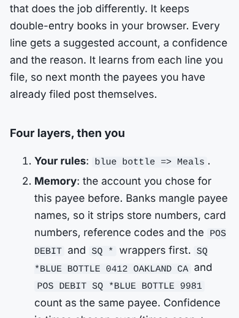
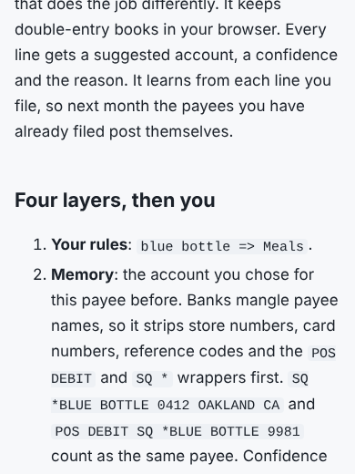

# Polish 2026-11-11: desktop Lighthouse, then 415 pages fixed by three renderer changes

**Why this item.** "Run `lighthouse.mjs --form=desktop`. Nobody has measured desktop" was
item 2 in `polish-2026-11-11-lighthouse-first-numbers.md` and still open in every later note.

## 1. Desktop: nothing to fix

Lighthouse 13.6.0, `--form=desktop`, local full build, the 16 default pages:
performance 100, accessibility 100 and SEO 100 on every page. Best practices is 100 on the
5 site pages and 96 on the 11 venture pages. The only failing audit there is
`errors-in-console`, from the usage beacon and Google Fonts, which do not resolve in a cloud
session (documented in `lighthouse.mjs`). FCP is 207 to 386 ms, TBT 0 to 51 ms, CLS at most 0.017.

## 2. A mobile sample beyond the default 16

Every audit so far ran on the same 16 pages, so I sampled 16 other page types
(mobile, one run each): `/guides/`, `/compare/`, one compare product page, two research
papers, a post, `/about/`, `/ask/`, `/custom-development/` and six non-flagship tools.

| page | perf | a11y | finding |
|---|---|---|---|
| /ask/ | 89 | 100 | CLS 0.219: the whole article moved down 460 px when the assistant mounted |
| /compare/acculynx/ | 100 | 98 | `heading-order`: h1 then card h3 |
| /guides/ | 82 | 100 | TBT 656 ms (not changed; see "Next") |
| /bai2-statement-reader/ | 92 | 100 | TBT 343 ms (not changed) |
| the other 12 | 94 to 100 | 100 | - |

(`/stories//` also showed `target-size`, but that was my doubled slash breaking the
stylesheet path, not the page. That trap is now in the README.)

A scan of the whole build for the heading skip (now `heading-order.mjs`) found it on 414 pages
the site build writes: **352 blog posts** (`writing/`), all **45 compare product pages**, and
**17 category pages** with no subgroups.

## What changed

1. **Blog and devlog headings** (`platform/devlog/markdown.mjs`). The renderer moved every
   markdown level down one ("the page owns `<h1>`"), so a post's `##` sections became `<h3>`
   under the page's `<h1>`. With `dropTitle` (both real callers), the source's `# ` title *is*
   the page h1, so levels now render as written: `##` is `<h2>`, with a floor of h2. Without
   `dropTitle` the old shift stays. The post CSS already had an `article h2` rule that had never
   fired, so the section headings now take their intended size (1.35rem, was 1.15rem).
2. **Card titles** (`build.mjs`). On compare product pages and on category pages with no
   subgroup or audience lead, the card titles are `<h2>`. The CSS rule is
   `.card h3, .cards > .card h2`. The extra specificity beats `.subject h2`, so the cards
   render at exactly the old size: computed 16.48px, margin 7px, before and after, on
   /compare/acculynx/, /c/ci/ and /c/backoffice/.
3. **/ask/ space reservation** (`assistant.mjs`). `.ask-app` reserves `min-height:460px`, the
   inline panel's own `min-height` in `assistant/client.js`, inside
   `@media (scripting:enabled)` so the no-JavaScript page has no empty box. A test ties the
   two numbers together.
4. **`heading-order.mjs`** (new) scans a build. It exits 1 only when a page the site build
   writes has a skip, and lists venture pages with `--list`. **`heading-order.test.mjs`**
   renders every real post in `docs/posts/` through `renderPost` and asserts no skip. It fails
   on the old `markdown.mjs` (checked) and passes now, so a post with `##` then `####` fails
   CI on its own PR.

## Measured after

Lighthouse mobile, median of 2 runs on the rebuilt dist:

| page | before (perf / a11y / CLS) | after |
|---|---|---|
| /ask/ | 89 / 100 / 0.219 | 100 / 100 / 0.000 |
| /compare/acculynx/ | 100 / 98 / 0 | 100 / 100 / 0 |
| /writing/a-bookkeeper-that-learns/ | 100 / 98 / 0 (pre-fix HTML served beside the build) | 100 / 100 / 0 |
| /c/ci/, /c/food-service/ | not run before (scan showed the skip) | 100 / 100 / 0 |

A Playwright `layout-shift` observer at 412 px agrees on /ask/: 0.219 before, 0.000 after.
`heading-order.mjs` on the rebuilt dist: 8,462 pages, 0 with a skip.

Post before / after, 390 px:

## Next

1. **Headings drawn by scripts.** A first rough scan that did not strip `<script>` flagged one
   page in each of 123 venture directories. The two I opened (401k-loan-vs-withdrawal-calculator,
   speaker-fee-calculator) render their result with `<h4>` inside JavaScript template strings,
   under a `<h2>Result</h2>`. Once the result draws, that is an h2 to h4 skip. The static scan skips `<script>`, so it does not see these. A
   Playwright pass that fills the form's defaults, waits for the result, then runs
   `headingSkips` on `document.documentElement.outerHTML` would find them. The fix is probably
   one shared result renderer, not 110 edits: grep `"<h4>` under `ventures/`.
2. **/guides/ TBT 656 ms on mobile** (perf 82), the slowest page in the sample. It is a long
   index. Measure it with `--throttling=devtools` and `longtask.mjs` before choosing a fix.
3. Still open from earlier notes: `--min-a11y=100` (and now `heading-order.mjs`) in the
   nightly browser checks. That is control-plane CI, so it goes in its own PR.
