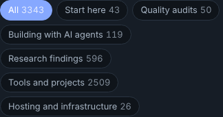
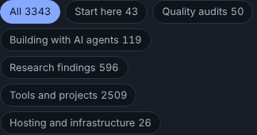

# Polish 2026-11-11: contrast on the site's index pages, and dark mode measured for the first time

**Why this surface.** The last ten polish runs added answer-first leads and fixed reflow. The 2026-11-10 report listed contrast and dark mode as "Not measured". `contrast.mjs` (axe-core, WCAG 2.1 A/AA) had only ever run in light mode.

**Measured, before.** axe `color-contrast` on the 10 index pages (hub, /research/, /writing/, /stories/, /compare/, /guides/, /about/, /engineering/, /lab/, /updates/), at 1280 and 390 px, local build, external requests blocked:

| | light | dark |
|---|---|---|
| failing nodes, before | 176 (172 real, 4 a hub fade-in caught mid-animation) | 80 |
| failing nodes, after | 0 | 0 |

The families:
- **/research/ theme colours.** 17 of the 31 light-mode `--t-*` tokens in `research/_homepage/template.html` are also small text (`.theme-tag` 11.5 px uppercase, `.theme-num` 13 px) and measured 2.58 to 4.44:1. Each one was darkened by the smallest RGB scale that reaches 4.6:1 on `--bg` #f7f8fa, so the hue stays the same. `--t-buildbot` went one step further (#9a4f00) so it doesn't land on the new `--t-swe` (#af5a00). Every dark-mode token already passed.
- **/engineering/ `--faint`.** It measured 3.45:1 in light mode and 3.8:1 in dark (76 nodes in each: dates, deltas, counts). Light #8a8994 became #706f78 (5.0:1 on white). Dark #75747f became #8e8d96 (at least 4.6:1 on both `--surface` and `--code`).
- **/writing/ topic chips.** The pressed chip painted `#fff` on the dark-mode accent #86a8ff, **2.31:1**, so every dark-mode reader saw it on the "All" chip. Its count was dimmed with `opacity:.75` (1.9:1). The fix: pressed text is `var(--bg)` (5.5:1 light, 8.0:1 dark), and the count has no opacity (unpressed count 5.5:1). Before and after, at 390 px in dark mode:
  
  
- **Site footer `code`.** The dark footer band (`SITE_FOOTER_CSS`, site-nav.mjs) kept the page's light `code` background under its #a8c7f0 link colour: **1.48:1** on /lab/. Now `footer:has(.pfs-foot) code` uses the band's own translucent fill (8.3:1). The fix is shared, so it covers any page whose footer has inline code.
- **/engineering/ scrollable tables** (found by the updated script, not a colour issue). The five `.scroll` wrappers scroll sideways on a phone but could not take keyboard focus (axe `scrollable-region-focusable`). They now have `tabindex="0" role="region" aria-label="<section title>"` and a focus ring.

**Check that keeps it fixed.** `contrast.mjs` now runs both colour schemes (`COLOR_SCHEMES=light,dark` by default, and either one can be named) and emulates `prefers-reduced-motion: reduce`, so a fade-in is read at its final colour. Run on the about, compare, engineering, guides, lab, stories and updates trees (53 pages × 4 runs): 0 violations after the scroll fix.

**False positive noted, not fixed.** In dark mode axe reports 1.01:1 for the bottom note of `hood-cleaning-bid-calculator`, `spray-foam-bid-calculator` and two other bid calculators. A screenshot shows the text inside its dark `.result` panel. The sticky panel (908 px) is taller than a 900 px viewport, and axe resolves the background past the panel's edge. A short desktop window can't see the panel's bottom while it is stuck, which is a small layout point for whoever next polishes the bid-calculator family.

**How to reproduce.** Build, serve `dist` on 8793, `npm i axe-core` somewhere and point `AXE` at its `axe.min.js`, set `PLAYWRIGHT=/opt/node-tools/node_modules/playwright/index.js`, then `ONLY_SLUGS=engineering,lab node platform/pages/contrast.mjs`. `ONLY_SLUGS=writing` sweeps all 3,343 posts and takes a long time.

**Not measured.** The full site in dark mode: 45 sampled tool and post pages in dark mode gave only the false positive above. Lighthouse.

**Next.**
1. A whole-site `contrast.mjs` run in dark mode (every 8th page is a reasonable sample). Tool pages each carry their own palette, and only 45 were sampled.
2. `contrast.mjs` cannot select "site pages only". A `SITE_ONLY=1` (top-level dirs that are not ventures, without /writing/'s posts) would make this run's check a one-liner.
3. The bid-calculator sticky panel taller than the viewport (see above).
