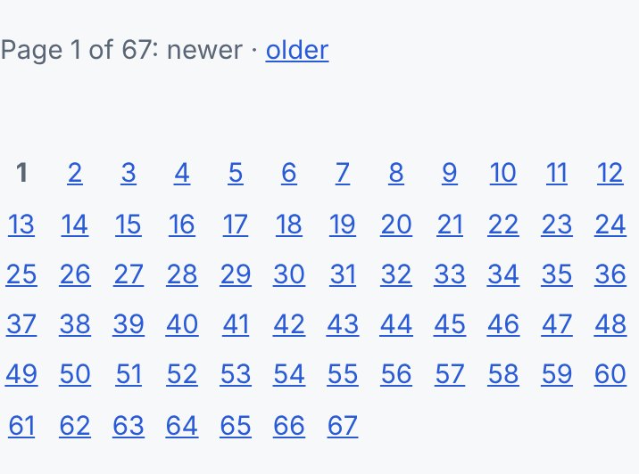
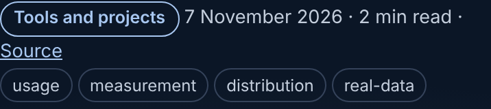
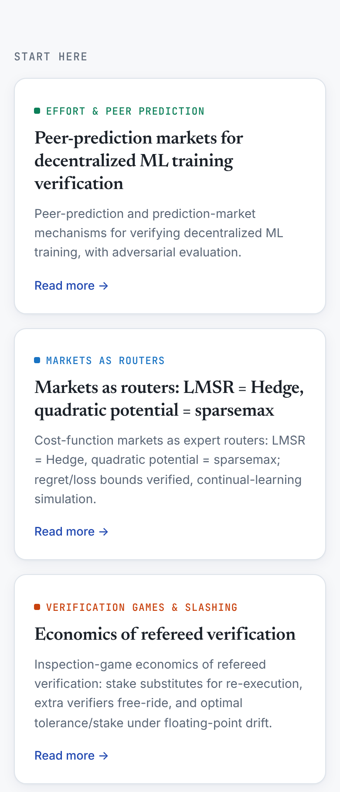

# Polish 2026-11-11: the first Lighthouse numbers, and the index-page fixes they pointed at

**Why.** Every earlier polish note listed "run Lighthouse" as not yet done. This run did it, on the
16 pages a first-time visitor is most likely to land on: the hub, /research/, /writing/, /stories/,
one post and the 11 flagships. It used Lighthouse 12.8.2 in mobile mode on the pre-installed
Chromium, against a local build. `platform/pages/lighthouse.mjs` (new) repeats the run with one
command: see `platform/pages/README.md`, "Lighthouse on the pages a visitor sees first".

**Before** (build of `main` at 7d2d368d, mobile):

| page | perf | a11y | best practices | SEO | LCP ms | failing a11y audits |
|---|---|---|---|---|---|---|
| / | 99 | 100 | 100 | 100 | 1507 | - |
| /research/ | 96 | **88** | 100 | 100 | 2552 | color-contrast, heading-order, link-in-text-block |
| /writing/ | 99 | **92** | 100 | 100 | 1201 | color-contrast, target-size |
| /stories/ | 100 | 100 | 100 | 100 | 1053 | - |
| a post | 100 | **95** | 100 | 100 | 1052 | target-size |
| wall-framing-takeoff | 83 | 100 | 96 | 100 | 3339 | - |
| ai-bookkeeper | 84 | 100 | 96 | 100 | 3422 | - |
| einvoice-preflight | 90 | 100 | 96 | 100 | 2883 | - |
| the other 8 flagships | 96 to 100 | 100 | 96 | 100 | 1683 to 2452 | - |

**What failed, exactly.**
- /research/ `color-contrast`: the `.theme-tag` label (11.5 px mono) is painted in the theme
  colour, and 18 of 31 light-mode theme colours are under 4.5:1 on white (lowest: osrobot #37b24d,
  2.59:1). Fixed by PR #14667, which another session opened this morning. This PR leaves the
  palette alone.
- /research/ `heading-order`: the "Start here" and "Research logs" cards are `h3`, under a
  `
`, so the page went h1 → h3. The labels are now `h2 class="label"`. Computed
  style is unchanged (12.5 px, weight 500, same margins), checked in the browser.
- /research/ `link-in-text-block`: each theme's "Topic page →" link sits in muted body text, and
  only colour sets it apart (1.39:1 against the surrounding text). It is now underlined.
- /writing/ `color-contrast`: chip counts at `opacity:.75` (3.25:1). Also fixed by PR #14667.
- /writing/ `target-size`: page numbers 1 to 67 were 9 px wide links 10 px apart. Each is now at
  least 24×24 (measured: 24×24.3), with a 6 px gap. The pager now reads as an even grid
  (screenshot below).
- Posts `target-size`: the tag pills were 21.8 px tall. With `padding:2px 8px` they are 25.8 px.

**After.** Measured on a build with this PR's changes plus a palette and chip fix equivalent to
PR #14667:

| page | a11y before | this PR alone | with #14667 |
|---|---|---|---|
| /research/ | 88 | 95 | **100** |
| /writing/ | 92 | 96 | **100** |
| a post | 95 | **100** | 100 |

The "this PR alone" column was measured by putting `main`'s palette and chip CSS back into the
built pages. All 16 pages score 100 for accessibility and 100 for SEO (`after-combined` table in the
PR). Performance did not move, and nothing here was meant to change it.

**How far to trust these numbers.**
- Best-practices 96 on every venture page is an artefact of the run. The usage beacon host does
  not resolve in a cloud session, so Lighthouse logs `errors-in-console`
  (ERR_NAME_NOT_RESOLVED). The live site should not lose those 4 points. That is not verified,
  because marisstella.app returns 403 through this session's proxy.
- Performance is simulated mobile throttling on a localhost server, so a page can move ±1 to 2
  points between runs. Accessibility and SEO were identical across the repeat runs.

**Weakest now, and what I would do next.**
1. **wall-framing-takeoff and ai-bookkeeper: performance 83/84, FCP 3.3 s.** The opening paint
   waits on four render-blocking files (pf-site.js, pf-chrome.css, pf-embed.css, pf-jobs.css).
   Lighthouse estimates only about 10 ms of savings from those four, so the rest is page size:
   wall-framing-takeoff's HTML is 60 KB gzipped. Look at what the first screen needs before
   inlining anything. wall-framing-takeoff also has CLS 0.084, the highest of the 16 pages.
2. **Run `lighthouse.mjs --form=desktop`.** Nobody has measured desktop.
3. **Add `lighthouse.mjs --min-a11y=100` to the nightly browser checks** (`browser_checks.py`).
   That is control-plane CI, so it goes in its own PR. The a11y regressions it would catch are
   all on site-owned index pages that no other nightly check covers.
