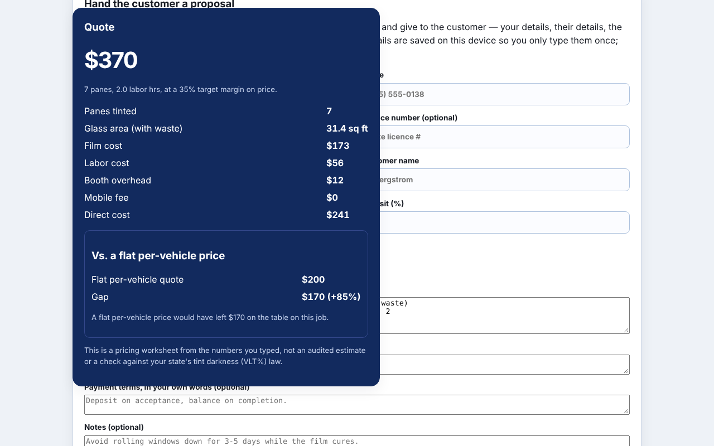
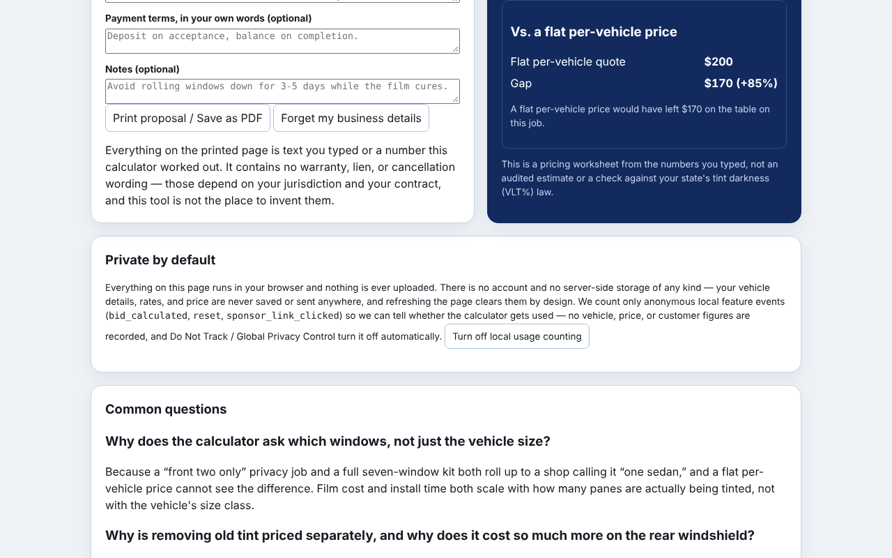
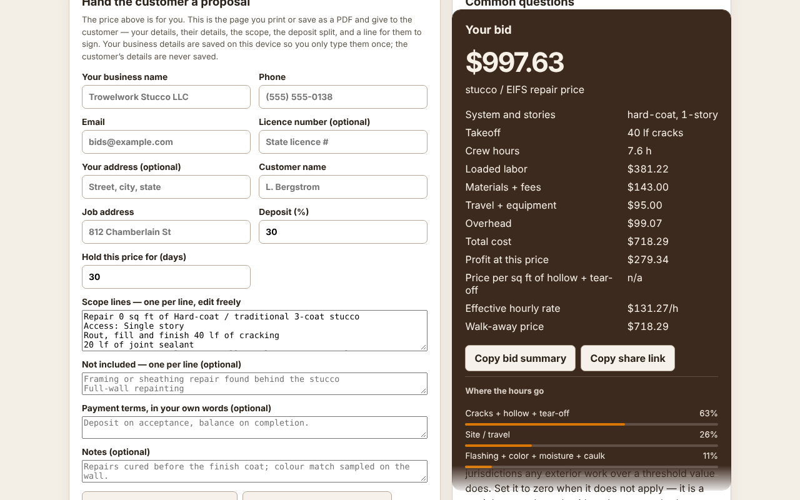
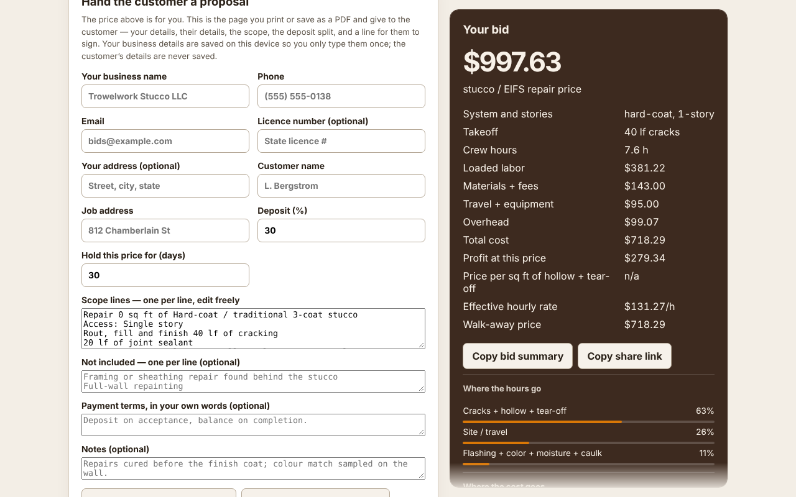
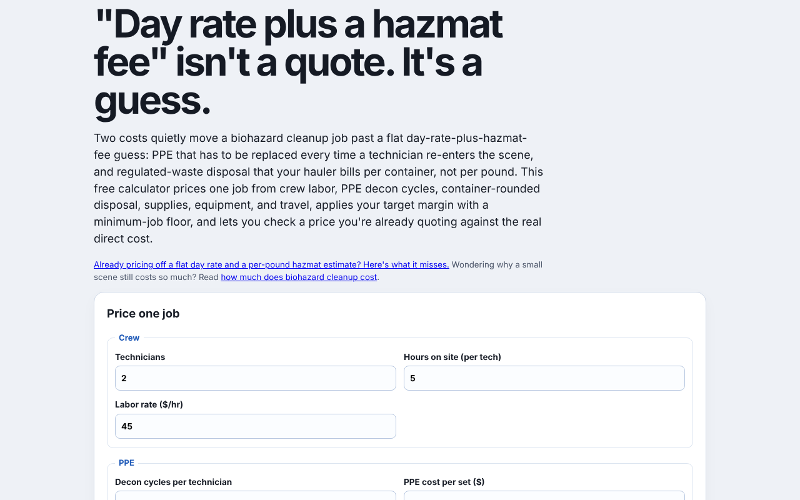
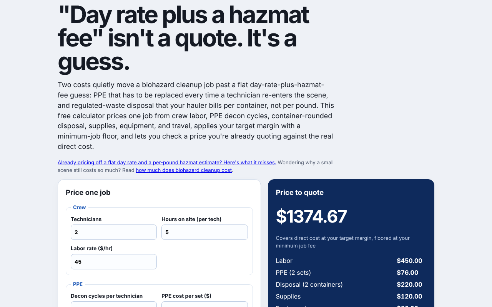

# Polish 2026-11-11: sticky result cards no longer slide over the FAQ or proposal

**Why this item.** Item 1 of "Still weakest" in `polish-2026-11-11-sticky-scroll-hint.md` was
"the 9 row-setter cards". Measuring them showed the real defect was bigger than a cut-off foot.
Chrome bounds a sticky grid item by the **grid container**, not its grid area. So a stuck
`.result` card in `main.layout` follows the reader past its own row and paints over the next
row's item in the same column. That item is the FAQ, the proposal form, or the full-width
proposal.

**What changed.**
- **83 venture pages** get a desktop-only block, marked `pf-result-column`:
  `main.layout > .result { grid-column: 2; grid-row: 1 / span N }` and every other child of
  `main.layout` in column 1. `N` = the grid's other children. The media query is
  `min-width: <page's own single-column max-width + 1>`, so phone layout is untouched. It sits
  at the end of the last `<style>` in `<head>`, after `/* proposal:end */`, so it wins source
  order over the adopter's `#proposalSection, main.layout > section:not(.result)
  { grid-column: 1 / -1 }`. The selector list matches that rule's specificity. On the 9 first
  pages the block sits after the `.result` rule, or after the adopter rule on kitchen-tile and
  parking-lot. On auto-repair-effective-labor-rate the wrapper `
` around the card, FAQ and
  "what this is" sections was removed, so they are grid children too.
- `platform/pages/sticky-fit-check.mjs` now also steps through each grid-parented sticky
  element's parent (ten positions) and fails a page whose card overlaps a sibling by more
  than 4 px. Sticky elements with a non-grid parent, such as site headers, are skipped, because
  covering what scrolls under them is their job.

**Found along the way.** On 5 pages (biohazard-cleanup, ice-dam-removal, locksmith,
vehicle-wrap, window-tinting) the adopter rule had also caught
the *form* section. The form ran full width, and the price card sat under it at half width,
below the fold. The new block restores the two columns there.

**Measured** (1280 x 800, local build, `pf-result-column` blocks patched into `dist` the same
way as the source; "before" = the same pages with the block stripped by `page.route`):

| | before | after |
|---|---|---|
| sticky cards overlapping a grid neighbour | 74 found by the new check + the 9 row-setters (turf: card at -546..1,380 px, FAQ from -162 px, same column) | **0** |
| stuck cards cut off at the window edge | 9 | **0** |
| cards capped to the window (scroll inside) | 114 (105 at the start of the day) | **120** |

- `sticky-fit-check.mjs` final: "195 pages, 192 sticky elements, 120 capped to the window (800px
  tall). No stuck card is cut off or covers a neighbour."
- At 390, 768 and 1,024 px on all 83 pages: no new sideways scroll. At 390 px the card's x
  equals the first child's x (single column). One pre-existing defect: change-order-margin
  scrolls sideways at 768 to 900 px (167 px at 768). The numbers are identical before and after.
  Its `.layout` is `1fr 360px` with a breakpoint at 760.
- Screens (1280 x 800): window-tinting at scroll 2,150, the card over the proposal inputs →
  clear; stucco-repair at 2,050, the card over the FAQ → clear; biohazard-cleanup at the top,
  price card under a full-width form → beside it.

**How to reproduce.** Build, `python3 -m http.server 8793 --directory platform/pages/dist`, then
`PLAYWRIGHT=/opt/node-tools/node_modules/playwright/index.js node platform/pages/sticky-fit-check.mjs`.

## Still weakest, and what I would do next

1. **The adopter still writes the overlap-prone rule.** `platform/proposal/adopt.mjs` emits
   `#proposalSection, main.layout > section:not(.result) { grid-column: 1 / -1 }`. A future
   adoption onto a page with a tall card brings the slide-over back, and on a page whose form is
   a `<section>` it breaks the two columns. The better template is the `pf-result-column`
   block. It needs the page's breakpoint and child count, which adopt.mjs could read the same way
   this run's script did (regex on `@media (max-width: Npx) { .layout { grid-template-columns: 1fr`).
2. **change-order-margin sideways scroll at 761 to 1,000 px.** Pre-existing. Raise its breakpoint
   to ~1,000 px or make the first column `minmax(0, 1fr)`.
3. **sticky-fit-check is still not in CI** (Playwright isn't a dependency). The nightly browser
   checks would be the place, but that's the control plane, so it needs its own PR.
4. Carried over: Firefox gets no scroll-hint fade; wall-framing-takeoff's 300 ms module task.
