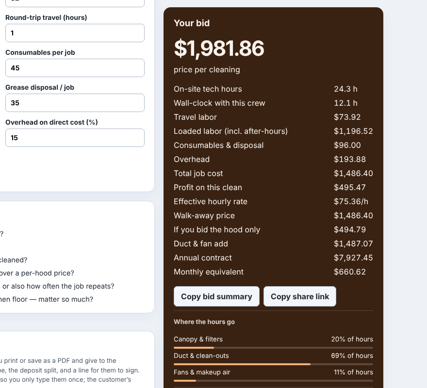
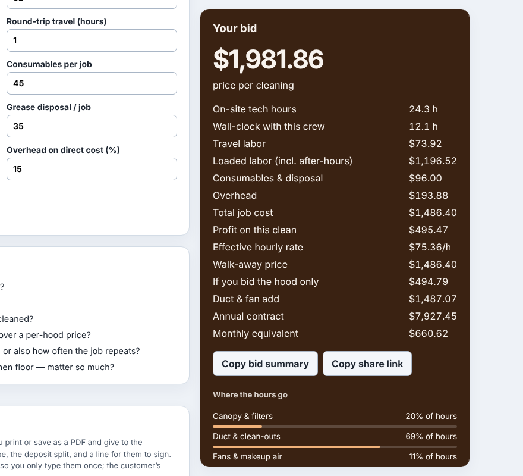
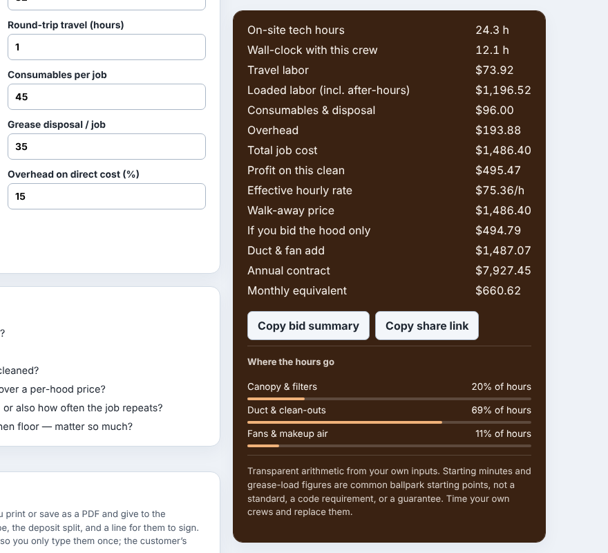

# Polish 2026-11-11: a stuck result card taller than the window now scrolls inside

**Why this item.** It was item 3 of "Still weakest" in `polish-2026-11-11-voice-button-css.md`,
the one visible defect on that list, first seen as an axe false positive in
`polish-2026-11-11-index-contrast-dark-mode.md`. Measuring it showed it was not a bid-calculator
quirk: 196 pages have a sticky element, almost all a `position: sticky; top: 15px` result card
beside a long form, and on a short desktop window most of those cards were taller than the window.
While such a card is stuck, its foot (copy-summary and share buttons, the hour split, the
disclaimer note) can't be seen at any scroll position until the form ends.

**What changed.**
- `platform/pages/sticky-fit.mjs` (new): `STICKY_FIT_JS`, appended to `pf-site.js` by
  `renderChromeModule()` in `build.mjs`. For a sticky element that is taller than the window
  and has room to travel, it sets `max-height` to the window height less its `top` above and the
  same gap below (less its padding and border when the card is content-box), `overflow-y:auto`, a
  thin scrollbar in the card's own ink, and a `tabindex` only when nothing inside can take focus.
  It releases all of that on `beforeprint`, on a taller window, and when a recalculation shortens
  the card.
- It leaves alone a card with no travel, and a card that sets its own grid row's height with
  more rows after it (kitchen-tile-backsplash: the proposal sections). Capping that one would pull
  those rows up the page. The script caps, measures the parent and undoes it in the same task, so
  nothing is painted in between, and it doesn't retry until the card's content height changes.
- Candidates come from stylesheet rules with `position: sticky` and `[style*="sticky"]`, not
  `getComputedStyle` on every element (the cost `polish-2026-11-11-scroll-sweep.md` measured).
  It runs after the paint, on load, resize, input, change and click, coalesced to one per frame.
- `platform/pages/sticky-fit.test.mjs` (new): 9 tests, 8 of them in a real browser (they skip
  without Playwright, like `lab.test.mjs`). They cover the cap and the 15 px gap, a card that
  fits, a card with no travel, the row-setter case, resize both ways, input shrinking the card, a
  media query turning sticky off, print, and the tab stop. The row-setter test fails with the
  guard removed (checked). The first run of the cap test caught the content-box padding bug: the
  card ran 17 px past a 700 px window.
- `platform/pages/sticky-fit-check.mjs` (new): sweeps every tool page with a sticky element at
  1280 x `HEIGHT`, scrolls to mid-column, and exits 1 listing any stuck card still cut off.
  README section "Checking a stuck result card fits the window".

**Measured** (`sticky-fit-check.mjs`, 1280 px wide, local build of `main` at 46277577 with and
without the new `pf-site.js`):

| window | sticky elements | stuck and cut off, before | after | capped, after |
|---|---|---|---|---|
| 800 px | 192 on 195 pages | 110 | 9 | 105 |
| 1000 px | 192 on 195 pages | (running) | (running) | (running) |

- An earlier, looser sweep (card bottom below the window mid-column) gave 131 of 193 cards
  taller than an 800 px window, a median of 338 px out of reach and a maximum of 2,496 px.
- **Layout shift.** On 8 pages (hood-cleaning, ebay-fee, roofing, amazon-fba,
  kitchen-tile-backsplash, shop-rate, auto-repair-effective-labor-rate, seller-net-sheet), load
  CLS was the same before and after within run-to-run noise. The only shift sources on the after
  build, read from `layout-shift` entries, were the top nav chrome (intermittent, about 0.0076)
  and a section near y = 711 on hood-cleaning (0.0138, present before too). The card never
  appeared as a source. The first version of the script did shift kitchen-tile-backsplash
  (0 → 0.0092), which is what the row-setter guard fixes.
- **Bytes.** `pf-site.js` grows by 3,171 bytes uncompressed.
- **Screens:** before, after, and after with the card scrolled to its foot (1280 x 800,
  hood-cleaning-bid-calculator, mid-form):

**Not done, and why.** Sticking by the bottom edge (negative `top`) shows the foot but hides
the headline price, which is why the card is sticky at all. A scroll-driven "moves with the
page until each edge shows" sidebar needs a handler on every scroll and lags the compositor by a
frame. The row-setter cards (see above) keep the old behaviour; they are the remaining cut-off
cards in the table.

## Still weakest, and what I would do next

1. **Row-setter cards** (the "after" column). The clean fix is per page: `align-self:start` and
   a two-row layout, or moving the proposal sections out of the card's grid. A sweep of which
   pages they are is one `sticky-fit-check.mjs` run.
2. **No scroll hint on macOS.** Overlay scrollbars stay hidden until you scroll, so the only cue
   that the card scrolls is the clipped last line. A bottom fade that disappears at the end
   (scroll-driven animation, or a shadow pattern like `reflow.mjs`'s) would be the next touch.
3. Carried over: wall-framing-takeoff's 300 ms module task, modulepreload A/B, a desktop
   Lighthouse run, `--min-a11y=100` in the nightly checks (control plane, own PR), and running
   `sticky-fit-check.mjs` and `ask-voice-icon.mjs` from `browser_checks.py` (same).
