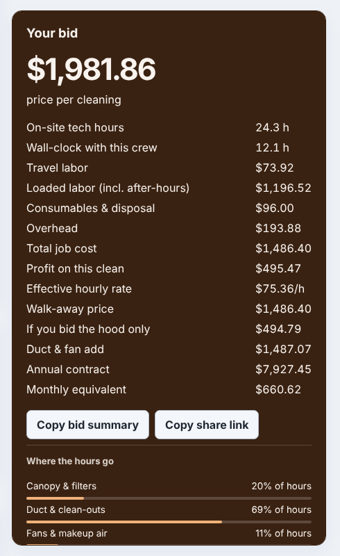
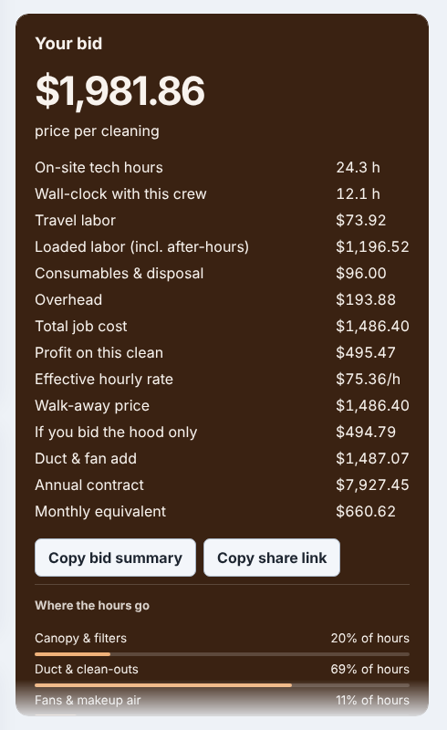
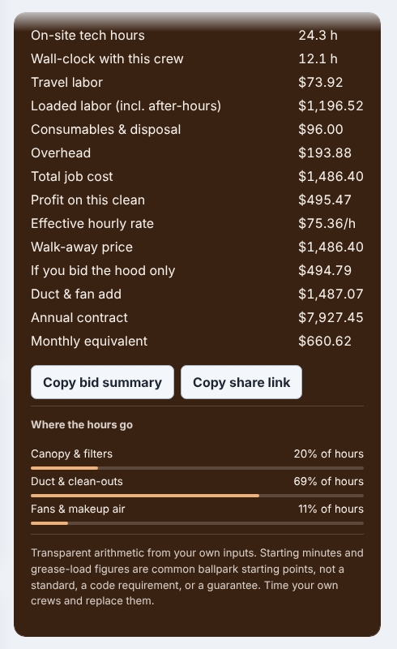

# Polish 2026-11-11: a scroll hint on capped result cards

**Why this item.** Item 2 of "Still weakest" in `polish-2026-11-11-sticky-fit.md`. That run capped
the stuck result card on 105 calculator pages at the window's height and let it scroll inside.
But macOS, iOS and many Linux desktops use overlay scrollbars that stay hidden until you scroll,
so a capped card looked complete. The only cue that the copy buttons, the hour split and the
disclaimer sat below was a line cut off at the edge.

**What changed.**
- `STICKY_FIT_CSS` (new, `platform/pages/sticky-fit.mjs`), appended to `pf-chrome.css` by
  `renderChromeStyle()` in `build.mjs`. It applies only to `[data-pf-sticky-fit]`, the
  attribute the existing script sets on a card it capped.
- When more is below, the card's bottom 40 px fade out. When the card reaches its end, the fade
  lifts. Once the card has scrolled, its top 24 px fade, so the headline row reads as "more
  above". This is a `mask-image` on the card, so it works on every card colour without knowing
  it, and it moves no layout. The amount follows the card's own scroll position: a
  scroll-driven animation (`animation-timeline: scroll(self)`) on two `@property` lengths. No
  scroll handler.
- It sits behind `@supports (animation-timeline: scroll())`. Without scroll timelines the fade
  could not lift at the end, and it would dim the last line for good. Those browsers (Firefox
  today) keep the plain capped card. Under `forced-colors: active` the mask is off.
- 3 new tests in `platform/pages/sticky-fit.test.mjs`. One checks the CSS ships in
  `pf-chrome.css` and every mask sits behind the `@supports` gate. One browser test checks the
  fade is on at the start (`--pf-fit-end: 40px`) and lifts at the end (`0px`, top `24px`).
  Another checks a card that fits gets no mask.

**Measured.**
- `sticky-fit-check.mjs` at 1280 x 800 on the local build, with the new `pf-chrome.css`:
  195 pages, 192 sticky elements, **105 capped**. Each of those 105 now carries the hint. The 9
  cards still cut off are the same row-setter cards as before. The mask changes no geometry, so
  the check's numbers match the previous run's "after" column exactly.
- `pf-chrome.css` grows by 802 bytes uncompressed (24,846 → 25,648). No new request.
- Screens (hood-cleaning-bid-calculator, 1280 x 800, mid-form, card column cropped): before; after,
  with the fade at the foot; after, scrolled to the end, with the disclaimer at full strength and
  the top edge faded:

- Checked by eye in light and dark colour schemes on hood-cleaning, roofing and ebay-fee.

**How to reproduce.** Build, serve `dist` on 8793, then
`PLAYWRIGHT=/opt/node-tools/node_modules/playwright/index.js HEIGHT=800 node platform/pages/sticky-fit-check.mjs`.
For before-and-after screens, route `pf-chrome.css` to the old and new files in Playwright
(`page.route`). Scroll to a third of the way down the card's parent, then set the card's
`scrollTop` to its `scrollHeight` for the end shot.

## Still weakest, and what I would do next

1. **The 9 row-setter cards** (artificial-turf, asphalt-driveway, auto-repair-effective-labor-rate,
   boiler-replacement, egress-window, employee-cost, kitchen-tile-backsplash, menu-engineering,
   parking-lot-striping). Each `.layout` grid has sections after the form and the card, and the
   card (1,200 to 2,800 px tall) is the tallest thing in its row. Capping it would pull those
   sections up the page. The fix is per page: move the after-sections out of `.layout`, or give
   the card its own column wrapper. Then the existing script caps it and this hint applies with
   no further work.
2. **Firefox gets no hint.** Scroll timelines are still behind a flag there. A JS fallback would
   need a scroll listener per card. That is cheap with `passive: true`, but measure it first.
3. Carried over: wall-framing-takeoff's 300 ms module task and 4,200 DOM nodes, a desktop
   Lighthouse run, and `--min-a11y=100` plus `sticky-fit-check.mjs` in the nightly browser checks
   (control plane, own PR).
