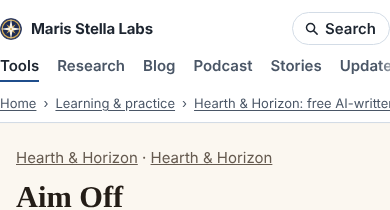
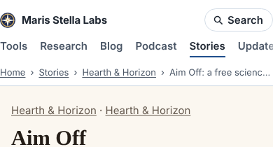

# Polish 2026-11-11: story pages sit under Stories, not Tools

**Why this item.** Seven polish runs today worked on the hub, tool pages and Lighthouse numbers
(and PR #14775 has the hub hero). The prompt's survey list also names the Stories page, so this run
screenshotted /stories/, /research/, a research project, a blog post and the story pages they lead to.
/stories/ itself was fine. Every story page under it said it was somewhere else:

- the header underlined **Tools**;
- the trail read "Home › Learning & practice › Hearth & Horizon: free AI-written science fiction and
  Catholic bedtime stories, with audio" (cut with an ellipsis on a phone);
- the `BreadcrumbList` JSON-LD said the same.

**Cause.** `injectChrome` (build.mjs) gives every venture page `current: 'tools'` and a trail of
category › tool title. The fiction lives in two ventures (`hearth-and-horizon`,
`saints-by-candlelight`) because that is how it is generated and published.

**Change.** `stories.mjs` exports `STORY_VENTURES` (slug → short name). `injectChrome` uses
Stories (`STORIES_PATH`) as the section and first crumb for those slugs, and the short name as the
second crumb, in the header, the visible trail and the `BreadcrumbList`. The visible trail and the
JSON-LD still come from the same list, so the existing "visible trail matches BreadcrumbList" test
covers them. New test in `build.test.mjs`: "story pages sit under Stories in the header, the trail
and the BreadcrumbList".

**Measured** (full local build, no flags):

| | before | after |
|---|---|---|
| `hearth-and-horizon/` pages (341) with Stories current | 0 | 341 |
| `saints-by-candlelight/` pages (95) with Stories current | 0 | 95 |
| same 436 pages with Tools current | 436 | 0 |
| `check.mjs` | pass | pass (8,442 pages, no dead links) |

**Seen but not changed.**
- Story pages carry the venture's own kicker "Hearth & Horizon · Hearth & Horizon" when the shelf
  is also called Hearth & Horizon (`ventures/hearth-and-horizon/stories.mjs`, line ~320). The story
  HTML is generated and checked in (300+ files), so the fix is a generator change plus a
  regeneration, a creative-track or polish run of its own.
- The shelf index `hearth-and-horizon/` is 154,000 px tall on a 390 px phone (242 KB of HTML: every
  story on one page). The newest-first list on /stories/ is the way in, but a visitor who lands on
  the shelf index from search scrolls a very long way. Per-shelf pages, or collapsing each shelf
  after its newest dozen, is the next thing to try there.
- Local builds load the shelf covers from the retired github.io address and show a broken image.
  Production passes `PAGES_BASE_URL`, so it is a local artifact only. Open PR #14596 fixes the
  default.
- The two ventures still appear in the "Learning & practice" category listing. That is search
  and catalogue reach, and was left as is.

**Next.** The shelf-index length above; the doubled kicker; then the carried-over items in
`polish-2026-11-11-voice-button-css.md` (wall-framing-takeoff `content-visibility`, modulepreload
A/B, desktop Lighthouse).

**Also seen.** `ventures/concrete-maturity/index.html` carried its FAQ twice after PRs #14766 and
#14774, which turned `faq-duplicate.test.mjs` red on main. This run fixed it too, but #14780 landed
the same fix first, so the merge kept main's copy.
