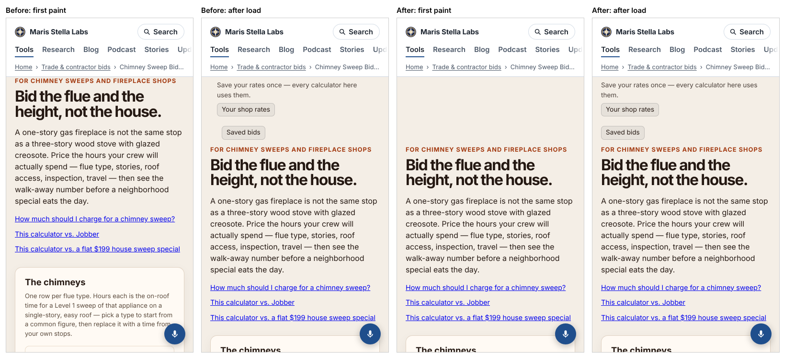

# Polish 2026-11-11: tool pages stopped jumping after first paint (CLS 0.11 → 0.002 on bid calculators)

**Why this surface.** The morning's Lighthouse report
(`polish-2026-11-11-lighthouse-first-numbers.md`) put wall-framing-takeoff, the top flagship, at the
bottom: performance 83, LCP 3.3 s, CLS 0.084. Its first suggestion was to look at what the first
screen waits on.

## What the 83 actually was

Lighthouse's "render delay" (86% of LCP) pointed at the 43 `<link rel="modulepreload">` tags
that `preload.mjs` writes into the head. Removing them scored 96. That result was misleading:

| wall-framing-takeoff, 2 runs each | Lantern perf | Lantern FCP | real-throttle FCP | real-throttle load (tool ready) |
|---|---|---|---|---|
| preloads in head (main) | 83, 84 | 3.26 s | 1.47 to 1.51 s | 6.03 to 6.07 s |
| preloads `fetchpriority="low"` | 80, 90 | 1.3 to 1.4 s | 1.42 to 1.43 s | 6.54 to 6.66 s |
| no preloads | 88, 97 | 1.8 to 2.4 s | 1.42 to 1.43 s | 6.32 to 6.36 s |

Lantern (Lighthouse's default simulated throttling) counts every request that finished before the
paint it observed on the fast local run into its LCP graph, whatever its priority
(`LargestContentfulPaint.getPessimisticGraph`, `treatNodeAsRenderBlocking: _ => true`). Locally the
modules land at about 75 ms and the paint at about 160 ms, so they always count. With real
throttling (`--throttling=devtools`, added to `lighthouse.mjs` by this PR), first paint was the same
in all three, and the preloads got the tool running about 0.3 s sooner. **The preloads stay.**
Chasing the simulated number would have made the page worse.

## What was real: two layout shifts, on about 2,000 pages

CLS is measured from the actual layout, not simulated, and it had two causes:

1. **The site band dropped 24 px after paint (CLS 0.027).** `pf-chrome.css` zeroes the body's top
   padding with `body:has(> .pf-chrome-top[data-pfs-head]:first-child)`. On 2026-11-09,
   `addNoscriptNotice` started inserting a `<noscript>` right after `<body>`, and with scripting on
   a `<noscript>` is still an element. So on **2,019 pages** the band stopped being `:first-child`.
   All three rules keyed on it stopped matching: the top padding, the bars' column alignment, and
   hiding the saved-bids bar's empty status. `pf-site.js` then pulled the band up with a negative
   margin after first paint. Fix: each selector also accepts `> noscript:first-child + .pf-chrome-top`.
2. **The shop-rates and saved-bids bars pushed the heading down 59 to 75 px after paint (CLS
   0.056 to 0.069 each).** Both ship `hidden`, and their scripts reveal them on `load`. Fix: with
   `@media screen and (scripting:enabled)`, a hidden bar is laid out as `visibility:hidden`, which
   holds its space and keeps it out of the accessibility tree and the tab order. `!important` is
   needed because 125 of the 188 saved-bids pages declare `[hidden]{display:none !important}`.
   The shop-rates markup now carries the first-visit status sentence the script writes anyway
   (`RATES_FIRST_VISIT_STATUS`), so the held box has the same height as the shown one.
   With scripting off, or in a browser without the `scripting` media feature, nothing changes.

## Numbers

Lighthouse mobile (Lantern), same session, before → after:

| page | CLS before | CLS after | perf before | perf after |
|---|---|---|---|---|
| /wall-framing-takeoff/ | 0.084 | 0.003 | 83 | 86 |
| /ai-bookkeeper/ | 0.018 | 0.003 | 84 | 85 |
| /einvoice-preflight/ | 0.036 | 0.003 | 90 | 90 |
| /sales-agent/, /changepoint-detector/, /shift-roster-builder/, /league-schedule-generator/, /open-tennis-robots/ | 0.018 | 0.000 to 0.003 | 96 to 100 | 96 to 100 |
| hub, /research/, /writing/, /stories/, a post, 3 other flagships | 0.000 to 0.006 | unchanged | unchanged | unchanged |

Accessibility and SEO stayed at 100 on all 16 pages.

Measured page CLS (Playwright, 412 px, after load) on every 12th saved-bids page:

| page | before | band fix + saved-bids bar | + shop-rates bar |
|---|---|---|---|
| /3pl-quote-normalizer/ | 0.035 | 0.003 | 0.003 |
| /basement-waterproofing-bid-calculator/ | 0.180 | 0.072 | 0.000 |
| /chimney-sweep-bid-calculator/ | **0.253** | 0.112 | 0.007 |
| /dryer-vent-bid-calculator/ | 0.181 | 0.069 | 0.000 |
| /fireplace-insert-bid-calculator/ | 0.182 | 0.073 | 0.003 |
| /good-faith-estimate-generator/ | 0.079 | 0.000 | 0.005 |
| /hot-tub-bid-calculator/ | 0.181 | 0.069 | 0.000 |
| /lawn-aeration-overseeding-bid-calculator/ | 0.067 | 0.003 | 0.000 |
| /notary-trip-quote/ | 0.036 | 0.000 | 0.003 |
| /pool-plaster-bid-calculator/ | 0.143 | 0.072 | 0.000 |
| /screen-print-job-quote-calculator/ | 0.048 | 0.000 | 0.005 |
| /solar-panel-cleaning-quote-planner/ | 0.079 | 0.000 | 0.000 |
| /toilet-replacement-bid-calculator/ | 0.143 | 0.069 | 0.000 |
| /wall-framing-takeoff/ | 0.084 | 0.003 | 0.003 |
| **median** | **0.113** | 0.036 | **0.002** |

Google's "good" CLS line is 0.1. Six of these 14 pages were over it before and none are now. The
0.000 → 0.005 moves are run-to-run noise of a few pixels. The "after" columns were measured on the
local build with the regenerated `pf-*.css`/`pf-rates.js` and the status line patched into the
sampled pages as the build now writes it; the full build runs on merge.

Chimney-sweep at 390 px. Left pair: before, at first paint and after load (the heading drops
144 px). Right pair: after (the space is held, and the bars now line up with the content column
again because the alignment rule matches):

## Check that keeps it fixed

`platform/pages/layout-shift-guard.test.mjs` fails if a band rule needs `:first-child` without
accepting the leading `<noscript>`, if either bar loses its reservation rule (or its `!important`,
or its print exemption), or if the shop-rates markup and script disagree on the first-visit
sentence. It failed 2 of 3 against `main` before the fix.

## Still weakest, and what I would do next

1. **A returning contractor still sees a small shift.** With saved rates or bids, the bars' status
   lines and lists differ from the first-visit markup. Rendering them earlier (a tiny classic
   script right after each bar that reads localStorage synchronously) would close it. Not measured.
2. **wall-framing-takeoff's HTML is 60 KB gzipped and 4,204 DOM nodes** (Lighthouse `dom-size`
   score 0; 440 ms of style and layout). That is real main-thread work on a phone. A
   `content-visibility:auto` pass on the below-the-fold sections is the obvious experiment. Measure
   it with `--throttling=devtools`.
3. **Other hidden-then-revealed chrome.** This run fixed the two bars that sit above the heading.
   Grep the build for other `hidden` sections a script reveals on `load` (`#pf-link-note`, venture
   banners) and measure each with `layout-shift` entries before reaching for CSS.
4. The earlier report's "add `lighthouse.mjs --min-a11y=100` to the nightly browser checks"
   still stands (control-plane CI, own PR).
