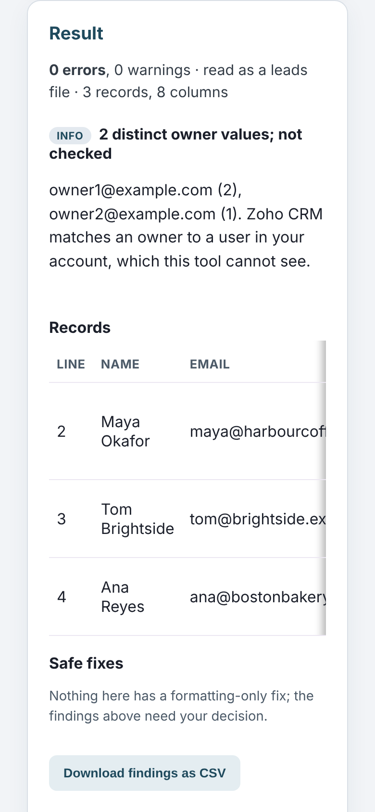
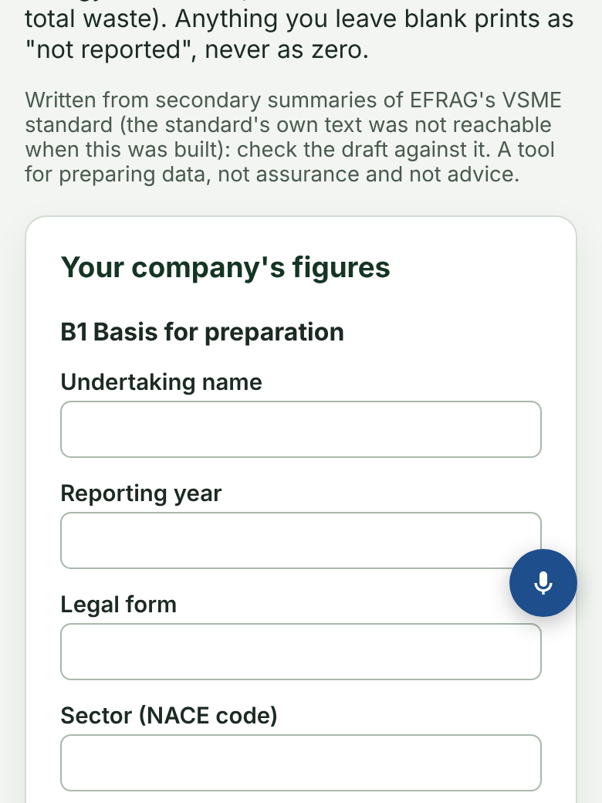

# Polish 2026-11-12: 281 tool results no longer jump from h2 to h4

**Why.** Item 2 of "still weakest" in `polish-2026-11-11-bare-tools.md`: about 290 tool pages draw
each result finding as `
<h4>` from script, under `<h2>Result</h2>`, and style
`.finding h4` in their own CSS. Once the result appears, the page skips a heading level. Lighthouse's
accessibility audit counts that (axe `heading-order`), and a screen-reader user moving by heading
hears a section that seems to have lost its parent. `heading-order.mjs` strips `<script>`, so no
existing check saw it.

**How it was measured.** `platform/pages/rendered-headings.mjs` (new) serves the local build, opens
each page in the pre-installed Chromium at 1280 px, clicks a "sample/example" button and then the run
button (Check, Calculate, ...), waits, and runs the skip rule on the headings that are displayed.
Third-party requests are blocked. A scratch variant also recorded the computed style (font size,
weight, line height, margins, colour, letter spacing, family, transform, rendered height) of every
`.finding` heading, before and after.

**What changed.**
1. **270 pages, mechanical.** Every script-drawn `<h4>` was a `.finding` heading, the only `h4` rule
   in the page CSS was `.finding h4 {`, and the browser showed an h2 to h4 skip. Script `<h4>`
   became `<h3>`, and `.finding h4 {` became `.finding h3 {`. The 30 pages in the same group whose
   findings rendered under an `<h3>` (so `h4` is right) were left alone.
2. **10 pages, by hand**, found by the full sweep afterwards: ad-spend-saturation-optimizer,
   edi-x12-order-checker, merchant-cash-advance-true-cost-calculator, the three Schedule C/E
   categorisers and worker-classification-checker (findings only; their per-business `<h4>` tables
   sit under an `<h3>` and stay), allergen-label-maker (findings and the label cards under "Labels"),
   event-seating-chart-optimizer (`.tbl` table cards under "Seating plan"), fbar-8938-checker
   (no `.finding h4` rule existed, so the browser's larger h3 default showed; a
   `.finding h3{font-size:1rem;margin:1.33em 0}` rule keeps the old size).
3. **vsme-report-builder** drew `<h3>` disclosure groups straight under the `<h1>`; its form card
   now opens with a visible `<h2>Your company's figures</h2>` (screenshot below). That is the one
   visible change.

**Numbers.**

| | before | after |
|---|---|---|
| 308-page group, pages that drew a finding | 300 | 300 |
| of those, rendered h2 to h4 skip | 270 | 0 |
| full sweep, every venture page whose script draws a heading | 493 pages, 11 skipping (after step 1) | 493 pages, 0 skipping |
| `.finding` heading computed style changed | | 0 of 310 pages |
| page errors | 0 | 0 |

The "before" for the full sweep is after step 1, because the sweep was written after it; the 270
before-numbers come from the same click-and-measure method.

**Keeping it fixed.** `platform/pages/finding-heading.test.mjs` fails when a venture page's script
draws `.finding` `<h4>` and the page is not on its list of 40 known ones. A static guess at where a
script writes its findings agreed with the browser on only 260 of 300 pages (87%), too weak to fail a
build on. So the test is a ratchet, not a judge: new pages draw h3, and a page whose findings really
sit under an h3 is added after a `rendered-headings.mjs --slugs=` run.

**Not measured.** Lighthouse was not re-run on these pages. Its default run loads a page without
clicking, so it only sees the skip on tools that draw a result on load. The rendered sweep is the
direct measure.

## Still weakest, and what I would do next

1. **The 8 pages in the group that drew no finding** under the clicker (brand-deal-rate,
   chiropractor-new-patient-roi, newsletter- and podcast-sponsorship-rate, rent-increase-notice,
   str-cleaning-fee, turo-host-payout, voiceover-project-rate) still draw `.finding h4`. They
   need real input to produce a finding; check them one by one with `--slugs=`.
2. **The clicker only reaches one state per page.** Pages that draw different headings for
   different inputs (errors versus a clean result) may skip in a state the sweep never reached.
   This run caught 7 such pages only on the second sweep.
3. Carried over: `--min-a11y=100`, `heading-order.mjs` and now `rendered-headings.mjs` in the
   nightly browser checks (control-plane CI, own PR); wall-framing-takeoff TBT;
   change-order-margin sideways scroll at 761 to 1,000 px.
