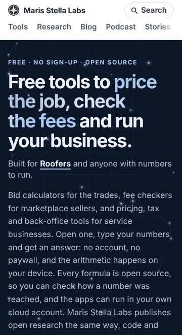
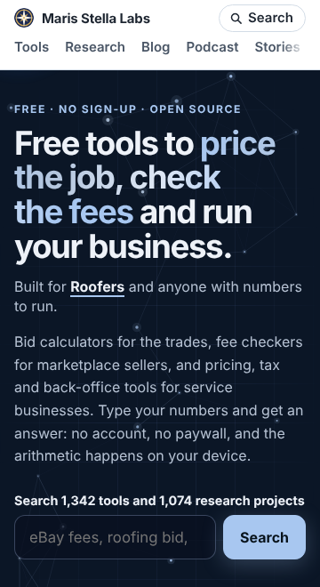

# Polish 2026-11-12: hub lede cut so the search sits above the fold on a phone

**Why.** Item 2 of "still weakest" in `polish-2026-11-11-count-format.md`: "At 390 px the lede under
the headline is about 13 lines before the search box ... Editorial, so measure first: where does the
fold land now?" The hub is the page most visitors see first, and its search is its main control.
(Item 2 in `polish-2026-11-11-result-column.md`, change-order-margin, is taken by open PR #14988.)

**How it was measured.** Local build (`node platform/pages/build.mjs`), served from `dist/`, opened
in the pre-installed Chromium with third-party requests blocked, 400 ms after `load`. Script:
bounding boxes of the hero `h1`, ticker, `.lede` and `#q`, plus `scrollWidth`. The "after" numbers
come from the same built `index.html` with only the lede text swapped (identical to what the
edited `build.mjs` renders; a full rebuild is 10+ minutes).

**What changed.** `renderHub` lede: five sentences, 76 words → two sentences, 37 words. Cut: "Every
formula is open source, so you can check how a number was reached, and the apps can run in your own
cloud account. Maris Stella Labs publishes open research the same way, code and tests included."
Those claims are steps 2 ("Check how the answer is worked out") and 3 ("Run your own copy") of the
hub's how-it-works band, and research is in the search label and stats. "Open one, type" became
"Type". No CSS changed.

**Numbers** (bottom edge of the search input, px from page top; lede lines in brackets).

| viewport | before | after | above the fold |
|---|---|---|---|
| 320 × 640 | 884 (13) | 730 (7) | no → no |
| 360 × 660 | 782 | 629 | no → **yes** |
| 375 × 560 | 757 | 629 | no → no |
| 390 × 844 | 757 (11) | 629 (6) | yes → yes (and inside Safari's ~664 px visible area, which it was not) |
| 412 × 700 | 693 | 590 | yes → yes |
| 768 × 1024 | 631 (6) | 554 (3) | yes → yes |
| 1280 × 800 | 730 (6) | 642 (3) | yes → yes |

`scrollWidth` equals the viewport at every width, before and after.

**Keeping it fixed.** `platform/pages/hub-lede.test.mjs` renders the hub and fails when the lede is
over 45 words, or comes after the search. Verified it fails on the old copy (76 words).

**Not measured.** No Lighthouse rerun (the change is text only). No ranking or traffic claim; the
meta description is separate and unchanged.

## Still weakest, and what I would do next

1. **320 px and short windows.** At 320 × 640 the search still ends at 730 px. Above it: a 142 px
   two-row site header, a four-line `h1` (193 px) and a two-line "Built for ..." ticker. Options, in
   order of how little they change the look: drop the hero's top padding to ~24 px under 400 px
   wide; shorten the ticker to "Built for <b>roofers</b>." on phones; or let the `h1` clamp go lower
   than 2 rem below 360 px. Measure each with the script above (it is short; rewrite it from this
   description).
2. **The how-it-works band is now the only place the open-source/self-host claims appear in full.**
   If a later edit removes that band, put the claim back in the lede (one short sentence fits the
   budget).
3. Carried over: change-order-margin mid-width scroll (open PR #14988); the 8 finding-heading pages
   that need real input (`polish-2026-11-12-finding-headings.md`); `--min-a11y=100` and the rendered
   checks in the nightly browser checks (control plane, own PR); wall-framing-takeoff TBT.
