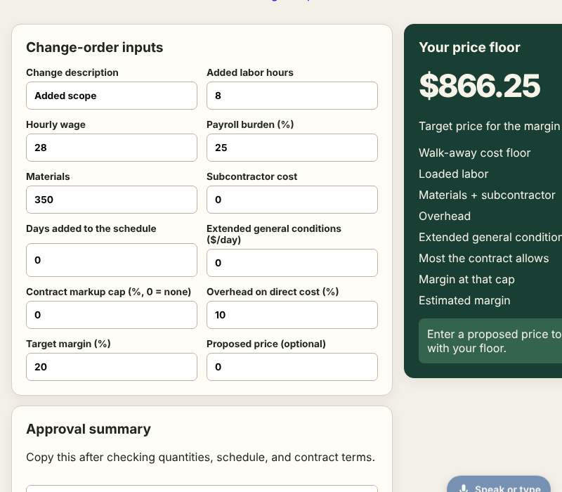
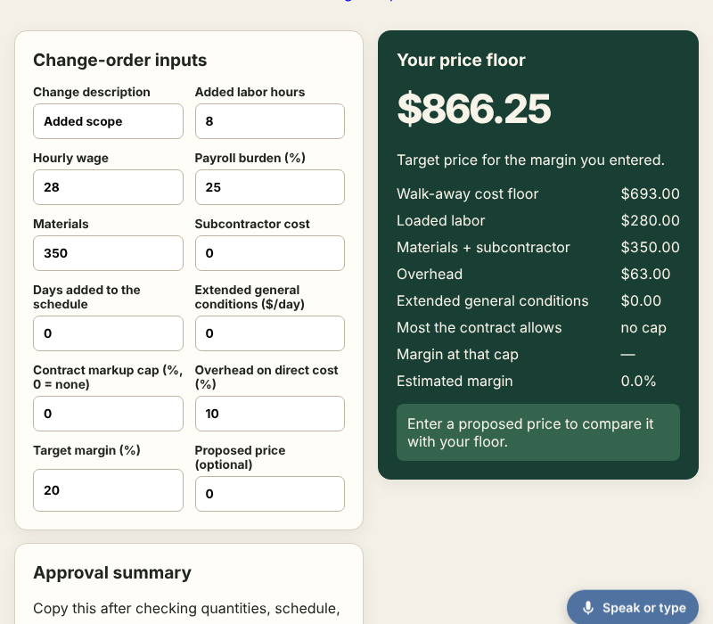
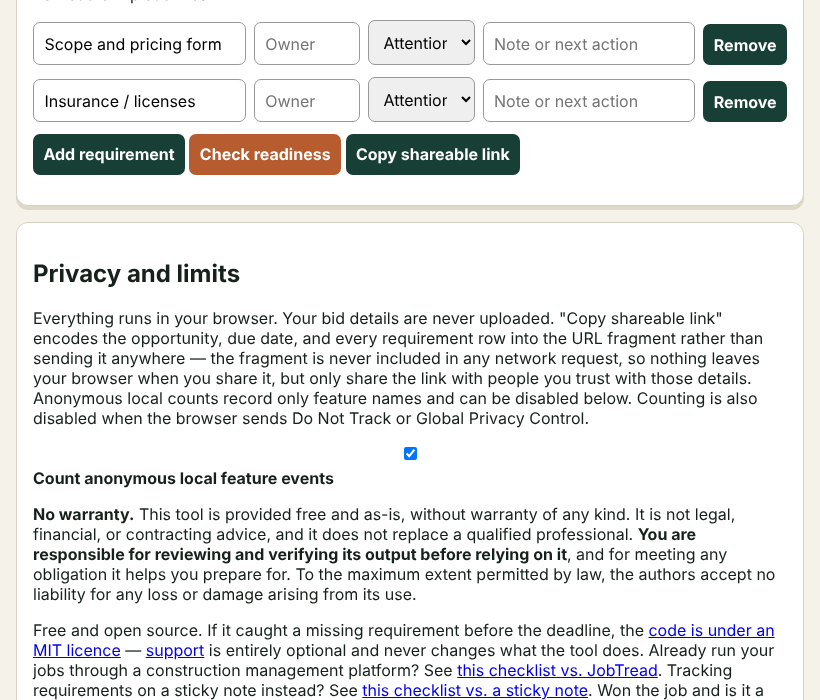
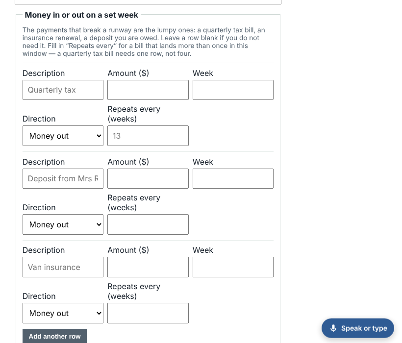

# Polish 2026-11-12: five pages stop scrolling sideways at tablet widths, and the sideways sweep now checks 820 px by default

**Why this item.** Item 2 of "still weakest" in `polish-2026-11-11-result-column.md`, carried
in every polish note since: "change-order-margin sideways scroll at 761 to 1,000 px". I fixed it,
then asked whether it was alone. Every earlier sweep ran at phone widths (320, 360, 390) or once at
768/1,024 on a list of 83 pages. Nobody had swept the whole catalogue between a page's
single-column breakpoint and its desktop width.

## What the sweep found

`sideways.mjs` on a full local build (8,679 pages), before any fix:

| width | pages that scroll sideways |
|---|---|
| 820 px | 5 |
| 900 px | 4 |

| page | overflow at 820 px | overflow range | cause |
|---|---|---|---|
| clothing-design-studio/pattern.html | +477 px | 700 to 860 px | below its 860 px breakpoint the grid is `1fr`, which grows to the full-size pattern SVG inside its own scroll box (1,247 px) |
| contractor-bid-readiness | +269 px | 700 to 1,100 px | requirement rows are `2fr 1fr 1fr 2fr auto` of inputs at the browser's default ~271 px; `main` is a grid with an implicit `auto` column |
| vendor-rate-break-even | +236 px | 761 to 1,050 px | `360px 1fr`: the `1fr` grows to the results table inside its `.pf-table-scroll` box |
| cash-runway-planner | +135 px | 700 to 1,050 px | five-column "money in or out" rows of default-width inputs widened a 34rem form |
| change-order-margin-calculator | +115 px | 761 to 950 px | `1fr 360px` with a `1fr 1fr` field grid of default-width inputs: first column held at 543 px |

The cause is the same CSS rule every time. A `1fr` grid track's minimum is `auto`, so it never
shrinks below its content's min-content width. A scroll box inside it does not help, because the
scroll box's own min-content is still its content's. `minmax(0,1fr)` lets the track shrink, and
then the scroll box (or the input, given `min-width:0; width:100%`) does its job.

What a visitor saw at 800 px on change-order-margin: the price card cut off at the dollar figures.

## What changed

- change-order-margin: `.layout` `minmax(0,1fr) 360px`; `.fields` `repeat(auto-fit,minmax(150px,1fr))`;
  inputs `min-width:0; width:100%; box-sizing:border-box`. Regression test in its `page.test.mjs`.
- contractor-bid-readiness: `.item` tracks wrapped in `minmax(0,…)`; controls `min-width:0;
  max-width:100%`; `main` gets an explicit `minmax(0,1fr)` column.
- cash-runway-planner: inputs fill their cell; the item row wraps with
  `repeat(auto-fill,minmax(9rem,1fr))` (three columns in the 34rem form). Five columns in 34rem
  cut the Direction select to "Mone" once the overflow was gone (screenshot below).
- vendor-rate-break-even: `360px minmax(0,1fr)`.
- clothing-design-studio/pattern.html: the ≤860 px rule is `minmax(0,1fr)`, so the pattern scrolls
  inside its box as the page meant it to.

**After.** Each of the five measured at 320, 360, 390, 600, 700, 761, 820, 900, 1,000, 1,100 and
1,280 px: 0 px overflow at every width. Venture suites pass (change-order 107, contractor 56,
cash-runway 76, vendor-rate 41, clothing-design-studio 654). Full-catalogue result at the new
default is in this PR's run record.

## Keeping it fixed

`sideways.mjs` now takes `WIDTH` as a comma list and defaults to `360,820`. It loads each page once
at the first width and resizes it in place for the rest, so 820 costs a resize, not a load. Checked
against fresh loads: vendor-rate-break-even before the fix reports +236 px at 820 and +156 px at
900 both ways. `browser_checks.py` runs `sideways.mjs` with no `WIDTH`, so the nightly browser
checks pick up 820 without a control-plane edit.

## Still weakest, and what I would do next

1. **Other mid widths.** 820 and 900 were swept; 1,000 to 1,100 only on the five pages above.
   contractor-bid-readiness overflowed up to 1,100 px, so a one-off `WIDTH=1040` sweep is worth a run.
2. **Default-width inputs in multi-column grids are a pattern, not five pages.** Many ventures write
   `input{font:inherit;padding:…}` with no width. They pass today because their tracks happen to be
   wide enough. A shared `input,select,textarea{min-width:0}` in `reflow.mjs`'s injected CSS would
   close the class; it needs a full-catalogue screenshot diff first, since it changes layout on
   pages that are fine.
3. Carried over: the 8 pages with `.finding h4` that need real input
   (`polish-2026-11-12-finding-headings.md`); `--min-a11y=100`, `heading-order.mjs`,
   `rendered-headings.mjs` and `sticky-fit-check.mjs` in the nightly checks (control-plane PR);
   wall-framing-takeoff TBT.
