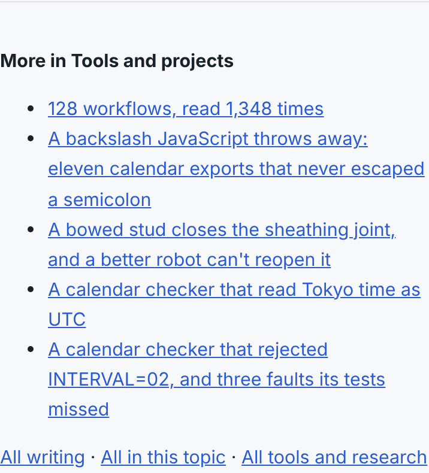
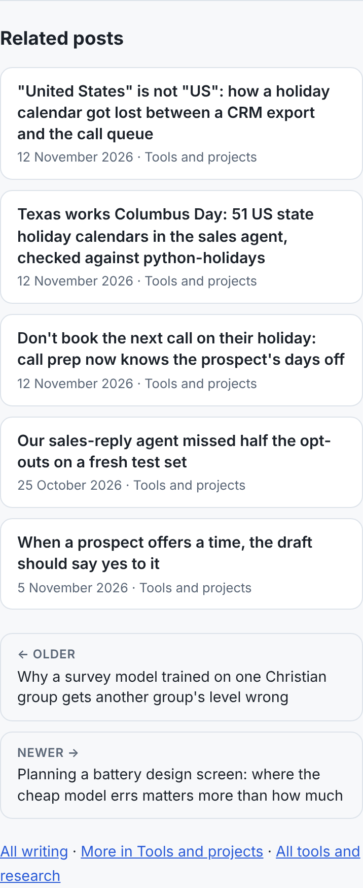
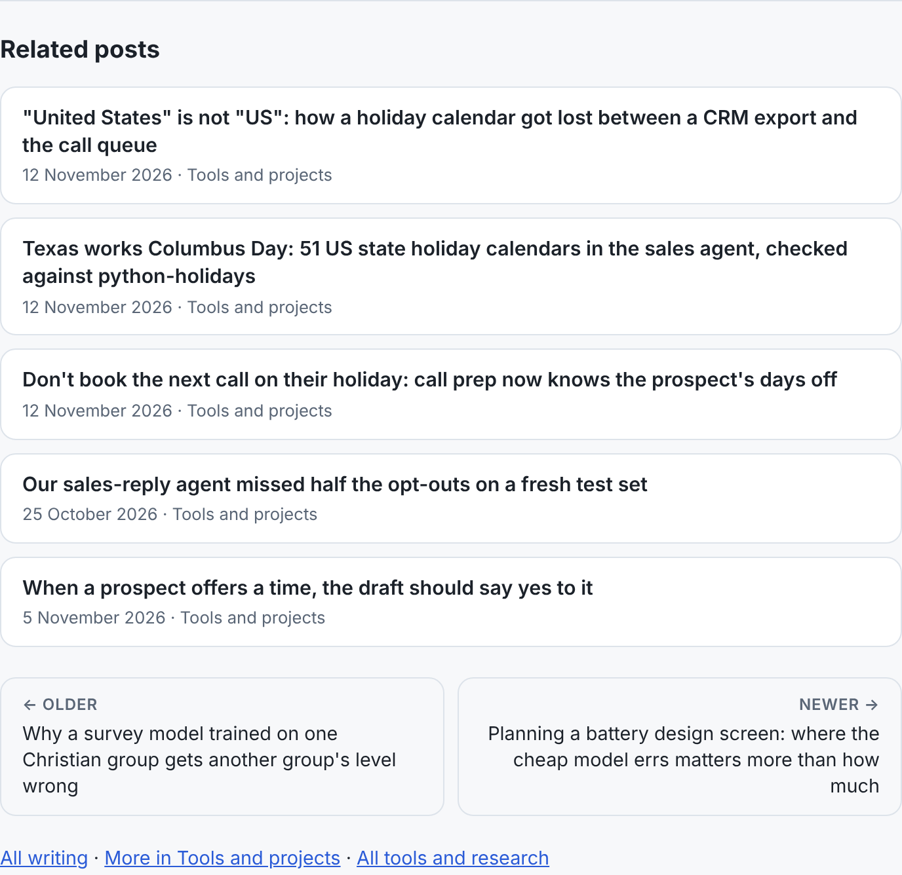

# Polish 2026-11-12: related posts that are related, and front-matter escapes

**Why this item.** The polish prompt asks for screenshots of the hub, a flagship, a research page,
Stories and a blog post, and the weakest surface a visitor is likely to see. Recent polish runs had
worked on tool pages and the hub. The blog (3,717 posts, mostly reached from search) ended each
post with an unstyled bulleted "More in <topic>" list and two bare older/newer links. The list
turned out to be the same five posts on nearly every page.

**How it was measured.** Full local build (`node platform/pages/build.mjs`, about 9 minutes this
run). For the link counts, `loadPosts()` plus the old and new `relatedPosts` run over every post
(script in the run's scratchpad; it is ten lines of counting). Screenshots: the built post page
patched with the newly rendered foot section and CSS (the same output `renderPost` gives), Chromium
at 390 and 1280 px, light and dark, third-party requests blocked.

## What changed (`platform/pages/writing.mjs`)

1. **`relatedPosts`** scores shared tags plus half per shared title word (≥4 letters, stopwords
   out), each weighted log(N/df). A tag or word on more than a fifth of all posts scores 0.
   Ties go to the post nearest in date. The rest is filled from the same topic nearest in date,
   then the other topics. The index is built once per posts array (WeakMap).
2. **Post foot**: "Related posts" `h2`, each post a card (title, date, topic, whole card clickable,
   focus ring on the card); older/newer as labelled cards, a two-column grid ≥ ~600 px, stacked
   below; then the All writing / More in <topic> / All tools links.
3. **`unquoteYamlScalar`**: double-quoted front-matter values decode `\"`, `\\`, `\/`, `\n`, `\t`,
   `\r`, `\0`; single-quoted ones decode `''`. 32 posts showed backslashes before.
   `docs/posts/2026-10-25-bookkeeper-plain-english-narrations.md` had double-escaped quotes in its
   `seo_title`; fixed.
4. Tests in `writing.test.mjs`: ranking (rare title word beats a series tag, nearer date breaks ties,
   an over-common tag scores nothing, fill order); YAML unescaping; no committed post shows `\"`;
   the pager assertions follow the new markup.

## Numbers

| | before | after |
|---|---|---|
| posts receiving ≥1 related link | 36 | 3,527 |
| posts receiving none | 3,681 | 190 |
| max inbound related links | 2,756 | 26 |
| links sharing a tag | 29.7% | 99.6% |
| links in the same topic | 100% | 91.1% |
| time for all posts | 0.7 s | 3.3 s |
| sideways scroll at 390 / 1280 | none | none |

## Still weakest, and what I would do next

1. **190 posts still get no related link.** Mostly singletons with generic tags. Their own
   outbound list falls back to topic-by-date. Description words (not just titles) would reach
   most of them; measure before adding, since descriptions are noisier.
2. **Research project pages** have their own "More in <topic>" (`id="more"` in the research
   template, `build.test.mjs` "research has a topic level"). Check whether it has the same
   newest-first hub problem across 1,074 projects. Same counting script.
3. **The research index is 44,000 px tall on a 390 px phone** (24,000 at 1280). 1,074 project
   cards on one page. A topic-first layout with a "show all" step would cut it. It needs a
   design pass, not a CSS tweak.
4. **`.pager` is defined twice in the writing `STYLE`** (index pager and post pager share the
   class; the second rule wins for both). The post pager now has `.steps`. Splitting the index
   rule out would remove the shared-class trap.
5. Carried over: the ticker's third line at 320 px; 1,000 to 1,100 px sideways sweep; browser
   checks in the nightly (control-plane PR).
