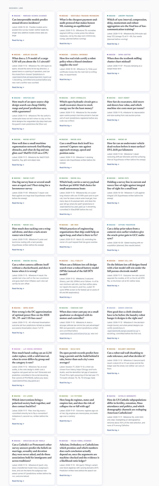
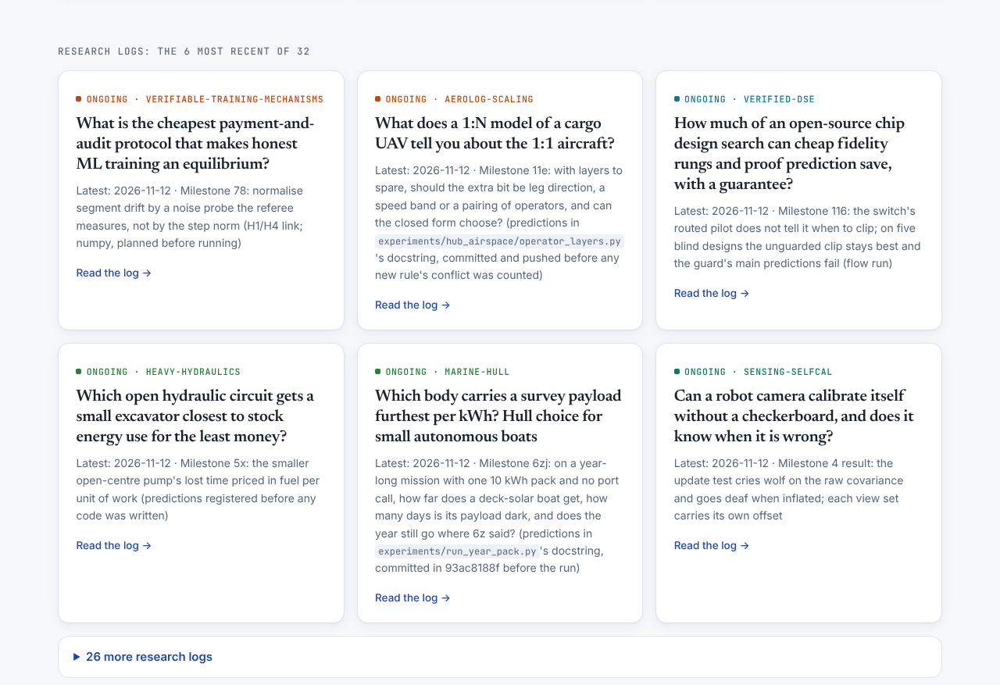
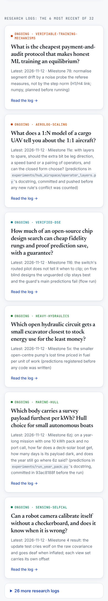

# Polish 2026-11-12: the research index, 44,050 px tall on a phone, now 25,455

**Why this item.** Item 3 of "still weakest" in `polish-2026-11-12-related-posts.md`: "The research
index is 44,000 px tall on a 390 px phone (24,000 at 1280)". Item 2 of that list (research "More in
<topic>" might have the blog's newest-first hub problem) was checked first and is not a problem:
`more_in_topic` in `research/_homepage/build.py` is a wrap-round ring of the next six projects, so
every project gets the same number of inbound links. Left as is.

**How it was measured.** Full local build (`node platform/pages/build.mjs`, about 9 minutes), then
`research/_homepage/build.py` re-run into `dist/research` with the same `--site-chrome` file. Served
from `dist/`, Chromium, third-party requests blocked, 300 to 400 ms after `load`;
`document.documentElement.scrollHeight` and the height of each top-level block.

## Where the height was

The report's guess was "1,074 project cards on one page". It was not: the index already shows only
2 cards per theme (`INDEX_CARDS`) and fetches the rest from `more-cards.json` on demand, 62 cards in
all. At 390 px the height was:

| block | px |
|---|---|
| "Research logs": every project with a `LOG.md`, 32 full cards | 10,292 |
| 32 theme sections, 2 cards each (~950 px a theme) | 30,204 |
| hero, featured, footer | ~3,300 |

## What changed

1. **Logs** (`logs_section` in `build.py`): the 6 projects whose newest log entry is most recent,
   newest first, as cards; the other 26 in a `
` list (title, date, slug, theme colour
   bar), so every log is still one click from the index and in the HTML for crawlers. The heading
   says "the 6 most recent of 32". Before, the order was registry order, so the logs that moved
   today could sit 20 cards down.
2. **Themes on a phone** (`template.html`, ≤ 600 px only): each theme previews one card. The second
   is hidden with CSS until the page adds `main.all`, which it does when someone searches or presses
   "Show all" (the same moment `more-cards.json` loads). Without script the topic page link is
   right there. Desktop unchanged.
3. **`research/marine-colregs/LOG.md`** had no `## <date> · <title>` headings, so `read_log`
   returned nothing and the log showed neither on its page nor on the index. Rewritten into two
   entries, text unchanged apart from the lead-in; the milestone 2 outcome paragraph, which was
   indented under milestone 1, moved under milestone 2 where it belongs.
4. Test: `platform/ci/test_research_homepage_publish.py`, `ResearchIndexLengthTest`: at most 6 log
   cards, newest first, every project with a log linked, and the phone rule plus its undo present.

## Numbers

| | before | after |
|---|---|---|
| index height, 390 px | 44,050 | 25,455 |
| index height, 1280 px | 24,105 | 21,076 |
| logs block, 390 px | 10,292 | 2,077 (list closed) |
| theme sections, 390 px | 30,204 | 19,761 |
| sideways scroll at 390 / 1280 | none | none |
| search for a hidden second card (`chip-rtl-probe`) at 390 | found | found |

## Still weakest, and what I would do next

1. **32 theme sections are still 19,761 px on a phone** (~620 each). The theme head (number,
   linked name, two-line blurb, "Topic page →") is about a third of that. A compact phone theme
   head, or a topic-first layout (the 31 topics as a grid of tiles linking to their pages, with
   the cards behind search), would take it under 10,000. A design pass; measure the tile grid first.
2. **Topic pages are long too**: `research/topics/twins/` is 68,158 px at 390 px (145 projects,
   every abstract). Same treatment as the index: question + lede per card, abstract on the project
   page.
3. **Log heading format is unchecked.** `marine-colregs` silently fell out. A check in
   `research/_shared/` (a `LOG.md` with no `## ` entry fails) would stop the next one.
4. Carried over from `polish-2026-11-12-related-posts.md`: 190 posts with no related link;
   `.pager` defined twice in the writing STYLE; the ticker's third line at 320 px.
